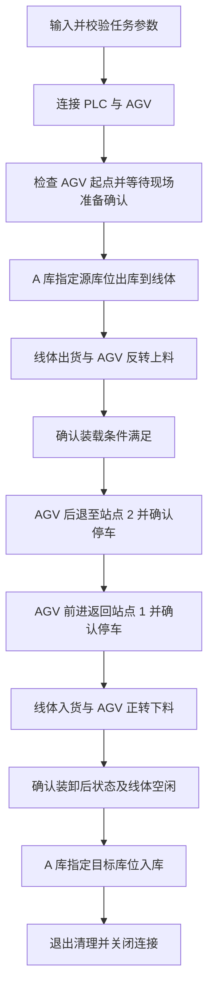
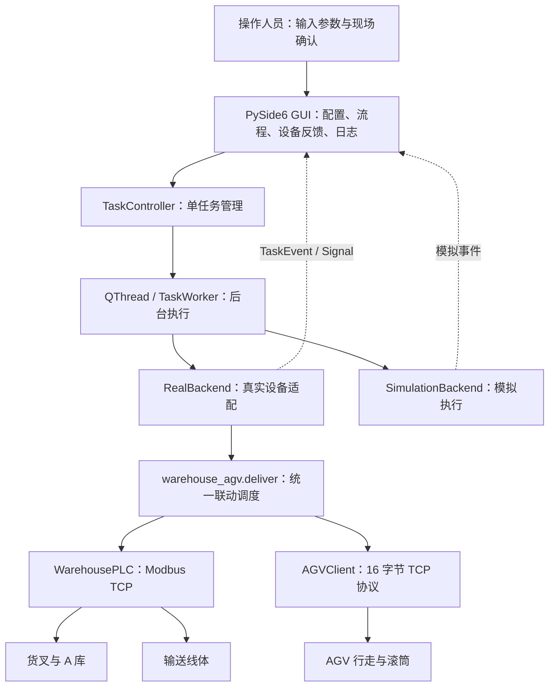

# 仓储与 AGV 联动控制系统

本项目通过 Modbus TCP 控制仓库 PLC 和线体，通过自定义 TCP 报文控制 AGV，并提供命令行、中文 GUI、模拟模式及离线测试。

本文合并了项目原有的全部 10 份 Markdown 文档，保留操作说明、协议差异、流程说明、技术交接、历史开发需求及 PPT 规划。原独立文档已合并为下文对应章节。

## 快速开始

以下命令在项目根目录的 PowerShell 中运行。当前环境为 `agv_control`；新电脑可先运行 `python -m venv agv_control`，再安装依赖。

```powershell
.\agv_control\Scripts\python.exe -m pip install -r requirements.txt
.\agv_control\Scripts\python.exe run_gui.py
```

GUI 默认进入模拟模式；真实设备参数由 `gui_settings.ini` 保存。滚筒方向按现场已验证的 `word` / `pdf` 定义选择，不能仅依据配置文件中的保存值判断。

仅预览完整出库、AGV 往返和回库流程，不连接设备：

```powershell
.\agv_control\Scripts\python.exe warehouse_agv.py --column 6 --level 1 --duration 5 --roller-profile word --inbound-column 6 --inbound-level 1 --dry-run
```

仅检查 AGV 指令报文，不连接设备：

```powershell
.\agv_control\Scripts\python.exe agv_tcp.py --command station --station 2 --dry-run
```

运行全部离线测试（Qt 使用 offscreen，TCP 测试仅连接本地回环）：

```powershell
.\agv_control\Scripts\python.exe -B -m unittest discover -p "test_*.py"
```

协议测试优先读取本地 `AGV*.docx`；没有该文档时使用 `tests/fixtures/agv_word_frames.txt` 中固定的 18 条 Word 定义报文样例。测试不需要临时 PDF 解析依赖。

## 文件说明

| 文件 / 目录 | 用途 |
| --- | --- |
| `warehouse_agv.py` | 完整仓储与 AGV 联动入口，包含回库 |
| `outbound_agv.py` | 出库与 AGV 搬运入口、共用通信 / 装卸 / 清理逻辑 |
| `warehouse_modbus.py`、`warehouse_plc.py` | 仓库单步操作、Modbus 驱动与 PLC 状态握手 |
| `agv_tcp.py` | 单条 AGV 指令构造、发送与应答解析 |
| `tcp_sender.py`、`tcp_receiver.py` | 之前的同机及双电脑 TCP 收发测试工具 |
| `run_gui.py`、`gui/` | GUI 入口、界面、模拟与真实后端、样式及四个必需图标 |
| `gui_settings.ini`、`requirements.txt` | 现场配置与项目依赖 |
| `test_agv_tcp.py`、`test_agv_task.py`、`test_agv_move.py` | AGV 协议、搬运与单体站点任务离线测试 |
| `test_warehouse_agv.py`、`test_real_backend.py`、`test_gui.py` | 仓储联动、真实后端替身及 GUI 离线测试 |
| `tests/fixtures/` | 独立于外部文档的固定测试样例 |
| `smoke_tests/` | 保留的 Windows 原生 Qt 完整模拟、AGV 单体与停止退出测试 |
| `docs/images/gui/` | 从临时目录归档的 GUI 演示截图 |
| `AGV核心流程代码.png` | 已有 AGV 核心流程代码图片 |
| `agv_control/` | 本机已有 Python 虚拟环境，不属于源代码 |
| `tmp/` | 测试可再生成的截图和临时配置；已有 `git-backups/` 历史恢复备份保留 |

Windows 原生 Qt 冒烟测试均使用模拟设备并禁止设备连接，按需单独运行：

```powershell
.\agv_control\Scripts\python.exe -B smoke_tests\phase2_native_smoke.py
.\agv_control\Scripts\python.exe -B smoke_tests\agv_single_native_smoke.py
.\agv_control\Scripts\python.exe -B smoke_tests\stop_exit_smoke.py
```

## 当前流程与历史资料

当前装卸逻辑：线体出货运行 `T` 秒，AGV 滚筒参与最后 2 秒；线体入货与 AGV 下料同时启动，滚筒 2 秒后停止，线体等待 PLC 检测到物料并恢复空闲后清零。`T` 只用于出货，入货由 PLC 反馈结束。

下文 AGV 搬运章节保留了早期按同一个 `T` 定时结束上下料的记录，该部分属于历史行为，当前行为以本节及完整流程、GUI 使用说明为准。历史开发需求记录第一阶段的实施要求；合并不表示重新执行这些要求。各章节中的既有测试数量和现场状态属于当时记录，本次整理结果见文末。

GUI 页面报告中的 `01-…` 至 `18-…` 图片路径是待配图规划，原目录未提供这些成图；实际已有截图保存在 `docs/images/gui/`。

## 文档目录

1. [仓库与线体 Modbus TCP 控制](#warehouse-modbus)
2. [TCP 收发测试](#tcp-tests)
3. [AGV 协议与单指令测试](#agv-tests)
4. [AGV 搬运与停止退出](#agv-transfer)
5. [仓储与 AGV 完整联动流程](#warehouse-workflow)
6. [GUI 使用说明](#gui-guide)
7. [GUI 页面功能介绍](#gui-functions)
8. [GUI 技术交接报告](#technical-report)
9. [历史 GUI 开发需求](#development-prompt)
10. [模块五 PPT 内容与排版规划](#presentation-plan)

---

<a id="warehouse-modbus"></a>

## 1. 仓库与线体 Modbus TCP 控制

`warehouse_modbus.py` 是仓库 PLC 的 Modbus TCP 客户端，支持仓库入库、仓库出库、线体入货、线体出货，以及两个连贯的入出库联动模式。每次运行选择一个模式，完成或终止后关闭 TCP 连接。

仓库操作固定使用 **A 库**，用户可指定 **1～6 列、1～3 层** 的任意有效库位。脚本控制仓库 PLC，不发送外部车辆控制指令。

### 文件与环境

| 文件 | 用途 |
| --- | --- |
| [warehouse_modbus.py](warehouse_modbus.py) | 主入口：参数输入、操作选择、单步和联动调度 |
| [warehouse_plc.py](warehouse_plc.py) | PLC 通信、寄存器读写、状态等待、命令清零与 TCP 关闭 |
| [test_warehouse_agv.py](test_warehouse_agv.py) | 使用模拟 PLC 与 AGV 的完整联动离线测试 |
| [requirements.txt](requirements.txt) | 项目依赖清单 |

项目现有 `agv_control` 环境使用 Python 3.10，脚本通信依赖 `pymodbus==3.11.4`。以下示例均在项目根目录的 PowerShell 中执行。

已有环境可直接运行；如果该环境缺少依赖，可安装项目依赖：

```powershell
.\agv_control\Scripts\python.exe -m pip install -r requirements.txt
```

默认连接参数如下，均可在运行时修改：

| 参数 | 默认值 |
| --- | --- |
| PLC 地址 | `192.168.1.11` |
| TCP 端口 | `502` |
| Slave ID | `1` |

### 运行前准备

PLC 必须已回零、处于自动模式和自动运行状态。下发每个动作前，脚本同时要求设备空闲和仓库已就绪。

物料准备取决于所选模式：

- 仓库入库：物料已在皮带机取料位，目标库位为空。
- 仓库出库：源库位有料，皮带机放料位为空。
- 线体入货：准备向皮带机送入物料，取料位可接收物料。
- 线体出货：皮带机有待输出物料，接料区域已准备好。
- 联动入库：目标库位为空，线体和取料位准备接收物料；先经线体送入，再由货叉入库。
- 联动出库：源库位有料，皮带机放料位为空，接料区域已准备好。

当前协议没有提供库位占用及物料完全输出的独立反馈，相关物料条件由现场人员确认。

### 交互运行

```powershell
.\agv_control\Scripts\python.exe warehouse_modbus.py
```

按提示输入 PLC 地址、TCP 端口、Slave ID，再选择操作。连接参数直接回车使用默认值；操作、列号、层号和运行秒数需要明确输入。无效输入会提示重新输入。

| 菜单编号 | 模式 | `--operation` 值 | 需要输入的操作参数 |
| --- | --- | --- | --- |
| 1 | 仓库出库 | `outbound` | 列号、层号 |
| 2 | 线体出货 | `line-outbound` | 运行秒数 |
| 3 | 线体入货 | `line-inbound` | 无 |
| 4 | 仓库入库 | `inbound` | 列号、层号 |
| 5 | 联动出库：仓库出库 → 线体出货 | `linked-outbound` | 列号、层号、线体运行秒数 |
| 6 | 联动入库：线体入货 → 仓库入库 | `linked-inbound` | 列号、层号 |

菜单编号 **5、6 是脚本的组合模式**，不会作为命令编号写入 PLC。参数全部收集并校验后才建立连接；输入期间按 `Ctrl+C` 或结束输入会取消运行。

### 命令行运行

#### 仓库入库

将皮带机取料位的物料存入 A 库第 3 层第 4 列：

```powershell
.\agv_control\Scripts\python.exe warehouse_modbus.py --operation inbound --column 4 --level 3
```

#### 仓库出库

从 A 库第 1 层第 6 列取料并放到皮带机：

```powershell
.\agv_control\Scripts\python.exe warehouse_modbus.py --operation outbound --column 6 --level 1
```

#### 线体入货

开启皮带机向内输送物料，等待 PLC 检测到物料并恢复空闲：

```powershell
.\agv_control\Scripts\python.exe warehouse_modbus.py --operation line-inbound
```

#### 线体出货

开启皮带机向外输送，观察到 PLC 忙碌后运行 5 秒，再清零停止：

```powershell
.\agv_control\Scripts\python.exe warehouse_modbus.py --operation line-outbound --duration 5
```

如果 PLC 提前恢复空闲，脚本会提前清零并结束运行。`--duration` 控制线体运行时长，**不代表物料已经完全输出**，实际出货情况需现场确认。

#### 联动入库

线体先入货到位，然后自动将物料存入 A 库第 3 层第 4 列：

```powershell
.\agv_control\Scripts\python.exe warehouse_modbus.py --operation linked-inbound --column 4 --level 3
```

顺序：线体入货（命令 3）→ 忙碌后恢复空闲 → 清 0 → 重新等待空闲且就绪 → 写库位参数 → 仓库入库（命令 4）→ 忙碌后恢复空闲 → 清 0。

#### 联动出库

先从 A 库第 1 层第 6 列出库，再自动运行线体出货 5 秒：

```powershell
.\agv_control\Scripts\python.exe warehouse_modbus.py --operation linked-outbound --column 6 --level 1 --duration 5
```

顺序：写库位参数 → 仓库出库（命令 1）→ 忙碌后恢复空闲 → 清 0 → 重新等待空闲且就绪 → 线体出货（命令 2）→ 运行指定时长或提前空闲 → 清 0 → 等待空闲。

两个步骤复用同一条 TCP 连接。第一步完成并成功清零后，才执行第二步；第一步失败或第二步无法就绪时终止后续动作。第二步失败时第一步可能已经改变物料位置，脚本不会自动回滚或重发。

#### 自定义连接参数

例如连接 `192.168.1.20:1502`、Slave ID `2`，向 A 库第 2 层第 5 列入库：

```powershell
.\agv_control\Scripts\python.exe warehouse_modbus.py --plc-host 192.168.1.20 --plc-port 1502 --device-id 2 --operation inbound --column 5 --level 2
```

`--host`、`--port` 分别是 `--plc-host`、`--plc-port` 的别名。指定 `--operation` 后，未提供的连接参数使用默认值；未提供的必要库位或线体运行秒数仍会提示输入。

### 参数说明

| 参数 | 含义与限制 | 默认或缺省行为 |
| --- | --- | --- |
| `--plc-host` / `--host` | PLC IP 地址或主机名，不能为空 | `192.168.1.11`；交互模式可输入 |
| `--plc-port` / `--port` | TCP 端口，整数 1～65535 | `502`；交互模式可输入 |
| `--device-id` | Slave ID，整数 1～247 | `1`；交互模式可输入 |
| `--operation` | 上表中的六种模式之一 | 未指定且非预览时进入菜单 |
| `--column` | 列号，整数 1～6 | 仓库与联动模式需要；缺省时提示输入 |
| `--level` | 层号，整数 1～3 | 仓库与联动模式需要；缺省时提示输入 |
| `--duration` | 线体出货运行秒数，有限正数，不能大于 `--action-timeout` | 线体出货与联动出库需要；缺省时提示输入 |
| `--ready-timeout` | 每次等待空闲且就绪的超时秒数 | `30` |
| `--start-timeout` | 每次下发后等待进入忙碌的超时秒数 | `15` |
| `--action-timeout` | 每个动作完成或线体停止的等待超时秒数 | `180` |
| `--dry-run` | 预览指定流程，不连接 PLC | 关闭；使用时必须提供完整操作参数 |
| `-h` / `--help` | 显示帮助并退出 | 无 |

所有超时参数必须是有限的正数。独立线体模式不接受 `--column`、`--level`；只有 `line-outbound`、`linked-outbound` 接受 `--duration`。

超时按阶段分别计算，不是整次运行的总时限。线体出货计时从观察到忙碌开始，清零后还会单独等待停止。

### 流程预览与离线测试

建议先用 `--dry-run` 检查库位、连接配置和动作顺序。预览不会连接 PLC，也不会写寄存器：

```powershell
.\agv_control\Scripts\python.exe warehouse_modbus.py --operation linked-inbound --column 4 --level 3 --dry-run
.\agv_control\Scripts\python.exe warehouse_modbus.py --operation linked-outbound --column 6 --level 1 --duration 5 --dry-run
```

预览模式不弹出输入提示，缺少模式、库位或必要运行秒数会报参数错误。

查看完整帮助：

```powershell
.\agv_control\Scripts\python.exe warehouse_modbus.py --help
```

运行离线测试，使用模拟 PLC，不连接实机：

```powershell
.\agv_control\Scripts\python.exe -m unittest discover -p "test_*.py"
```

现有测试覆盖完整联动参数、PLC / AGV 调度、装卸时序、异常清理、协议与 GUI。离线测试不能替代现场设备验证。

### Modbus 寄存器映射

PLC 作为 Modbus TCP 服务器，脚本使用功能码 **03** 读取保持寄存器、功能码 **06** 写单个保持寄存器。Python 使用从 0 开始的协议地址。

| 功能 | 文档地址 | Python 地址 | 权限及含义 |
| --- | --- | --- | --- |
| 设备状态 | 40001 | 0 | 只读：0 空闲、1 忙碌、2 未回零 |
| 列号 | 40002 | 1 | 只写：1～6 |
| 层号 | 40003 | 2 | 只写：1～3 |
| 目标库 | 40004 | 3 | 只写：本设备使用 1，A 库 |
| 命令 | 40005 | 4 | 只写：0 清除、1 仓库出库、2 线体出货、3 线体入货、4 仓库入库 |
| 仓库就绪 | 40006 | 5 | 只读：0 未就绪、1 已就绪 |

下发仓库动作前，先清除命令，再分别写入列号、层号、A 库；参数全部写入成功后，最后写动作命令。独立线体动作只操作命令寄存器，不写库位参数。

命令地址采用调度说明寄存器总表及截图中的 **40005**。原文部分操作步骤把命令地址写成 40004，与总表不一致；40004 在本脚本中仅用于选择 A 库。

### 状态等待、停止与 TCP 断开

每个动作开始前都检查 `设备状态 == 0` 且 `仓库就绪 == 1`。下发后必须观察到设备进入忙碌，再等待恢复空闲，避免把尚未开始的动作误判为已完成。

线体入货由 PLC 的物料检测结束；未检测到物料导致动作超时时，脚本会尝试清零。线体出货按指定运行秒数停止，运行中会轮询设备状态；正常通信下可用 `Ctrl+C` 中断当前操作。

正常结束、通信异常、动作超时或 `Ctrl+C` 时，主程序的 `finally` 调用 `plc.close()`。如果本次可能仍有活动命令，先尝试清 0；即使清零失败，也会执行 `client.close()` 关闭 TCP 连接。

清 0 是撤销命令或停止皮带机的处理，不等同于机械急停；关闭 TCP 连接也不代表设备一定停止。通信中断可能导致清零失败，程序会报告设备状态未确认，此时需现场处理。强制结束进程无法保证清理代码执行。

操作正常结束返回退出码 `0`，输入取消、连接或动作失败、中断及清零失败返回 `1`；命令行参数错误由参数解析器返回 `2`。

### 常见问题

| 提示或现象 | 原因及检查方向 |
| --- | --- |
| `PLC 连接失败` | 检查 PLC 地址、端口、网络和 Modbus TCP 服务是否与配置一致 |
| `等待空闲/就绪超时，设备状态=0，就绪=0` | 设备空闲但未就绪；需检查自动模式、自动运行状态及 PLC 就绪条件。只延长超时不能使设备就绪 |
| `设备未回零` | 状态为 2；先在设备端完成回零，再重新运行 |
| `等待动作进入忙碌状态超时` | 下发后未观察到状态 1；检查动作是否被接受、寄存器映射及 PLC 状态反馈，不要直接跳过握手等待 |
| `等待动作完成超时` | 动作没有在时限内恢复空闲；检查设备和物料。线体入货时需检查物料是否到位 |
| `命令清 0 失败` | 命令撤销未确认；需现场检查和停止设备，再决定后续操作 |
| 联动第一步完成，第二步失败 | 物料可能已移动；按日志核对现场位置，处理故障后再选择合适的单步或联动操作 |

如使用 Modbus Slave 模拟器，就绪初始值可在模拟器端设置为地址 0 = 0、地址 5 = 1；验证完整动作还需要模拟忙碌和空闲的变化。真实 PLC 的设备状态和就绪寄存器是只读的，由 PLC 程序更新，脚本不会写入。

---

<a id="tcp-tests"></a>

## 2. TCP 收发测试

`tcp_receiver.py` 使用 Python 标准库模拟 AGV 的 TCP 接收端，持续监听 1024 端口，将收到的原始字节打印为大写 HEX。无需安装第三方包，适用于 Python 3.8 及以上版本。客户端断开后仍可继续接收新的连接，也支持多个客户端连接。按 Ctrl+C 停止。

`tcp_sender.py` 是配套的发送测试脚本。它把 HEX 字符串转换成真实字节后发送，例如 `AA BB` 发送两个字节，而不是发送字符 `A A 空格 B B`。示例报文仅用于验证收发，不是 AGV 的实际控制指令。

### 一、同一台电脑先测试

在脚本所在目录打开两个终端。第一个终端运行：

```powershell
python tcp_receiver.py --host 127.0.0.1
```

第二个终端运行：

```powershell
python tcp_sender.py --host 127.0.0.1 --hex "01 02 03 04 AA BB CC DD"
```

接收端应打印类似内容（时间和客户端端口会不同）：

```text
[2026-10-08 14:00:00] 来源 127.0.0.1:53001 | 收到 8 字节 | HEX: 01 02 03 04 AA BB CC DD
```

### 二、按老师要求使用两台电脑

1. 电脑 A 用于编写和运行发送脚本。将 `tcp_receiver.py` 复制到电脑 B，电脑 B 用来模拟 AGV。两台电脑均需要 Python；电脑 A 运行配套发送脚本时，将 `tcp_sender.py` 和 `tcp_receiver.py` 放在同一目录。
2. 两台电脑接入相互可访问的同一局域网，为电脑 B 配置静态 IPv4 地址。在电脑 B 运行 `ipconfig` 确认所连接网卡的 IPv4 地址。比如 B 为 `192.168.1.100`、A 为 `192.168.1.101`，两台子网掩码均为 `255.255.255.0`。这是示例；按实际网络使用未被占用的地址。
3. 在电脑 B 的脚本目录启动接收端，并保持终端打开：

   ```powershell
   python tcp_receiver.py
   ```

   默认监听 `0.0.0.0:1024`，即所有本地 IPv4 网卡。也可以指定 B 的网卡地址：

   ```powershell
   python tcp_receiver.py --host 192.168.1.100 --port 1024
   ```

4. 如果 Windows 防火墙阻止连接，在电脑 B 的防火墙设置中允许 Python 接收专用网络连接，或放行 TCP 1024 入站端口。已将该局域网设置为“专用网络”时，可以在管理员 PowerShell 中建立仅限本地子网的规则：

   ```powershell
   New-NetFirewallRule -DisplayName "AGV TCP Test 1024" -Direction Inbound -Action Allow -Protocol TCP -LocalPort 1024 -Profile Private -RemoteAddress LocalSubnet
   ```

5. 在电脑 A 上，发送程序的**目标 IP 填电脑 B 的静态 IP**，目标端口填 **1024**。配套脚本示例：

   ```powershell
   python tcp_sender.py --host 192.168.1.100 --port 1024 --hex "01 02 03 04 AA BB CC DD"
   ```

6. 查看电脑 B 的接收窗口。如果出现来自电脑 A 的连接记录，并打印 `HEX: 01 02 03 04 AA BB CC DD`，说明本次 TCP 收报测试通过。可以多次运行发送脚本，或将 `--hex` 替换成需要验证的实际报文。

**地址区别：** `127.0.0.1` 永远指向运行程序的本机，不能用于两台电脑互连。`0.0.0.0` 用作接收端监听地址；发送端应填写电脑 B 的实际 IPv4 地址。

### 三、排查与测试边界

- **连接被拒绝：** 确认电脑 B 已启动接收脚本，目标 IP 和端口正确。
- **连接超时：** 检查两台电脑的网段、网络连通性、防火墙和 Wi-Fi 客户端隔离。电脑 A 可运行 `Test-NetConnection 192.168.1.100 -Port 1024`，查看 `TcpTestSucceeded`。该命令只测试连接，不发送 HEX 数据，因此接收端可能只打印连接和断开记录。
- **端口被占用：** 在电脑 B 运行 `netstat -ano | findstr :1024`，检查是否已有接收脚本或其他程序监听该端口。避免重复启动接收端。
- **一条报文显示为多行，或多条报文合成一行：** TCP 是字节流，`recv()` 的一次返回不一定对应一条协议报文。本脚本按每次收到的数据块打印 HEX，比较时应按同一连接内的顺序拼接字节。要分辨完整 AGV 报文，需要再按照协议的长度字段、报文头等规则拆包。
- **实际 AGV 客户端等待应答：** 该脚本仅验证字节是否到达，不解析命令、不回 ACK、不模拟状态或动作完成。因此客户端可能因等不到应答而超时；接收端的 HEX 输出仍能证明收到的数据。

现有 `warehouse_modbus.py` 是仓库 PLC 的 Modbus TCP 客户端，不能直接当作 AGV 原始 TCP 控制程序使用。它会等待 Modbus 应答，而本接收脚本只打印字节。

---

<a id="agv-tests"></a>

## 3. AGV 协议与单指令测试

已经读取当前目录的 `AGV远程调度说明(1).docx` 和 `AGV与调度系统通信协议（通信篇）V1.0.2(1).pdf`。`agv_tcp.py` 根据 Word 的常用指令表生成报文，并按照 PDF 的帧格式和状态字段接收、校验、解析应答。本页的 TCP 测试脚本只依赖 Python 标准库，无需 pip 安装。

完整的仓库出库和 AGV 搬运流程见 [Readme.md 的「AGV 搬运与停止退出」章节](#agv-transfer)，所有控制代码和停止退出代码均在 `outbound_agv.py` 中，停止命令为 `python outbound_agv.py --operation stop`。仓库联动需要 `pymodbus`，当前 `agv_control` 环境内已安装。

### 两台电脑测试

电脑 A 编写和运行发送程序；电脑 B 运行接收脚本模拟 AGV。电脑 B 的静态 IP 假设为 `192.168.1.100`，请替换成实际地址。两台电脑的网络配置、防火墙和本机测试步骤见 [Readme.md 的「TCP 收发测试」章节](#tcp-tests)。

电脑 B 只需复制 `tcp_receiver.py`，在其所在目录运行：

```powershell
python tcp_receiver.py
```

电脑 A 在 `agv_tcp.py` 所在目录运行，向电脑 B 下发站点 2 报文：

```powershell
python agv_tcp.py --host 192.168.1.100 --command station --station 2 --send-only
```

电脑 B 应打印以下 16 字节，末字节 `B2` 是自动计算的校验和：

```text
HEX: AA 01 06 02 00 00 00 00 00 00 00 00 00 00 FF B2
```

继续测试后退和状态查询报文：

```powershell
python agv_tcp.py --host 192.168.1.100 --command backward --send-only
python agv_tcp.py --host 192.168.1.100 --command status --send-only
```

预期分别收到：

```text
AA 01 01 01 00 00 00 00 00 00 00 00 00 00 FF AC
AA 01 05 01 00 00 00 00 00 00 00 00 00 00 FF B0
```

`--send-only` 用于老师要求的 HEX 接收测试，因为 `tcp_receiver.py` 不回协议应答。默认目标为 `127.0.0.1`，便于同机测试；跨电脑必须通过 `--host` 指定电脑 B 的实际静态 IP。`0.0.0.0` 是接收端监听地址，不能代替发送端的目标 IP。

不连接任何设备，仅检查生成的帧：

```powershell
python agv_tcp.py --command station --station 2 --dry-run
```

### 常用指令

| --command | 功能 | 功能码 | 数据码 |
| --- | --- | --- | --- |
| station --station N | 下发站点 N（1～255；Word 列出 1～10） | 06 | N |
| clear-stations | 清除所有目标站点 | 06 | 00 |
| forward | 前进运行 | 01 | 00 |
| backward | 后退运行 | 01 | 01 |
| stop | 全部停止 | 02 | 00 |
| slow-stop | 减速停止 | 03 | 00 |
| status | 状态查询 | 05 | 01（可选 00） |
| roller-stop | 滚筒停止 | 17 | 00 |
| roller-forward-send | 滚筒正转送料 | 17 | 01 |
| roller-backward-send | 滚筒反转送料 | 17 | 02 |
| roller-forward-receive | 滚筒正转接料 | 17 | 03 |
| roller-backward-receive | 滚筒反转接料 | 17 | 04 |

表中功能码和数据码均为十六进制；命令行的站点、端口和 ID 参数填十进制。`--agv-id` 默认为 1，`--port` 默认为 1024，`--timeout` 默认为 5 秒。

### 使用真实 AGV

Word 中的接口配置为：AGV 是 TCP Server，IP 为 `192.168.1.16`、端口 1024、ID 1、子网掩码 `255.255.0.0`；发送电脑是 TCP Client。实际连接时以设备当前配置为准。

查询当前状态：

```powershell
python agv_tcp.py --host 192.168.1.16 --command status
```

下发站点和启动是两条独立指令。按 Word 的站点 2、后退示例，分别运行：

```powershell
python agv_tcp.py --host 192.168.1.16 --command station --station 2
python agv_tcp.py --host 192.168.1.16 --command backward
```

脚本每次连接、发送一条指令、等待匹配的应答并关闭连接。接收时按固定 16 字节拆包，检查 AA/FF 和校验和；忽略 ID 或功能码不匹配的帧，直至收到对应应答或超时。任何超时都不会自动重发，避免重复下发动作。收到指令应答只代表收到该应答，不能据此判定已经到站或完成装卸。

状态查询会显示地标号、当前站点、速度百分比、状态、挂钩、电池电压、报警 IO 原始位和有输入的 IO 编号。报警 IO 的 bit0 为驱动异常、bit1 为牵引棒异常、bit2 为急停按下，其余位为备用。

### 文档差异与采用的规则

- **查询数据码：** Word 为 `AA 01 05 01 ... FF B0`，PDF 第 12 页为 `AA 01 05 00 ... FF AF`。默认采用 Word。若设备使用 PDF 示例，可明确运行 `python agv_tcp.py --host 192.168.1.16 --command status --query-data 0`。程序不自动切换或补发。
- **滚筒名称：** Word 将数据 1/2 写为送料、3/4 写为接料；PDF 第 15 页将 1/2 写为上料、3/4 写为下料。代码的命令名称按 Word，字节值与两份文件的示例一致，实际动作含义需要按设备配置确认。
- **长度与校验：** PDF 2.5.2 表格明确应答为 16 字节、预留 9 字节、校验 1 字节，后文却写预留 8 字节和校验 2 字节。采用表格和 Word 抓包截图的 16 字节格式，校验为前 15 字节之和 `% 256`，不是 CRC。
- **数据字节序：** 指令表格标明数据码低位在前，但文字举例 `01 02 = 258` 与此不一致。本实现按表格；目前公开命令的数据都不超过 255，和 Word 示例一致。状态帧地标号按 PDF 2.5.1 的高位在前解析。
- **应答不是原样回显：** Word 截图下发站点 2，返回的是功能码 06、数据码 1 的应答。因此代码匹配 ID 和功能码并打印应答数据，不要求应答与发送帧完全相同；文档未完整定义其他应答数据的成功/失败含义，程序不猜测。
- **电量字段：** PDF 用 `16 20` 举例表示 `22.32 V`，所以按两个字节的十进制整数和小数显示电压，不显示为电量百分比。
- **输入 IO：** PDF 将 bit0 和 bit1 都写成“物料传感器1”，描述不明确；代码只显示输入编号 1～8，不推断物料到位。
- **版本：** PDF 文件名含 V1.0.2，内部页眉标注 V1.0.1。本实现依据实际正文、表格和示例。

仓库 PLC 的 `warehouse_modbus.py` 使用 Modbus TCP，与这里的 AGV 原始 TCP 协议分开使用。

### 已完成的本地验证

运行 `python -m unittest -v test_agv_tcp.py` 可执行 7 项测试，其中优先读取本地 Word 表格，缺失时使用固定报文样例，对照全部 18 条常用指令。测试还覆盖错误校验和、逐字节拆包、多帧粘包、状态字段、应答匹配以及超时不重发；网络测试只连接本地回环地址。

已实际启动 `127.0.0.1:1024` 接收端，分别发送站点 2、后退、状态查询及任意 HEX 示例，在接收端确认对应字节完整打印；同时保持一个空闲连接，其他客户端仍可正常发送。尚未使用两台实体电脑或真实 AGV 验证，跨电脑测试请按上述步骤执行。

---

<a id="agv-transfer"></a>

## 4. AGV 搬运与停止退出

> 历史记录：下文按同一个 T 定时停止入货的描述已更新为 PLC 物料检测结束；参见本文「当前流程与历史资料」。

本次任务执行：**A 库指定库位出库到线体 → AGV 在站点1反转上料2秒 → 后退到站点2 → 前进回站点1 → 正转下料2秒 → 停止并退出**。

完整的仓库出库、线体送货、AGV 通信、报文解析、搬运和停止退出代码全部写在 `outbound_agv.py` 中。它按仓库寄存器映射执行出库、线体出货和停止，直接运行这一个文件即可。

### 文件

| 文件 | 用途 |
| --- | --- |
| `outbound_agv.py` | 完整的单文件控制程序，包含仓库出库、AGV 搬运及停止退出 |
| `agv_tcp.py` | 已有单条 TCP 指令测试工具；完整搬运程序可独立运行 |
| `test_agv_task.py` | 联动顺序、状态判断、异常和本地 TCP 测试 |

AGV 部分仅依赖 Python 标准库。仓库联动使用当前 `agv_control` 环境内已有的 `pymodbus==3.11.4`。以下命令在项目根目录的 PowerShell 中运行。

### 先单独测试，再完整联动

第一步，只控制 AGV，按提示选择现场已验证的滚筒定义：

```powershell
.\agv_control\Scripts\python.exe outbound_agv.py --agv-only
```

确认准备后，上料2秒 → 确认货物完全上车 → 后退到站点2 → 前进回站点1 → 下料2秒。此模式不连接 PLC，不自动启停线体。

第二步，完整流程（含回库），运行交互入口：

```powershell
.\agv_control\Scripts\python.exe warehouse_agv.py
```

依次输入 PLC 参数、出库列层、线体运行时间 T（大于2秒）、滚筒定义、回库列层。上下料自动使用同一个 T，不需要重复输入。流程为：仓库出库 → 线体与AGV重叠上料 → AGV往返 → 线体与AGV重叠下料 → 确认线体空闲 → 仓库入库。下料过程中已执行线体入货，不再重复启动一次线体。

例如 T=5秒，出库第1层第6列并回到原库位，仅预览：

```powershell
.\agv_control\Scripts\python.exe warehouse_agv.py --column 6 --level 1 --duration 5 --roller-profile word --inbound-column 6 --inbound-level 1 --dry-run
```

实际运行去掉 `--dry-run`；`word` 应替换为现场已验证的定义。`outbound_agv.py` 的默认联动执行到返回下料结束，含回库的完整流程使用 `warehouse_agv.py`。

### 连接参数

现场已确认本设备起点实际为站点1，但启动反馈可能是0。因此，`warehouse_agv.py` 和 `outbound_agv.py` 的启动检查、准备确认及首次上料允许原始站点反馈0或1，并继续检查零速度、停车状态和报警。原始报文不改写；出发后仍要求站点2反馈2、返回站点1反馈1，这不是对全部站点采用编号偏移。

| 设备 | 默认 IP | 端口 | ID |
| --- | --- | --- | --- |
| 仓库 PLC | `192.168.1.11` | `502` | Slave ID `1` |
| AGV | `192.168.1.16` | `1024` | AGV ID `1` |

设备子网掩码为 `255.255.0.0`。发送电脑应使用不冲突的地址和能访问设备的网络配置。子网掩码属于网卡配置，不是 TCP 报文中的字段，脚本不会修改网卡配置。

### 滚筒指令需现场确认

用户提供的 Word 与 PDF 对滚筒数据码的含义存在冲突。功能码均为 `0x17`：

现场反馈上料方向相反，现仅将上料切换为反转，下料保持已验证的正转指令。沿用原来的 `--roller-profile` 选择即可。

| `--roller-profile` | 反转上料：AGV 接收货物 | 正转下料：AGV 送出货物 |
| --- | --- | --- |
| `word` | `04`（Word 反转接料） | `01`（Word 正转送料） |
| `pdf` | `02`（PDF 反转上料） | `03`（PDF 正转下料） |

程序没有默认选项。未提供参数时，运行前会提示输入 `word` 或 `pdf`；不确定时输入 `q` 退出，不连接设备。请依据实际设备已经验证的定义选择，不能仅按文件名称决定。

状态查询默认数据码为 `01`，采用 Word；设备若使用 PDF 示例，可指定 `--query-data 0`。程序不自动切换或补发。

### 本次任务运行

例如从 A 库第1层第6列取货：

```powershell
.\agv_control\Scripts\python.exe outbound_agv.py --column 6 --level 1 --line-duration 5
```

运行前选择正确的滚筒定义。AGV 必须**实际位于站点1并停车**，仓库必须已回零、自动运行且就绪；源库位有货，站点1的线体能完成上料及车辆返回后的接料。程序不会把“下发站点1”当作实际位置设置，也不会先从图中的初始位置移动车辆。

流程如下：

1. 连接 AGV 与仓库 PLC，检查 AGV 在站点1停车；若配置了物料 IO，还要求 AGV 无料。
2. 停止行走、停止滚筒、清除旧目标站点。现场确认源库位、空载 AGV、站点1上料及返回下料条件就绪后按回车。
3. 等待仓库空闲且就绪，设置列、层、A 库，发送出库命令 `1`。
4. 观察仓库进入忙碌后恢复空闲，将仓库命令清 `0`。此时货叉已将货物放到线体上。
5. 发送仓库线体出货命令 `2`，从观察到线体忙碌开始计时。线体剩余2秒时启动 AGV 反转上料。
6. 线体和 AGV 上料共用结束时刻，到时清仓库命令 `0`、停止滚筒，再确认线体空闲。
7. 下发目标站点2，再下发后退启动，轮询 AGV 状态。连续两次同时满足“站点2、速度0、停站中/对接完成”才视为到站。
8. 在站点2停止行走、清除旧目标，设置目标站点1并发送前进启动，等待站点1停车。
9. 在站点1停止行走，启动线体入货（命令 `3`）并随即启动 AGV 正转下料。2秒后停止滚筒，线体继续运行至同一个设定时长，再清 `0` 并确认空闲。
10. 停止设备、清除 AGV 目标站点、关闭双方 TCP 连接并退出。

上料固定计时2秒、下料固定计时2秒，到时停止，未配置物料 IO 时，上料停止后还需现场确认货物完全上车、与货架脱离，才允许后退；取消或超时会终止任务。任务开始前的准备确认也需要按回车，按 `q` 可取消；运行中用 `Ctrl+C` 中断。请在交互 PowerShell 终端运行，准备确认不支持重定向标准输入；准备确认默认最多等待120秒。

`--line-duration` 设置上下料共用的线体运行时间 T，默认5秒，必须大于2秒。上料和下料滚筒均运行2秒。以 T=5秒为例，两次装卸分别重新计时：

| 阶段 | 0秒 | 2秒 | 3秒 | 5秒 |
| --- | --- | --- | --- | --- |
| 上料 | 启动线体出货 | 线体继续 | 启动AGV滚筒 | 线体和滚筒停止 |
| 返回下料 | 启动线体入货和AGV滚筒 | 停滚筒，线体继续 | 线体继续 | 停线体 |

程序使用单调时钟的绝对截止时间计时，滚筒计时包括指令应答等待。实际设备时序受网络响应和系统调度影响；通信异常可能导致定时停止未确认，应依据日志和现场状态处理。定时停止不代表货物一定完全装入或卸出，需要现场验证实际输送效果。仓库和 AGV 报文均不自动重发。

### 仅运行 AGV

如果仓库出库已由其他程序完成，可使用：

```powershell
.\agv_control\Scripts\python.exe outbound_agv.py --agv-only
```

该模式只控制 AGV；线体由现场或现有仓储程序配合。准备确认后立即上料2秒；未配置物料 IO 时需现场确认上料完成，才后退到站点2、前进回站点1并下料2秒。要自动实现“线体最后2秒上料、最初2秒下料”，请使用默认的仓库联动模式。

### 物料 IO 模式

协议提供输入 IO #1～#8，但文档对物料传感器的标注不明确，程序不会默认假定某个 IO 是物料到位反馈。

如果已经确认例如 **IO #2 的高电平代表货物完全进入 AGV，低电平代表完全卸出**，可这样运行：

```powershell
.\agv_control\Scripts\python.exe outbound_agv.py --column 6 --level 1 --material-input 2 --loaded-level 1
```

物料 IO 用于装卸前后校验：上料开始前必须无料，下料开始前必须有料，上料运行2秒、下料运行2秒并停止滚筒后再次核对物料状态。检测到有料或无料不会提前结束定时运行；运行后状态不符会终止后续动作。现场准备确认仍需按回车。

单个传感器只有在能可靠反映“完全装入/完全卸出”时才适合此模式；仅检测到货物经过传感器不能作为装卸完成条件。若需要两个传感器组合判断，请补充实际 IO 和动作逻辑后再调整。

### 停止与退出

停止退出代码也在 `outbound_agv.py` 中。运行中的本任务按 `Ctrl+C`，会终止后续动作并执行清理。只执行停止 AGV 并退出：

```powershell
.\agv_control\Scripts\python.exe outbound_agv.py --operation stop
```

停止模式发送停止行走 `02/00`、滚筒停止 `17/00`、清除所有目标站点 `06/00`，查询行走停车状态，最后关闭 TCP。它只控制 AGV，也不能结束另一进程；运行中的联动任务应使用该任务自己的 `Ctrl+C` 清理双方设备。

不连接设备，直接退出 AGV 程序：

```powershell
.\agv_control\Scripts\python.exe outbound_agv.py --operation exit
```

正常完成、异常、超时和 `Ctrl+C` 都会经过主入口的清理。某条 AGV 停止指令未收到应答时，会尝试其余停止指令；通信已经失效则重新建立用于停止的连接，搬运指令不会重发。仓库活动命令会尝试清0，即使失败也关闭 PLC 连接。

有效应答不是动作完成反馈。协议没有完整定义应答数据的成功/失败含义，也没有独立滚筒停止反馈；程序显示原始应答数据，行走依据状态确认到站，装卸均按2秒计时停止，并可用物料 IO 校验。通信中断可能导致停止无法确认，关闭 TCP 也不代表设备已经停止；此时应现场核对设备。强制杀进程不能保证清理执行。

退出码：正常完成/正常退出 `0`；取消、设备异常或清理失败 `1`；命令行参数错误 `2`。

### 预览与测试

以下预览采用 `pdf` 定义作为示例，**不连接设备**；真实运行前仍须验证滚筒含义。

```powershell
.\agv_control\Scripts\python.exe outbound_agv.py --column 6 --level 1 --roller-profile pdf --dry-run
.\agv_control\Scripts\python.exe outbound_agv.py --operation stop --dry-run
.\agv_control\Scripts\python.exe outbound_agv.py --help
.\agv_control\Scripts\python.exe -m unittest -v test_agv_task.py test_agv_tcp.py
```

离线测试覆盖装卸重叠时序、上下料共用线体时长、AGV往返、回库顺序、应答等待计入运行时长、异常清理和本地回环通信。模拟测试不连接真实设备；实际输送效果待现场验证。

仓库联动可用 `--plc-host`、`--plc-port`、`--device-id` 修改参数；AGV 可用 `--host`、`--port`、`--agv-id` 修改参数。默认通信超时5秒、仓库就绪等待30秒、仓库忙碌握手15秒、仓库出库完成180秒、每段AGV行走180秒、准备确认120秒、状态轮询间隔0.5秒。线体默认5秒，上料2秒、下料2秒。详见 `--help`。

---

<a id="warehouse-workflow"></a>

## 5. 仓储与 AGV 完整联动流程

本文依据当前项目代码整理，用于后续 GUI 页面需求讨论。范围仅包括“仓库出库 → 线体与 AGV 上料 → AGV 往返 → 线体与 AGV 下料 → 仓库入库”的完整流程。

完整流程入口为 [warehouse_agv.py](warehouse_agv.py)，该入口复用 [outbound_agv.py](outbound_agv.py)、[warehouse_modbus.py](warehouse_modbus.py) 和 [warehouse_plc.py](warehouse_plc.py)。本文描述代码已经实现的行为；GUI 相关内容属于后续讨论背景。

### 1. 项目目标

由电脑端 Python 程序统一调度立体仓库 PLC、输送线体和 AGV，完成一次货物出库、往返搬运与回库。

用户指定 A 库的出库源库位、返回后的入库目标库位和线体运行时间。系统先将货物从源库位取出，经线体送上 AGV；AGV 从站点 1 后退到站点 2，再前进返回站点 1；货物由 AGV 卸回线体，最后存入目标库位。

**站点 1 是上料与下料的交接位置，站点 2 是往返折返点。当前完整流程不在站点 2 卸货。**

仓库固定使用 A 库，列号为 1～6、层号为 1～3，共 18 个可选库位。回库目标可以是本次出库腾空的原库位，也可以是其他已确认可用的库位。

### 2. 设备与通信关系

| 对象 | 默认连接 | 通信方式 | 完整流程中的职责 |
| --- | --- | --- | --- |
| 仓库 PLC | `192.168.1.11:502`，Slave ID 为 `1` | Modbus TCP，依赖 `pymodbus==3.11.4` | 控制货叉出库、线体出货、线体入货和货叉入库 |
| AGV | `192.168.1.16:1024`，AGV ID 为 `1` | TCP，自定义 16 字节报文 | 接料、后退行走、返回行走和送料 |
| 电脑端程序 | 项目内 Python 环境 | 分别连接 PLC 与 AGV | 收集参数、调度时序、检查反馈、处理确认及退出清理 |

线体由仓库 PLC 控制，完整流程没有独立的线体网络连接。正常情况下，一次任务复用各自的 PLC 和 AGV 连接，任务结束后关闭连接。

### 3. 完整流程图



各阶段出现通信异常、状态不符、超时或用户中断时，流程终止后续动作并进入退出清理。

### 4. 各阶段的实际行为

#### 4.1 参数准备与初始检查

开始前收集并校验设备连接参数、出库列层、回库列层、线体运行时间和滚筒指令配置。回库目标在出库动作之前完成校验，避免货物已经出库后才发现目标参数无效。

连接设备后，程序读取 AGV 状态，要求车辆处于可装卸的停车状态，速度为零且未触发代码检查的报警条件。若配置了物料 IO，还要求车辆初始无料。

现场已确认 AGV 实际起点为站点 1，但设备初始站点反馈可能是 `0`。代码仅在初始检查、准备确认和首次上料阶段允许反馈 `0` 或 `1`，保留原始反馈值。车辆出发后，到站点 2 必须反馈 `2`，返回站点 1 必须反馈 `1`。

程序先停止 AGV 行走、停止滚筒并清除旧目标站点，再等待人工确认以下条件：源库位有货、AGV 空载、站点 1 可完成装卸，以及回库目标在入库时为空。

#### 4.2 仓库出库

等待 PLC 空闲且仓库就绪后，先清除旧命令，再写入源库位列号、层号和 A 库编号，最后下发仓库出库命令 `1`。

程序必须先观察到 PLC 进入忙碌，再等待恢复空闲，随后将命令清 `0`。此阶段完成后，货物已由货叉从源库位放到线体。

#### 4.3 线体出货与 AGV 上料

启动 PLC 线体出货命令 `2`，观察到忙碌后开始计算线体运行时间。在线体剩余 2 秒时启动 AGV 滚筒反转上料。

到达共同截止时间后，依次发送线体命令清 `0` 和滚筒停止指令，再等待 PLC 反馈空闲，并检查 AGV 停车状态。

若配置了物料 IO，程序检查上料前无料、上料后有料；未配置物料 IO 时，需要人工确认滚筒已停止、货物完全上车且已与货架脱离，才允许后退。

#### 4.4 AGV 后退到站点 2

下发目标站点 `2`，再发送后退启动指令。行走期间轮询站点、速度、运行状态和报警信息。

连续两次反馈同时满足以下条件，才判定到站：目标站点为 `2`、速度为 `0`、状态为“停站中”或“对接完成”。随后发送停止行走指令并再次检查停车状态。

#### 4.5 AGV 前进返回站点 1

清除旧目标站点，设置返回目标站点 `1`，发送前进启动指令。

沿用相同的严格到站规则，确认车辆已返回站点 1 并停车。站点 2 到站后直接进入返回阶段，不执行装卸操作。

#### 4.6 AGV 下料与线体入货

启动 PLC 线体入货命令 `3`，观察到忙碌后随即启动 AGV 滚筒正转下料。

滚筒运行 2 秒后停止，线体由 PLC 物料检测结束；程序等待已经进入忙碌的 PLC 恢复空闲，再将命令清 `0`。该完成握手复用 `WarehousePLC.finish()`，与原 `line_inbound()` 一致。入货等待保留动作超时，但不使用出货时间 `T` 定时停止。若配置了物料 IO，还检查下料前有料、下料后无料。

此阶段已经启动并结束线体入货，后续回库不再重复启动一次线体入货。

#### 4.7 仓库入库与退出

线体停止、装卸后检查通过后，调用仓库入库流程。重新等待 PLC 空闲且就绪，写入目标库位列号、层号和 A 库编号，发送入库命令 `4`，等待忙碌后恢复空闲，再清除命令。

任务正常结束或异常终止时，程序执行清理：尝试清除本次可能仍活动的 PLC 命令，停止 AGV 行走和滚筒、清除目标站点，并关闭双方连接。

### 5. 装卸同步时序

线体出货按运行时间 `T` 计时停止，线体入货由 PLC 物料检测结束。AGV 上料与下料滚筒运行时间均固定为 2 秒。

在完整流程入口中，`T` 必须是大于 2 秒的有限数，且不超过仓库动作超时。未提供时由交互输入收集；完整流程入口没有直接使用辅助模块中 5 秒的默认值。

| 阶段 | 线体动作 | AGV 滚筒动作 | 结束处理 |
| --- | --- | --- | --- |
| 上料 | 出货，总时长为 `T` | 在最后 2 秒反转接料 | 共用截止时间，清除线体命令并停止滚筒 |
| 下料 | 入货，等待 PLC 物料到位后空闲 | 开始阶段正转送料 2 秒 | 先停止滚筒，再等 PLC 入货完成后清除命令 |

以 `T = 5 秒` 为例，时间起点是程序观察到线体忙碌之后：

| 阶段 | 0 秒 | 2 秒 | 3 秒 | 5 秒 |
| --- | --- | --- | --- | --- |
| 上料 | 线体出货运行 | 线体继续 | 启动 AGV 反转上料 | 清除线体命令，停止滚筒 |
| 下料 | 线体入货运行，随即启动 AGV 正转下料 | 停止滚筒 | 按 PLC 物料检测状态推进 | 不按 5 秒清零；等待入货完成 |

入货物料到位时间可以早于或晚于出货设置的 `T`；程序在滚筒停止后确认 PLC 已恢复空闲才清零，超时或取消时进入异常清理，禁止继续仓库入库。

代码使用单调时钟和绝对截止时间，滚筒计时包含指令应答等待。通信发送按顺序进行，表中的同步表示调度目标，不表示设备在物理上毫秒级同时启停。计时结束也不能单独证明货物已经完全交接。

### 6. 任务输入与状态反馈

#### 6.1 完整流程需要的输入

| 输入 | 含义或范围 |
| --- | --- |
| PLC 地址、端口、Slave ID | 仓库与线体连接配置 |
| AGV 地址、端口、AGV ID | 车辆连接配置 |
| 出库列号、层号 | A 库源库位，1～6 列、1～3 层 |
| 入库列号、层号 | A 库回库目标，1～6 列、1～3 层 |
| 线体出货时间 `T` | 仅用于出货，大于 2 秒且不超过动作超时；入货由 PLC 检测结束 |
| 滚筒配置 | `word` 或 `pdf`，依据现场已验证的指令定义选择 |
| 物料输入 IO 与有料电平 | 可选；IO 为 1～8，有料电平为 0 或 1，两项必须一起提供 |
| 状态查询数据码 | 默认 `1`，也可配置为 `0` |
| 超时与 AGV 轮询间隔 | 控制通信、动作、行走和人工确认等待 |

滚筒配置对应功能码均为 `0x17`：

| 配置 | 反转上料数据码 | 正转下料数据码 |
| --- | --- | --- |
| `word` | `0x04` | `0x01` |
| `pdf` | `0x02` | `0x03` |

代码没有自动选择滚筒配置，也不会在通信失败时自动换用另一套定义。

#### 6.2 已有反馈

| 来源 | 可读取信息 | 展示时的含义 |
| --- | --- | --- |
| PLC | 空闲、忙碌、未回零 | 仓库与线体共用的设备状态，不是每个机构的独立状态 |
| PLC | 仓库就绪标志 | 用于判断能否开始下一动作 |
| AGV | 当前站点、地标 | 原始离散位置反馈，不提供连续地图坐标 |
| AGV | 状态码及状态名称 | 运行、停站、对接、防撞、急停等 |
| AGV | 速度比例 | 百分比形式，不是米每秒 |
| AGV | 电压 | 不能直接解释为电池剩余百分比 |
| AGV | 报警 IO、有效输入 IO、挂钩状态 | 报警和输入反馈；指定物料 IO 后才用于判断有无料 |
| 程序 | 当前动作、等待阶段、日志、任务结果 | 由调度逻辑产生，需要接入 GUI 展示 |

#### 6.3 完整入口的超时配置

| 参数 | 默认值 | 用途 |
| --- | --- | --- |
| `--timeout` | 5 秒 | AGV 连接及单次请求超时 |
| `--ready-timeout` | 30 秒 | PLC 等待空闲且就绪 |
| `--start-timeout` | 15 秒 | PLC 下发动作后等待忙碌 |
| `--action-timeout` | 180 秒 | PLC 动作完成及完整流程中线体停止等待 |
| `--travel-timeout` | 180 秒 | 每段 AGV 行走等待 |
| `--transfer-timeout` | 120 秒 | 每次现场确认等待 |
| `--poll-interval` | 0.5 秒 | AGV 状态和确认等待轮询间隔 |

完整入口创建 `WarehousePLC` 时，PLC 单次通信超时使用驱动默认 3 秒，PLC 轮询间隔使用驱动默认 0.2 秒；上述 `--timeout` 和 `--poll-interval` 没有传入该 PLC 驱动。各阶段超时分别计算，不是整次任务的总时限。

### 7. 代码分工

| 文件或接口 | 在完整流程中的作用 |
| --- | --- |
| `warehouse_agv.py::parse_args()` | 收集、校验完整任务参数 |
| `warehouse_agv.py::deliver()` | 调度出库、装卸、AGV 往返和回库 |
| `warehouse_agv.py::Conveyor` | 将已有 PLC 连接适配给共用装卸时序 |
| `outbound_agv.py::AGVClient` | AGV TCP 请求、状态查询和退出停止 |
| `outbound_agv.py::FrameDecoder` | 处理 TCP 拆包、粘包及无效帧 |
| `outbound_agv.py::transfer()` | 上下料滚筒控制及与线体重叠运行 |
| `outbound_agv.py::wait_at_station()` | 行走反馈轮询及严格到站判断 |
| `outbound_agv.py::wait_confirmation()` | 人工确认等待及期间的停车检查 |
| `warehouse_modbus.py::outbound()/inbound()` | 调用 PLC 货叉出库、入库 |
| `warehouse_plc.py::WarehousePLC` | 寄存器读写、动作握手、等待和连接清理 |

完整流程依赖的 PLC 寄存器映射如下，Python 协议地址从 0 开始：

| 文档地址 | 协议地址 | 用途 |
| --- | --- | --- |
| 40001 | 0 | 设备状态：0 空闲、1 忙碌、2 未回零 |
| 40002 | 1 | 列号：1～6 |
| 40003 | 2 | 层号：1～3 |
| 40004 | 3 | 库编号：1 表示 A 库 |
| 40005 | 4 | 命令：0 清除、1 出库、2 线体出货、3 线体入货、4 入库 |
| 40006 | 5 | 仓库就绪：0 未就绪、1 已就绪 |

### 8. GUI 讨论需要保留的现状与边界

以下内容用于说明现有代码与界面的关系，不预先限定页面布局或 GUI 技术选型。

- **执行方式：** 当前一次运行执行一项完整任务，结束后关闭连接；没有任务队列、暂停续跑、故障后自动续接或自动回滚。
- **人工确认：** 当前通过交互终端完成准备确认和未配置物料 IO 时的上料确认。GUI 需要提供对应的确认与取消入口，不能直接跳过这些检查。
- **通信顺序：** 现有流程同步执行，各设备连接上的请求串行处理。GUI 状态刷新应接入已有执行过程，避免显示线程与控制线程争用同一连接。
- **已有显示接口：** `WarehousePLC.set_observer()` 提供连接、寄存器、等待阶段和动作事件；`warehouse_plc.LOG_SINK` 提供日志接收入口。AGV 日志和人工确认目前仍使用终端交互，需要另行适配。
- **库位占用：** 当前代码没有读取 18 个库位的实际占用状态。库位图可以表达本次选择的源与目标，但不能把任务选择或命令完成直接当作全仓实时库存。
- **物料交接：** 物料 IO 是可选反馈；未配置时部分交接条件依赖现场确认。线体空闲和计时结束不能独立证明物料已完全到位。
- **位置与电量：** AGV 有站点和地标反馈，没有连续坐标；返回的电压值不能直接显示为电池百分比。
- **停止范围：** 完整入口的 `--operation stop` 只连接并停止 AGV，不控制仓库 PLC。运行中中断后执行的双方清理，与独立 `stop` 操作范围不同；统一停止完整任务需要单独设计并接入现有流程。
- **完成与停止确认：** 程序异常时会尝试清除 PLC 命令并发送 AGV 停止指令。命令清零、收到应答或连接关闭，均不等同于机械急停或所有机构已确认停止。AGV 行走停止可检查，滚筒停止仍需现场核对。
- **异常恢复：** 动作应答丢失时，设备可能已执行动作。程序不自动重发搬运命令；发生中断后需结合日志和现场物料位置确定后续处理。

### 9. 一个完整任务示例

任务设定：A 库第 1 层第 6 列出库，线体运行 5 秒，使用现场已验证的 `word` 滚筒定义，往返后回到原库位。

预览命令如下，不连接 PLC 或 AGV：

```powershell
.\agv_control\Scripts\python.exe warehouse_agv.py --column 6 --level 1 --duration 5 --roller-profile word --inbound-column 6 --inbound-level 1 --dry-run
```

对应过程为：参数校验 → 现场准备确认 → 第 1 层第 6 列出库 → 线体出货 5 秒且最后 2 秒 AGV 上料 → 装载检查或确认 → 后退到站点 2 → 前进回站点 1 → 启动线体入货并同时 AGV 下料 2 秒 → 等待 PLC 物料到位后空闲、清零并检查装卸后状态 → 第 1 层第 6 列入库 → 清理并退出。

本次文档整理以代码阅读为依据，未运行真实设备；预览只展示计划，不模拟设备反馈或证明现场动作成功。

---

<a id="gui-guide"></a>

## 6. GUI 使用说明

### 1. 当前版本：第二阶段

本版为 Windows 单机 PySide6 / Qt Widgets 应用，默认进入模拟模式。模拟和真实执行均覆盖 A 库出库、线体与 AGV 上料、AGV 往返、线体与 AGV 下料、A 库入库和退出清理。

新增“AGV 单体到站”任务，可控制 AGV 前往用户指定站点，默认目标为 **站点 1**。单体任务与仓储完整流程共用控制器，不能同时运行；单体只连接 AGV，不创建或连接 PLC 客户端，不执行仓库和线体动作。

新增真实执行适配层，调用现有 `warehouse_agv.deliver()`。只有明确选择“真实设备模式”，点击开始并在参数核对窗口选择“确认连接并启动任务”后，才创建连接并执行设备指令。打开程序、修改模式、保存设置或取消启动核对均不连接设备。每次重新打开程序仍默认模拟模式。

AGV 状态框底边与任务参数框对齐，整数和小数输入框统一使用实心正三角、倒三角按钮。新增原始站点显示，区别于通过准备确认或严格到站检查得到的确认站点。

第二阶段给原控制模块增加可选执行钩子、取消检查与清理报告，保留命令行调用方式、寄存器、16 字节报文、方向和原安全检查。按用户 2026-10-10 的反馈，现场联调与验收已完成。本次按现场反馈调整“停止后退出”及“仅线体出货计时”，代码修改使用离线测试验证。

### 2. 安装与启动

在项目根目录打开 PowerShell，使用已有 Python 3.10 环境：

```powershell
.\agv_control\Scripts\python.exe -m pip install -r requirements.txt
.\agv_control\Scripts\python.exe -m gui.main
```

也可以使用便于双击关联或打包的入口：

```powershell
.\agv_control\Scripts\python.exe run_gui.py
```

依赖保留 `pymodbus==3.11.4`，新增 PySide6。无需启动浏览器、Web 服务或数据库。

### 3. 模拟任务操作

1. 打开“系统设置”，在“控制参数”中显式选择 `word` 或 `pdf` 滚筒定义并保存。首次启动不会替用户选择定义；真实任务须确认现场设备实际采用的指令。
2. 配置出库源库位和入库目标库位，范围为 1～6 列、1～3 层。允许使用同一库位。
3. 输入线体出货时间 `T`，默认 5 秒，支持小数；必须大于 2 秒，且不超过动作超时。该参数只用于出货；线体入货由 PLC 物料检测结束。
4. 用“选择出库位置 / 选择入库位置”切换库位图点击对象。输入框和库位图双向同步；蓝色表示出库选择、绿色表示入库选择、双色及“出 / 入”文字表示相同库位。图中没有真实库存信息。
5. 选择“正常完整流程”，点击“开始模拟任务”。弹出的现场准备确认窗口需要点击“确认并继续模拟”。
6. 未配置物料 IO 时，上料后还会弹出上料完成确认窗口；取消确认会结束任务，不会执行后续模拟行走。
7. 观察八个阶段的颜色、说明、PLC 模拟反馈、AGV 离散站点示意和运行日志。
8. 模拟回库及资源清理结束后，按钮和参数重新解锁，可开始下一次任务。

演示默认采用约 0.15 倍时间比例，保留“上料重叠最后 2 秒、下料重叠最初 2 秒”的业务关系。人工确认等待不按演示比例缩短。设备动作由模拟反馈事件推进；计时结束与物料交接检查分开表达。

站点 1 是装卸交接位置，站点 2 是折返点，不在站点 2 卸货。行走中保留“上次确认站点”，同时显示目标站点和离散行走状态，不展示虚构的连续坐标。速度显示比例，电压显示伏特，不显示推算的电池百分比。

#### 3.1 AGV 单体到站操作

1. 在窗口底部的任务类型选择“AGV 单体到站”，左侧参数区切换为目标站点与行走方向。初始目标为站点 1，方向默认为前进。
2. 输入目标站点，范围为 1～255；协议的站点 0 是清除所有目标指令，不能作为行走目标。设备实际配置了哪些站点需以现场路线为准。
3. 明确选择“前进”或“后退”。编号大小不能用于推算行走方向；例如原完整流程从站点 1 到站点 2 使用后退，从站点 2 回站点 1 使用前进。
4. 使用模拟模式时点击“开始模拟单体行走”，确认模拟行走条件，观察四个阶段：AGV 检查与准备、前往指定站点、到站停车确认、完成与清理。
5. 使用真实设备模式时，先在系统设置核对 AGV 地址、端口、ID、查询码及超时，点击“开始真实单体行走”，在参数核对窗口确认连接并启动。单体不要求选择滚筒定义，也不使用出入库库位或出货时间。
6. 连接后检查停车和报警，发送停止行走、停止滚筒、清旧目标指令，再要求确认货物固定、交接区已脱离、滚筒停止且路线可通行。等待确认期间继续查询 AGV 停车与报警状态。
7. 设置目标站点（功能码 06），按所选方向启动（01/00 前进、01/01 后退）。连续两次目标站点、零速度、停站或对接完成反馈通过后，发送停止行走并再次复核目标站点停车，最后清理连接。
8. 如当前已在目标站点停站，会复核连续到站反馈，不重复启动行走。原始站点反馈 0 不会在单体模式中自动改写成站点 1；默认目标只是任务参数，不代表当前实际位置。

单体模式中的 AGV 示意显示原始站点与目标站点，支持站点 1、2 以外的目标；没有连续地图或自动路径规划。模拟起点为站点 1。任务成功、失败或取消后正常清理；“停止并退出”沿用上一阶段行为，清理及后台线程退出后关闭程序。切回“仓储完整流程”可继续使用原有出入库参数。

### 4. 取消、失败与关闭

“停止并退出”在待机时直接关闭程序；任务运行时设置线程安全的取消标志，在下一检查点终止后续动作，再执行设备清理。真实任务清理调用 PLC 的原清零/关闭逻辑及 AGV 的三条停止/清目标指令。清理结果产生且后台原生线程退出后，主窗口自动关闭。正在进行的网络请求受通信超时约束，无法瞬间中断；取消检查不会中断后续清理。该按钮不是机械急停。

任务运行和清理期间，任务参数、系统设置和开始按钮锁定，禁止重复启动。清理结束且后台原生线程退出后才解锁。

运行中关闭主窗口会请求取消并关闭待确认窗口，保留 Qt 事件处理直到后台清理和线程退出完成，随后自动关闭主窗口；不强制终止 QThread。

可以通过“模拟场景”验证异常路径：

| 场景 | 演示结果 |
| --- | --- |
| 正常完整流程 | 按完整业务顺序运行并回库 |
| 上料反馈异常 | 上料阶段失败，不执行 AGV 行走 |
| AGV 到站超时 | 前往站点 2 阶段失败，不执行返回、下料或回库 |
| 退出清理异常 | 清理阶段失败，任务不能显示为模拟成功 |

失败或取消时，已完成阶段保留其结果，当前阶段标记失败或取消，未执行阶段保持等待中，清理阶段单独显示结果。下一任务会重置所有阶段。

日志显示时间、级别及消息，区分 INFO、WARNING、ERROR，最多保留 2000 条显示记录；“清空显示”只清空日志窗口，不改变任务状态。本版不自动写入日志文件。

### 5. 设置与代码默认值

设置使用 `QSettings` 的 INI 格式，保存在项目根目录的 `gui_settings.ini`。文件在首次保存设置时创建；设置窗口中显示完整路径。下次启动自动加载。无效设置会回到代码默认值，并通过日志提示重新选择滚筒定义。

连接参数、ID、超时和轮询间隔从现有控制入口读取；GUI 的线体时间 5 秒取自 `outbound_agv.LINE_DURATION`。原完整命令行入口要求用户提供或输入线体时间，GUI 按开发 Prompt 要求显示这个初始值。

可保存 PLC 地址/端口/Slave ID，AGV 地址/端口/ID，滚筒配置，可选物料 IO 与有料电平，查询数据码，动作、行走、就绪、启动、人工确认超时，以及分别配置的 PLC / AGV 通信超时、轮询间隔。物料 IO 与有料电平必须一起配置。

GUI 的真实适配器分别使用 AGV `timeout` / `poll_interval` 与 PLC `plc_io_timeout` / `plc_poll_interval`。默认分别为 5 / 0.5 秒及 3 / 0.2 秒，读取原代码默认值。原完整命令行入口的 `--timeout` / `--poll-interval` 仍只用于 AGV，PLC 使用驱动原默认值。已有第一阶段 INI 可直接加载，缺少的新字段使用代码默认值。

### 6. 模块与事件接口

| 文件 | 职责 |
| --- | --- |
| `gui/main.py` | 创建 QApplication，加载样式和字体，启动窗口 |
| `gui/main_window.py` | 参数、流程、AGV、日志和确认对话框 |
| `gui/storage_grid.py` | 18 个库位和出入库选择同步 |
| `gui/settings.py` | 源码默认值、设置校验、设置对话框和持久化 |
| `gui/models.py` | 任务参数、阶段名称和事件数据契约 |
| `gui/task_controller.py` | 单任务生命周期、取消、确认和线程回收 |
| `gui/task_worker.py` | QObject Worker、线程安全控制、结果和清理汇报 |
| `gui/simulation.py` | 模拟动作、反馈、确认请求和异常场景 |
| `gui/real_backend.py` | 连接真实客户端、调用原调度、转换反馈与 GUI 确认、分别清理两台设备 |
| `gui/agv_move.py` | 模拟及真实 AGV 单体到站，复用原 AGV 协议、到站检查和清理 |
| `gui/styles.qss` | 工业控制台浅色样式 |
| `gui/assets/*.svg` | 上下三角按钮及禁用状态图标 |
| `run_gui.py` | 项目根目录启动入口 |
| `test_gui.py` | Qt offscreen 与后台任务自动化测试 |
| `test_real_backend.py` | 原调度 + 内存 Modbus / 假 AGV 的真实适配器隔离测试 |
| `test_agv_move.py` | 单体控制站点、方向、确认、取消、超时、动作不重发与无 PLC 隔离测试 |

后台 Worker 通过 Signal 发送 `TaskEvent`，界面通过 Slot 更新 QWidget。事件包含 `kind`、数据字典、时间、模式和任务类型标识；仓储任务使用八个阶段，单体任务使用四个阶段，类型如下：

| 事件 | 主要内容 |
| --- | --- |
| `stage` | 阶段序号、等待/执行/完成/失败/取消状态和说明 |
| `device` | PLC 与 AGV 状态字段的增量更新 |
| `log` | 日志级别和消息 |
| `confirmation` | 请求 ID、确认类型、标题、说明和等待上限 |
| `cleanup` | 清理成功与否、说明及逐设备报告 |
| `result` | 成功/失败/取消、说明及清理结果和报告 |

`TaskControl` 使用 `threading.Condition`。确认请求在发出事件前注册；主线程用请求 ID 提交结果，防止旧窗口回答新的请求。取消可以唤醒计时或确认等待，不依赖被阻塞的 Worker Qt 事件循环。

线程生命周期遵循 [Qt QThread 文档](https://doc.qt.io/qtforpython-6/PySide6/QtCore/QThread.html)：Worker 移入 QThread，线程结束时删除 Worker；控制器用非阻塞的 `wait(0)` 确认原生线程完全退出后释放引用并解锁。设置文件行为参考 [Qt QSettings 文档](https://doc.qt.io/qtforpython-6/PySide6/QtCore/QSettings.html)。

### 7. 测试运行

在项目根目录执行：

```powershell
$env:QT_QPA_PLATFORM = 'offscreen'
.\agv_control\Scripts\python.exe -m unittest -v test_gui test_agv_move test_real_backend test_warehouse_agv test_agv_task test_agv_tcp
.\agv_control\Scripts\python.exe -m compileall -q gui run_gui.py warehouse_agv.py outbound_agv.py warehouse_plc.py test_gui.py test_agv_move.py test_real_backend.py
.\agv_control\Scripts\python.exe -m pip check
```

完成 offscreen 测试后，恢复桌面模式再启动 GUI：

```powershell
Remove-Item Env:QT_QPA_PLATFORM -ErrorAction SilentlyContinue
.\agv_control\Scripts\python.exe -m gui.main
```

GUI 测试覆盖启动、中文字体、参数范围、库位同步、同库位选择、设置持久化、阶段顺序、确认门控、异常反馈、取消、重复启动限制、界面响应和运行中关闭；新增卡片底边对齐、三角按钮点击、真实启动核对取消，以及真实执行路径在 QThread 中完整运行、取消和关闭。真实适配器测试使用内存 Modbus 与假 AGV，仍执行原 `deliver()` 和真实装卸计时算法，使用局部模拟时钟加速。覆盖应答丢失不重发、人工确认期间报警监测、超时、初始站点 0、连接失败及双方独立清理失败。

GUI 和适配器测试禁止真实 socket 创建、Modbus 连接和 `input()`，并断言没有调用。原协议回归测试只使用模拟设备和本地回环服务，不连接现场设备。

已归档的界面预览在 `docs/images/gui/` 下（新测试仍输出到 `tmp/`），包括 1366×768、1920×1080、运行中、确认窗口和模拟完成截图。

验证环境为 Python 3.10.11、PySide6 6.12.0 和 pymodbus 3.11.4。当前测试包括停止按钮待机退出、模拟任务清理后退出、真实入货等待期间清理后退出，以及入货完成时间独立于出货 T、入货超时和取消。原有计时断言已按现场反馈调整为“出货计时、入货等待 PLC 完成”。

上一轮停止退出及入货反馈修改的 118 项测试已保留。加入单体控制后，52 项 GUI 测试、15 项单体控制测试、18 项真实适配器测试和 56 项流程/协议测试全部通过，共 141 项。单体测试覆盖任意目标站点、前进后退、默认站点 1、无需滚筒配置、已在目标时不重复行走、严格到站、报警、取消、超时、应答丢失不重发，以及仓储与单体任务互斥。

语法编译和依赖检查通过。Windows 原生 Qt 验证曾确认停止按钮完成清理、等待线程退出，并由窗口关闭自然结束事件循环，未强制结束进程或连接现场设备。

另在 Windows 原生 Qt 平台完成启动、中文字体、完整模拟任务、主线程心跳及正常退出的冒烟验证，过程禁止设备连接。截图为 `docs/images/gui/gui-native-windows-phase2.png`。

现场联调与验收的完成情况依据用户反馈；本次修改未重新操作现场设备。两种分辨率截图是在 Qt 逻辑像素下检查；其他 Windows DPI 设置仍需在目标电脑上确认。`docs/images/gui/gui-real-completed-fake.png` 为假设备执行真实代码路径的截图，不能用作现场任务完成证明。

### 8. 真实设备模式操作与适配接口

先在“系统设置”核对设备地址、ID、滚筒定义、物料 IO、电平、超时及轮询间隔，再输入出入库位置和线体时间。选择“真实设备模式”后点击“开始真实任务”，核对启动窗口列出的 PLC / AGV 地址及任务参数，选择“确认连接并启动任务”。选择模式和取消该核对窗口均不连接设备。

连接后先执行原初始化停止指令，然后弹出现场准备确认。确认源库位有货、AGV 在站点 1 空载且可交接、目标库位在回库时为空后继续。未配置物料 IO 时，上料结束还必须确认货物完全上车、滚筒停止且脱离交接区；未确认不能出发。配置 IO 时保留原装卸前后的电平校验，准备确认仍必需。

出货线体运行 `T` 秒、最后 2 秒滚筒上料；入货线体与 AGV 下料同时启动，滚筒运行 2 秒后停止，线体等待 PLC 检测物料到位并恢复空闲，再清零并进入仓库入库。完整入口通过 `Conveyor.finish_receive()` 调用原 `WarehousePLC.finish()`，复用 `line_inbound()` 的完成握手；`warehouse_modbus.py`、`warehouse_plc.py` 的控制逻辑保持不变；原仓库 README 已合并至本文。入货等待仍受动作超时限制，该超时不是线体预定运行时长。

模拟演示时间比例不传给真实适配器。到站仍要求目标站点、零速度、停站/对接完成连续两次反馈，再发送停止并复核。初始原始站点反馈 0 只在现场准备确认后按起点 1 使用；回程站点 0 不会被当作到达站点 1。

程序结束、失败或取消后执行双方清理。报告中的 `travel_stop_ack` / `roller_stop_ack` / `target_clear_ack` 是指令应答；`travel_stationary` 是状态复核结果；`roller_stationary` 和 `plc_mechanical_stop` 为 `None`，表示协议没有证明全部机械停止。PLC 没有待清命令时，`plc_command_clear` 为 `None`，不虚报本次清理发送过清零。任何已尝试的停止/清零或关闭失败都会阻止任务显示成功。错误后不自动恢复搬运，需现场核对后重新准备任务。

当前接口改造：

| 接口 | 改动 |
| --- | --- |
| `warehouse_agv.deliver(..., hooks=None)` | 可选阶段、确认、日志与取消钩子；原四参数调用保持兼容 |
| `outbound_agv.ExecutionHooks` / `execution_hooks()` | 使用 ContextVar 限定于当前执行线程；任务结束恢复原控制台行为 |
| `AGVClient.status_observer` | 复用原状态查询发布 GUI 数据，不新增竞争通信线程 |
| AGV 请求、到站等待、确认等待、装卸计时 | 在请求前及等待循环检查取消，原计时和报文不变 |
| `AGVClient.shutdown_report` | 停止指令应答、停车复核、关闭结果；`shutdown()` 原布尔返回值不变 |
| `WarehousePLC.cancel_check` | 可选读写前检查；清理阶段关闭该检查，保留原 observer 和日志接口 |
| `TaskController.start(..., mode='real', real_confirmed=True)` | 显式确认后选择真实适配器，仍限制单任务 |

全部连接、PLC / AGV 请求及清理都在同一个 Worker 中串行执行。人工确认通过线程安全的有界等待返回原调度，因此等待期间仍查询 AGV；后台不调用终端输入或操作 QWidget。设备卡片仅刷新原调度产生的反馈，某些定时装卸阶段反馈不会连续更新。断开后显示的是最后一次任务反馈。

真实接入继续保留寄存器定义、16 字节帧协议、反转上料/正转下料、严格到站判断、上下料重叠时序，以及不自动重发搬运命令的规则。

### 9. exe 打包建议

本轮优先提供 Python 源码运行，不生成 exe。后续可以先使用 PyInstaller 的目录模式，便于核对 Qt 插件和依赖：

```powershell
.\agv_control\Scripts\python.exe -m pip install pyinstaller
.\agv_control\Scripts\python.exe -m PyInstaller --noconfirm --windowed --onedir --name WarehouseAGV --add-data 'gui/styles.qss;gui' --add-data 'gui/assets;gui/assets' run_gui.py
```

该打包命令为建议，未在本轮执行或验证。打包阶段需将设置文件明确放到用户可写的应用目录，例如 exe 同目录或本地应用数据目录；目前源码使用的路径基于项目目录，不能直接假设打包后仍指向 exe 旁边。现场联调是后续工作，不能由打包测试代替。

---

<a id="gui-functions"></a>

## 7. GUI 页面功能介绍

| 项目 | 内容 |
| --- | --- |
| 系统名称 | 仓储 AGV 联动控制系统 |
| 编制日期 | 2026 年 10 月 10 日 |
| 报告用途 | 介绍 GUI 页面布局、全部现有操作功能及对应功能图片的放置位置 |
| 功能范围 | 仓储完整流程、AGV 单体到站控制、模拟演示、真实设备执行、状态监控与系统设置 |
| 单体控制完成情况 | 按项目设定，AGV 单体指定站点控制已完成，作为正式功能介绍 |
| 编写依据 | 当前 GUI 与控制模块代码；本文不补写未提供的现场测试次数、成功率等数据 |

### 1. 系统介绍

本系统采用 Python 与 PySide6 开发中文桌面 GUI，将仓储 PLC、输送线体与 AGV 的操作集中到同一个窗口。操作人员可以在页面中完成任务参数填写、库位选择、设备配置、任务启动、人工确认和过程监控，并通过日志查看执行结果与异常原因。

系统已实现两类任务：

- **仓储完整流程：** A 库出库 → 线体与 AGV 上料 → AGV 往返 → 线体与 AGV 下料 → A 库入库 → 完成与清理。
- **AGV 单体到站：** 设置目标站点与行走方向，单独控制 AGV 到达指定站点，完成停车确认和连接清理。

两类任务均支持模拟模式和真实设备模式。仓储任务协调仓库 PLC 与 AGV，单体任务只连接 AGV。系统一次执行一项任务，运行期间锁定相关参数，避免重复启动和中途修改任务配置。

### 2. 主页面布局

主页面采用单窗口布局，顶部显示系统名称、设备状态和任务状态，左侧负责参数输入，右侧负责流程与 AGV 状态监控，下方显示日志，底部提供任务类型、运行模式和操作按钮。

| 页面区域 | 页面位置 | 主要内容 |
| --- | --- | --- |
| 标题与状态栏 | 顶部 | 系统名称、仓库 PLC 状态、AGV 状态、任务状态、系统设置入口 |
| 模式提示条 | 标题栏下方 | 提示模拟或真实执行方式，以及当前任务的相关说明 |
| 任务参数区 | 左侧 | 仓储参数与库位图，或 AGV 单体目标站点与方向 |
| 流程监控区 | 右侧上部 | 显示当前任务的阶段、执行说明和阶段状态 |
| AGV 状态区 | 右侧下部 | 站点示意、运行状态、速度比例、报警、电压等反馈 |
| 运行日志区 | 主体下方 | 显示按时间排列的执行日志及清空显示按钮 |
| 任务操作区 | 底部 | 任务类型、运行模式、系统设置、停止并退出、开始按钮 |

窗口支持调整大小。参数区与监控区可滚动查看，左右区域及主体与日志区之间的分隔条可拖动调整，便于在不同屏幕尺寸下阅读。

**图 1 放置位置：本节布局表之后。** 截取完整主窗口，保留标题、参数、流程、AGV 状态、日志和底部按钮，可在图片上标注上述区域。

> 【图 1 待插入】仓储 AGV 联动控制系统主页面全貌。

<!-- 图片准备好后，将下面一行移出注释即可显示。 -->
<!--  -->

### 3. 顶部状态与任务模式功能

#### 3.1 设备及任务状态显示

顶部状态标签集中显示仓库 PLC、AGV 和任务的当前情况。

| 显示项 | 功能说明 |
| --- | --- |
| 仓库 PLC | 模拟时标明模拟模式；真实任务中随执行显示未连接、连接中、已连接、连接失败、已断开等状态；单体任务显示“未参与” |
| AGV | 标明模拟模式，或显示真实连接状态及清理后的连接结果 |
| 任务 | 显示待机、运行中、等待人工确认、完成、失败、取消或正在取消与清理 |
| 模式提示条 | 区分模拟演示与真实设备执行；单体真实模式提示仅连接 AGV |
| 系统设置 | 顶部与底部均提供入口，打开同一设置窗口 |

真实连接状态依据任务执行反馈更新。待机时没有持续连接设备进行后台监测；任务结束后，设备区可能保留最后一次任务反馈。

**图 2 放置位置：本节状态说明之后。** 裁取顶部三个状态标签及模式提示条，建议分别展示模拟待机和真实模式待机两个画面。

> 【图 2 待插入】顶部设备状态、任务状态与模式提示。

<!--  -->

#### 3.2 任务类型、运行模式与启动

底部“任务类型”支持选择“仓储完整流程”和“AGV 单体到站”。选择后，左侧参数内容、右侧阶段名称及 AGV 站点示意随任务类型切换。

“运行模式”支持选择“模拟模式”和“真实设备模式”。每次打开程序默认进入模拟模式。模拟模式使用模拟事件展示流程，演示时间默认缩短至约 0.15 倍，人工确认等待时间保持原设置。真实模式按实际设备反馈和实际装卸时序运行。

| 任务与模式 | 开始按钮文字 | 执行内容 |
| --- | --- | --- |
| 仓储完整流程＋模拟模式 | 开始模拟任务 | 演示仓储与 AGV 的八阶段联动 |
| 仓储完整流程＋真实设备模式 | 开始真实任务 | 核对启动参数后连接 PLC 与 AGV，执行完整流程 |
| AGV 单体到站＋模拟模式 | 开始模拟单体行走 | 演示指定方向与指定站点的单体到站 |
| AGV 单体到站＋真实设备模式 | 开始真实单体行走 | 核对启动参数后只连接 AGV，执行单体到站 |

任务开始前会校验当前参数。切换模式、打开设置、保存设置以及取消启动核对窗口均不会连接设备；真实连接在用户确认启动后建立。

**图 3 放置位置：本节按钮对应表之后。** 裁取底部操作栏，展开任务类型或模式下拉框，展示两类任务和两种运行模式。

> 【图 3 待插入】任务类型、模式切换与任务操作栏。

<!--  -->

### 4. 仓储完整流程的参数与库位功能

#### 4.1 出入库位置与出货时间设置

选择“仓储完整流程”后，左侧显示“任务参数 · A 库”，支持独立设置出库源库位和入库目标库位。

| 参数 | 范围或规则 | 功能 |
| --- | --- | --- |
| 出库源库位 | 1～6 列、1～3 层 | 指定本次任务从哪个库位取货 |
| 入库目标库位 | 1～6 列、1～3 层 | 指定 AGV 返回卸货后，将物料存入哪个库位 |
| 出货时间 T | 默认 5 秒，支持小数；必须大于 2 秒且不超过动作超时 | 设置线体出货运行时间 |

库位输入框支持直接输入，也支持点击上下三角按钮调整。出库位置和入库位置可以相同，用于原库位回存，也可以不同，用于库位之间的转移。

出货时间 T 对应的装卸关系为：线体出货运行 T 秒，AGV 滚筒在最后 2 秒反转上料。返回后，线体入货与 AGV 正转下料配合执行，滚筒运行 2 秒后停止，线体继续等待 PLC 检测完成。**T 只控制出货时长，入货完成由 PLC 反馈判断。**

**图 4 放置位置：本节时序说明之后。** 截取左侧两个库位输入行、出货时间输入框和时序提示文字，建议使用不同的出入库位置。

> 【图 4 待插入】出库源库位、入库目标库位与线体出货时间设置。

<!--  -->

#### 4.2 18 库位可视化选择与同步

库位图显示 A 库 6 列、3 层，共 18 个库位。图中上方为第 3 层，下方为第 1 层，按钮使用“列号-层号”标识位置。

操作人员先选择“选择出库位置”或“选择入库位置”，再点击库位按钮，即可更新对应参数。修改数字输入框时，库位图也同步更新。将鼠标停留在库位按钮上，可查看库位位置及用途提示。

| 库位显示 | 含义 |
| --- | --- |
| 蓝色＋“出库” | 本次任务的出库源库位 |
| 绿色＋“入库” | 本次任务的入库目标库位 |
| 蓝绿双色＋“出 / 入” | 出库与入库选择同一库位 |
| 普通浅色 | 本次任务未选择该库位 |

库位图表达本次任务的选位结果，不提供库存占用查询。库位有货或为空的条件通过现场准备确认核对。

**图 5 放置位置：本节颜色说明之后。** 建议拼接两张库位图：一张展示不同出入库位置，一张展示同一库位的双色效果。保留选择单选按钮与图例。

> 【图 5 待插入】库位图选择、输入同步及同库位出入库效果。

<!--  -->

### 5. 仓储完整流程监控

右侧“完整流程监控”将联动任务分为八个阶段，每行显示序号、阶段名称、当前执行说明和状态。界面根据后台执行事件更新，操作人员可以看到已完成阶段、当前阶段和后续等待阶段。

| 序号 | 阶段 | 对应业务及显示内容 |
| --- | --- | --- |
| 01 | 准备与设备检查 | 检查设备与初始状态，等待现场准备确认 |
| 02 | 仓库出库 | 从选定源库位取货；显示 PLC 动作进度 |
| 03 | 线体与 AGV 上料 | 线体出货、滚筒上料、物料校验及必要的人工确认 |
| 04 | AGV 前往站点 2 | AGV 后退前往折返点，等待严格到站反馈 |
| 05 | AGV 返回站点 1 | AGV 前进回到装卸交接站点，确认停车 |
| 06 | 线体与 AGV 下料 | 滚筒下料、线体入货，等待 PLC 完成反馈 |
| 07 | 仓库入库 | 将返回物料存入选定目标库位 |
| 08 | 完成与清理 | 停止相关动作、处理命令清零、关闭连接并汇报结果 |

站点 1 为上下料交接点，站点 2 为往返折返点，完整流程在站点 2 不执行卸货。

| 阶段状态 | 页面表现 |
| --- | --- |
| 等待中 | 浅灰背景，尚未开始 |
| 执行中 | 蓝色强调，显示当前动作或等待条件 |
| 已完成 | 绿色状态，保留完成说明 |
| 失败 | 红色状态，显示失败原因 |
| 已取消 | 橙色状态，显示取消说明 |

流程区同时显示 PLC 状态和就绪反馈，包括空闲、忙碌、未回零及异常值等情况。任务发生异常时，已完成阶段保留结果，未执行阶段保持等待，清理阶段独立显示。开始下一项任务时，阶段状态重置。

**图 6 放置位置：本节阶段状态说明之后。** 截取流程区，建议在上料或行走阶段拍摄，使画面同时包含已完成、执行中和等待中状态，并保留 PLC 反馈行。

> 【图 6 待插入】八阶段流程监控与 PLC 反馈。

<!--  -->

### 6. AGV 状态与站点示意

AGV 状态区将站点反馈、目标信息和运行状态集中展示。仓储任务显示站点 1、站点 2 与行走方向；单体任务显示原始站点与所选目标站点。车辆图标根据运动状态改变颜色，已确认且停站的对应站点会突出显示。

| 显示字段 | 功能说明 |
| --- | --- |
| 确认站点 | 经准备确认或到站检查确定的站点；移动时标注“上次确认” |
| 目标站点 | 当前执行阶段的目标站点；目标清理后可显示“—” |
| 运行状态 | 显示停站、行走、上料、下料及停止等状态 |
| 速度比例 | 显示设备反馈的百分比速度比例 |
| 报警信息 | 显示模拟报警说明，或真实反馈中的报警 IO 信息 |
| 电压信息 | 显示反馈电压，单位为 V；没有电压反馈时显示“—” |
| 原始站点 | 直接展示 AGV 返回的站点编号，便于与确认站点对照 |
| 中部站点示意 | 提示前往站点、返回站点、站点已确认或等待反馈 |

示意图表达离散站点和行走状态，不包含连续位置坐标或实时地图。速度比例不等于实际行驶速度，电压也不用于推算电池百分比。真实反馈随任务中的设备查询更新，部分定时装卸阶段不会连续刷新；断开连接后显示的是最后一次任务反馈。

**图 7 放置位置：本节字段说明之后。** 建议展示行走中与到站后两个状态，保留全部七项字段，突出“原始站点”“确认站点”“目标站点”的区别。

> 【图 7 待插入】AGV 离散站点示意与运行反馈。

<!--  -->

### 7. AGV 单体指定站点控制（已完成）

#### 7.1 目标站点与方向设置

AGV 单体到站控制已完成。操作人员在底部选择“AGV 单体到站”后，左侧切换为“任务参数 · AGV 单体”，可直接配置目标站点和行走方向，右侧切换为单体控制监控。

| 操作项 | 功能与规则 |
| --- | --- |
| 目标站点 | 默认站点 1，允许输入 1～255；实际可到达站点以现场路线配置为准 |
| 行走方向 | 可选择前进或后退；初始选择为前进 |
| 开始单体行走 | 按所选模式运行模拟或真实单体任务 |
| 单体参数提示 | 提醒方向需依据现场路线选择，到站需满足停车反馈条件 |

站点 0 用于清除目标，不能作为行走目的地。站点编号大小不能用于判断前进或后退，因此方向由操作人员明确选择。

单体任务只控制 AGV 行走，不连接仓储 PLC，不执行仓库出入库或滚筒装卸。该任务不要求配置滚筒定义，也不使用仓储库位和出货时间。单体与完整流程共用任务管理，不能同时运行；切回仓储完整流程后可继续使用原仓储参数。

**图 8 放置位置：本节参数说明之后。** 截取完整单体页面，保留目标站点、方向选择、四阶段监控、原始与目标站点示意，以及底部任务类型。

> 【图 8 待插入】已完成的 AGV 单体指定站点控制页面。

<!--  -->

#### 7.2 单体执行与到站停车确认

单体任务分为四个阶段：

| 序号 | 阶段 | 功能说明 |
| --- | --- | --- |
| 01 | AGV 检查与准备 | 检查停车与报警，处理旧目标，等待行走准备确认 |
| 02 | 前往指定站点 | 设置目标并按选定方向行走，检查连续到站反馈 |
| 03 | 到站停车确认 | 发送停止行走指令，复核目标站点停车状态 |
| 04 | 完成与清理 | 停止相关动作、清除目标并关闭连接，显示结果 |

真实任务到站判断要求连续两次反馈同时满足目标站点、零速度和停站或对接完成状态，随后停止并再次复核。如果 AGV 已在目标站点停站，系统复核到站反馈，不重复启动行走。

真实连接后还会要求人工确认路线可通行、货物固定、交接区已脱离和滚筒已停止。模拟模式同样保留准备确认交互。报警、超时或取消会结束后续执行并进入清理。

**图 9 放置位置：本节到站确认说明之后。** 拍摄单体任务成功清理后的页面，保留四个完成阶段、确认站点和顶部完成状态。最终目标字段可能已清空，所选目标仍可从左侧参数查看。

> 【图 9 待插入】AGV 单体到站停车与任务完成效果。

<!--  -->

### 8. 系统设置功能

系统设置窗口包含“仓库 PLC”“AGV”“控制参数”三个页签。操作人员可以保存连接与控制参数，窗口下方显示设置文件位置，并在保存失败或参数错误时给出提示。

#### 8.1 仓库 PLC 连接设置

| 参数 | 功能或范围 |
| --- | --- |
| IP 地址 | 指定仓库 PLC 的地址；支持非空地址文本 |
| 端口 | 指定 Modbus TCP 端口，范围 1～65535 |
| Slave ID | 指定 PLC 从站 ID，范围 1～247 |

**图 10 放置位置：本节参数表之后。** 打开“系统设置 → 仓库 PLC”，保留页签、连接参数、设置路径和保存／取消按钮。

> 【图 10 待插入】仓库 PLC 连接设置。

<!--  -->

#### 8.2 AGV 连接设置

| 参数 | 功能或范围 |
| --- | --- |
| IP 地址 | 指定 AGV 的通信地址；支持非空地址文本 |
| 端口 | 指定 AGV TCP 通信端口，范围 1～65535 |
| AGV ID | 指定车辆 ID，范围 1～255 |

**图 11 放置位置：本节参数表之后。** 切换至“系统设置 → AGV”，展示地址、端口和车辆 ID。

> 【图 11 待插入】AGV 连接设置。

<!--  -->

#### 8.3 控制、物料反馈与超时设置

| 参数 | 页面选项或作用 |
| --- | --- |
| 滚筒定义 | 显式选择 word（上料 04／下料 01）或 pdf（上料 02／下料 03），应与现场设备定义一致 |
| 物料输入 IO | 不配置时使用上料人工确认；配置时可选择输入 IO 1～8 |
| 有料电平 | 选择低电平 0 或高电平 1；必须与物料 IO 成对配置 |
| 状态查询数据码 | 选择 01 或 00 |
| AGV 通信超时 | 限定 AGV 通信等待时间 |
| 动作超时 | 限定相关动作完成等待时间，同时限制出货时间 T 的上限 |
| PLC 通信超时 | 单独设置 PLC 通信等待时间 |
| PLC 轮询间隔 | 设置 PLC 状态查询间隔 |
| 行走超时 | 限定 AGV 到站等待时间 |
| AGV 轮询间隔 | 设置 AGV 状态查询间隔 |
| PLC 就绪超时 | 限定 PLC 满足就绪条件的等待时间 |
| PLC 启动超时 | 限定 PLC 动作启动反馈的等待时间 |
| 人工确认超时 | 限定人工确认的等待时间 |

各超时与轮询输入框支持小数，页面输入范围为 0.001～86400 秒。未配置物料 IO 时，有料电平选择禁用；配置 IO 后启用，并要求选择电平。

**图 12 放置位置：本节控制参数说明之后。** 展示“控制参数”页签全部字段；若单张图显示不全，可分为图 12(a) 滚筒与 IO、图 12(b) 超时与轮询。

> 【图 12 待插入】滚筒定义、物料 IO、查询码与超时参数。

<!--  -->

#### 8.4 设置保存与自动加载

点击“保存设置”后，系统校验参数并写入项目根目录的 `gui_settings.ini`，下次启动自动加载。点击“取消”放弃本次窗口中的修改。读取到无效配置时，系统恢复代码默认值，并在日志中提示；仓储完整流程需重新核对滚筒定义。

保存设置只完成配置持久化，不连接设备。任务运行或清理期间，设置入口锁定，防止配置与正在执行的任务不一致。

本功能配图可共用图 10～12，截图时保留“保存设置”“取消”及设置文件路径。

### 9. 确认弹窗与参数校验

#### 9.1 真实任务启动参数核对

真实模式点击开始后，页面先弹出“真实任务 · 核对参数并启动”窗口。

仓储完整流程的核对内容包括 PLC／AGV 地址与 ID、出入库位置、出货时间、滚筒定义、上下料码和物料 IO 配置。单体任务的核对内容包括 AGV 地址与 ID、目标站点、行走方向和到站等待上限。

选择“确认连接并启动任务”后开始连接和执行；选择“取消”返回待机。启动核对期间锁定相关任务控件，避免核对的内容被修改。

**图 13 放置位置：本节启动核对说明之后。** 建议将仓储任务与单体任务的启动核对窗口并排展示，突出各自的设备和参数内容。仅打开窗口即可拍摄。

> 【图 13 待插入】真实仓储任务与真实单体任务的启动参数核对。

<!--  -->

#### 9.2 现场准备与上料确认

任务执行中，系统根据当前阶段弹出人工确认窗口，显示确认内容、等待时间上限以及“确认并继续模拟／真实”“取消任务”按钮。

| 确认场景 | 需要核对的内容 | 对任务的作用 |
| --- | --- | --- |
| 仓储现场准备 | 源库位有货、AGV 空载且可在站点 1 交接，回库目标在入库时为空 | 确认通过后继续完整流程 |
| 上料完成 | 未配置物料 IO 时，确认货物完全上车、滚筒停止、交接区已脱离 | 确认通过后允许 AGV 出发 |
| 单体行走准备 | 目标与方向正确、路线可通行、货物固定、交接区脱离、滚筒停止 | 确认通过后继续单体到站任务 |

等待期间顶部任务状态显示“等待人工确认”。取消确认、关闭确认窗口或超过等待上限，会结束本次任务并进入清理。真实任务在等待人工确认期间继续查询 AGV 停车及报警状态。

**图 14 放置位置：本节确认场景表之后。** 建议展示准备确认、上料确认与单体准备确认三个窗口，可用模拟任务拍摄并保留“模拟确认”标识。

> 【图 14 待插入】现场准备、上料完成与单体行走准备确认。

<!--  -->

#### 9.3 参数错误提示

系统在保存设置或启动任务前校验参数。任务参数错误显示在左侧参数区，并同步写入警告日志；设置参数错误显示在设置窗口，用户修正后可重新保存。

典型校验包括：出货时间必须大于 2 秒且不超过动作超时，仓储任务必须明确选择滚筒定义，设备地址不能为空，物料 IO 与有料电平必须成对配置。库位、端口、ID 与单体目标站点的范围由输入控件限制。

**图 15 放置位置：本节校验说明之后。** 可将出货时间设置为 2 秒后点击开始，截图左侧错误提示和对应警告日志；也可展示设置窗口中未选择有料电平的提示。

> 【图 15 待插入】参数校验与错误提示。

<!--  -->

### 10. 模拟场景与异常处理

仓储完整流程在模拟模式下提供四种场景，可用于展示正常流程和异常处理。真实模式以及单体任务不使用该场景选择功能。

| 模拟场景 | 页面与执行结果 |
| --- | --- |
| 正常完整流程 | 按顺序完成出库、装卸、往返、入库与清理 |
| 上料反馈异常 | 上料阶段显示失败，禁止后续 AGV 出发 |
| AGV 到站超时 | 前往站点 2 阶段显示失败，终止后续返回、下料与入库 |
| 退出清理异常 | 清理阶段显示失败，最终任务结果显示失败 |

异常发生后，系统显示失败阶段和原因，并通过日志提供进一步说明。任务成功、失败或取消后均进入资源清理；清理失败会使最终结果显示失败。清理及后台线程退出后，界面恢复操作，可重新配置并启动任务。

**图 16 放置位置：本节异常处理说明之后。** 展示模拟场景下拉框及一次异常结果，保留失败阶段、顶部失败状态、后续等待阶段和错误日志。

> 【图 16 待插入】模拟异常选择与任务失败显示。

<!--  -->

### 11. 运行日志功能

日志区用于查看启动、阶段切换、设备反馈检查、等待确认、报警或超时、清理和任务结果等信息。每条记录包含时间、日志级别与消息，新增内容自动滚动到末尾。

| 日志功能 | 说明 |
| --- | --- |
| 时间记录 | 显示事件发生时间，格式为时:分:秒 |
| INFO | 记录常规动作与执行说明，使用灰蓝色文字 |
| WARNING | 记录等待人工确认、参数提示和取消等信息，使用棕黄色文字 |
| ERROR | 记录执行或清理错误，使用红色文字 |
| 模式区分 | 标题区分模拟事件与真实事件，日志消息保留相应执行标识 |
| 清空显示 | 清空当前日志窗口，任务状态及流程执行不受影响 |
| 显示容量 | 最多保留 2000 个文本块；常规单行记录约对应 2000 条 |

日志窗口为只读。本版本没有日志导出按钮，也不自动将日志写入文件。

**图 17 放置位置：本节日志功能说明之后。** 截取日志区，保留标题、时间、不同级别消息及“清空显示”按钮。

> 【图 17 待插入】运行日志与清空显示功能。

<!--  -->

### 12. 运行锁定、停止退出与结果显示

#### 12.1 运行期间的界面锁定

任务运行及清理期间，参数输入、库位选择、任务类型、运行模式、系统设置和开始按钮锁定。监控与日志继续更新，避免阻塞界面。后台清理完成且线程退出后，控件恢复操作。

本功能可在图 6 或图 16 中展示，截图时保留灰色禁用的参数与开始按钮。

#### 12.2 停止并退出

“停止并退出”按钮在待机时直接关闭程序；任务运行时请求取消后续动作，执行停止、命令处理和连接清理，等待后台线程结束后自动关闭主窗口。运行中点击窗口关闭按钮也执行相同的取消与清理流程。

停止请求通常在下一执行检查点处理，正在进行的通信可能需要等待超时。“停止并退出”属于软件退出操作，机械急停使用现场设备急停按钮。人工确认窗口中的“取消任务”则在清理后保留程序窗口，便于重新操作。

按钮位置与页面提示可共用图 3。若需要补充取消过程图片，应在窗口自动关闭前截取“正在取消与清理”状态。

#### 12.3 最终结果

| 结果 | 页面表现 |
| --- | --- |
| 完成 | 顶部任务状态为绿色完成标签，清理阶段显示已完成 |
| 失败 | 顶部任务状态为红色失败标签，相应阶段与日志记录失败原因 |
| 已取消 | 顶部任务状态为取消结果，保留已完成阶段与清理结果 |

成功、失败与取消均按清理结果汇报；清理异常会覆盖为失败。停止指令应答和连接关闭结果能够反馈到界面，滚筒及其他机械部分的实际停止情况仍需依据现场设备状态核对。

**图 18 放置位置：本节结果表之后。** 拍摄仓储完整流程完成后的全窗口，保留八个阶段、顶部完成标签、最终状态和清理日志。单体完成图放在第 7.2 节图 9。

> 【图 18 待插入】仓储完整流程完成与清理结果。

<!--  -->

### 13. 典型使用流程

#### 13.1 仓储联动操作

1. 打开系统设置，核对 PLC、AGV、滚筒定义、物料反馈和超时参数，保存设置。
2. 选择“仓储完整流程”，输入或点击选择出库与入库位置，设置出货时间 T。
3. 选择模拟或真实设备模式。模拟演示可选择相应场景。
4. 点击开始；真实模式先核对启动窗口中的设备和任务参数。
5. 完成现场准备确认；未配置物料 IO 时，完成上料后的人工确认。
6. 通过八阶段监控、PLC 反馈、AGV 状态与日志查看联动执行情况。
7. 等待入库及清理结束，查看最终任务结果。

#### 13.2 AGV 单体到站操作

1. 选择“AGV 单体到站”，设置有效目标站点，并依据现场路线选择前进或后退。
2. 核对 AGV 地址、ID、查询码与超时参数，选择运行模式。
3. 点击开始；真实模式核对目标站点、方向和连接参数后确认启动。
4. 完成单体行走准备确认。
5. 查看四阶段监控、原始站点、确认站点、运行状态和日志。
6. 等待到站停车复核与连接清理，查看单体任务完成结果。

### 附录 A：功能图片放置清单

报告放在项目根目录，截图统一放在 **`docs/images/gui/`**。正文已经在对应功能介绍之后预留图位，图片插入语句暂放在 HTML 注释中，避免尚未放图时出现失效图片。准备好截图后，将对应的 `` 一行移出注释即可显示。

| 图号 | 功能图片 | 正文放置位置 | 图片文件路径 | 建议截图内容 |
| --- | --- | --- | --- | --- |
| 1 | 主页面全貌 | 第 2 节末尾 | `docs/images/gui/01-main-window.png` | 完整窗口及全部页面区域 |
| 2 | 顶部状态与模式 | 第 3.1 节末尾 | `docs/images/gui/02-status-banner.png` | PLC、AGV、任务标签及提示条 |
| 3 | 任务类型与底部操作 | 第 3.2 节末尾 | `docs/images/gui/03-task-mode-controls.png` | 类型、模式、设置、停止与开始按钮 |
| 4 | 仓储参数 | 第 4.1 节末尾 | `docs/images/gui/04-warehouse-parameters.png` | 出入库输入、出货时间、时序说明 |
| 5 | 库位可视化选择 | 第 4.2 节末尾 | `docs/images/gui/05-storage-selection.png` | 不同库位及同库位双色效果 |
| 6 | 八阶段流程监控 | 第 5 节末尾 | `docs/images/gui/06-warehouse-stages.png` | 完成、执行、等待状态和 PLC 反馈 |
| 7 | AGV 状态监控 | 第 6 节末尾 | `docs/images/gui/07-agv-status.png` | 站点示意及七项反馈字段 |
| 8 | 单体控制页面 | 第 7.1 节末尾 | `docs/images/gui/08-agv-single-control.png` | 目标站点、方向、单体页面 |
| 9 | 单体到站完成 | 第 7.2 节末尾 | `docs/images/gui/09-agv-single-completed.png` | 四阶段完成、确认站点、完成标签 |
| 10 | PLC 设置 | 第 8.1 节末尾 | `docs/images/gui/10-settings-plc.png` | PLC 地址、端口、Slave ID |
| 11 | AGV 设置 | 第 8.2 节末尾 | `docs/images/gui/11-settings-agv.png` | AGV 地址、端口、ID |
| 12 | 控制参数设置 | 第 8.3 节末尾 | `docs/images/gui/12-settings-control.png` | 滚筒、IO、查询码、全部超时与轮询 |
| 13 | 真实启动核对 | 第 9.1 节末尾 | `docs/images/gui/13-real-start-confirmation.png` | 仓储与单体启动核对窗口 |
| 14 | 人工确认窗口 | 第 9.2 节末尾 | `docs/images/gui/14-manual-confirmations.png` | 准备、上料与单体准备确认 |
| 15 | 参数错误提示 | 第 9.3 节末尾 | `docs/images/gui/15-validation-error.png` | 参数区或设置窗口的校验提示 |
| 16 | 模拟异常与失败 | 第 10 节末尾 | `docs/images/gui/16-simulation-failure.png` | 场景选择、失败阶段、错误日志 |
| 17 | 运行日志 | 第 11 节末尾 | `docs/images/gui/17-runtime-logs.png` | 时间、日志级别、清空显示按钮 |
| 18 | 完整流程完成 | 第 12.3 节末尾 | `docs/images/gui/18-warehouse-completed.png` | 八阶段完成、任务结果、清理日志 |

图片插入示例：

```markdown


图8 AGV 单体指定站点控制页面，支持目标站点及前进／后退选择。
```

截图建议使用统一窗口尺寸，确保中文、按钮文字和日志可读。局部图保留标题与上下文；如拼接多个画面，可标注 (a)、(b)。模拟画面保留模拟标识，真实运行图片使用实际任务截图。

### 附录 B：现有预览图参考

项目 `docs/images/gui/` 中已有部分归档界面预览，可作为选图参考。采用前应核对是否与当前页面文字、任务类型及模式一致；其中测试替身画面不能作为现场设备运行记录。

| 已有文件 | 可参考的图位 | 说明 |
| --- | --- | --- |
| `docs/images/gui/gui-preview-1366x768.png`、`docs/images/gui/gui-preview-1920x1080.png` | 图 1 | 主窗口布局预览 |
| `docs/images/gui/gui-running.png` | 图 6、7 | 运行阶段与状态预览 |
| `docs/images/gui/gui-confirmation.png` | 图 14 | 确认窗口预览 |
| `docs/images/gui/gui-completed.png` | 图 18 | 模拟完成状态预览 |
| `docs/images/gui/gui-agv-single-1366x768.png`、`docs/images/gui/gui-agv-single-1920x1080.png` | 图 8 | 单体页面预览 |
| `docs/images/gui/gui-real-start-confirmation.png` | 图 13 | 真实启动核对窗口预览 |
| `docs/images/gui/gui-real-completed-fake.png` | 布局参考 | 测试替身执行真实代码路径的画面 |
| `docs/images/gui/gui-agv-single-real-fake.png` | 布局参考 | 单体真实代码路径的测试替身画面 |

本文预留了完整配图位置，尚未将这些预览图复制到正式图片目录。正式图片按附录 A 命名放置后，即可逐项启用正文中的图片引用。

---

<a id="technical-report"></a>

## 8. GUI 技术交接报告

| 项目 | 内容 |
| --- | --- |
| 系统名称 | 仓储 AGV 联动控制系统 |
| 文档版本 | V1.1 |
| 编制日期 | 2026 年 10 月 9 日 |
| 运行平台 | Windows，Python 3.10，PySide6 / Qt Widgets |
| 交接对象 | 负责撰写项目技术报告的队友，并供调试与维护人员参考 |
| 文档用途 | 提供技术方案、联动流程、调试过程及验证结果，作为正式技术报告的编写依据 |
| 技术范围 | A 库、输送线体、AGV、上位机 GUI 及完整联动调度 |
| 编写依据 | 项目现有源代码、开发 Prompt、流程总结、使用说明及自动化测试 |

**给报告编写队友的说明：** 本文用于交接我们负责的仓储系统与 AGV 联动及 GUI 开发工作，供队友编写项目整体技术报告时参考。内容重点是我们采用了哪些技术、如何完成设备之间的联动、完整任务怎样执行、调试中解决了哪些问题，以及最终实现了哪些功能和取得了哪些验证结果。撰写正式报告时，可按“项目目标 → 技术方案 → 联动流程 → 关键实现 → 调试与验证 → 实现成果”组织内容，并突出参数可手动输入、库位可视化选择、设备反馈与运行日志实时查看等特点。部署命令、文件清单和维护说明可作为附录材料。

> 本报告按“GUI 各阶段已完成、进入项目交付”的场景组织，说明可由现有代码核实的技术实现。现有《Readme.md 的「GUI 使用说明」章节》仍记录为第二阶段完成离线验证、尚未开展现场 PLC / AGV 联调；因此，本文的软件验证结果与现场验收记录分别说明，不补写未经提供的现场测试次数、成功率或验收签字。调试章节区分已有记录中的问题与离线测试覆盖的异常场景。

### 1. 项目目标、技术实现与成果概述

#### 1.1 项目目标与业务范围

本项目实现了一套由电脑端统一调度立体仓库、输送线体和 AGV 的单机控制系统。操作人员通过中文 GUI 输入出库库位、入库库位和线体运行时间，启动任务后，可在同一页面查看仓库动作、装卸交接、AGV 往返运行、设备反馈和退出清理结果。

本次联动的完整业务链路为：

**A 库源库位出库 → 线体出货与 AGV 上料 → 装载确认 → AGV 后退至站点 2 → 前进返回站点 1 → AGV 下料与线体入货 → A 库目标库位入库 → 双方清理及连接关闭。**

仓库固定使用 A 库，包含 6 列、3 层，共 18 个库位。出库源库位与入库目标库位可以相同，也可以不同。站点 1 为上下料交接位置，站点 2 为折返点；本项目流程在站点 2 不执行卸货。

项目完成的关键工作，是将两种不同通信协议下的设备操作组织为有前置条件、反馈检查和异常出口的统一流程，并将原命令行调度接入 GUI。用户的一次任务启动，最终对应多个经过顺序约束的设备动作，而不是同时向两台设备发送一组指令。

#### 1.2 可直接用于正式技术报告的技术总结

本项目采用 Python 与 PySide6 开发仓储 AGV 联动控制系统，由上位机统一协调立体仓库 PLC、输送线体和 AGV。仓库及线体通过 Modbus TCP 控制，AGV 通过自定义 16 字节 TCP 报文进行指令交互与状态查询。我们在原有设备控制模块基础上建立统一调度流程，将仓库出库、线体输送、AGV 装载、往返行走、卸载及仓库入库组织为一项完整任务，并通过设备反馈和必要的人工确认控制各阶段的衔接。

在联动实现上，PLC 动作采用“空闲且就绪 → 下发命令 → 忙碌 → 恢复空闲 → 命令清零”的握手机制；装卸阶段采用线体与滚筒重叠运行的时序，上料时滚筒在线体运行的最后 2 秒反转接料，下料时在线体运行的最初 2 秒正转送料；AGV 到站采用目标站点、零速度及停站状态连续两次满足的联合判断。我们还加入物料 IO 校验或上料人工确认，以及超时、取消和双方独立清理机制，使后续动作具有明确的执行条件，并保留异常发生时的处理结果。

在 GUI 实现上，操作人员能够手动输入出入库位置和线体运行时间，通过 18 库位图选择任务位置，并配置设备连接、滚筒定义、物料反馈及超时参数。界面随任务查询和执行事件更新 PLC 状态、AGV 原始站点与确认站点、运行状态、速度比例、报警、电压、流程阶段及运行日志，实现联动过程的可视化查看。设备执行采用 QThread 后台任务，界面通过 Signal / Slot 接收事件，人工确认通过线程安全机制返回调度流程。最终形成了包含模拟模式和真实设备适配器的完整软件实现；报告编制时重新执行的 109 项离线测试全部通过，语法编译及依赖检查通过。现场运行效果和验收结论应引用项目实际联调记录。

#### 1.3 正式报告建议突出的问题、方法与成果

| 技术问题或目标 | 我们采用的方法 | 已实现的成果 | 详细依据 |
| --- | --- | --- | --- |
| 仓库与 AGV 使用不同协议，动作需要协调 | 上位机统一调度，分别封装 Modbus TCP 与 AGV TCP 接口 | 出库、装卸、往返及回库形成完整任务链路 | 第 2、3 章 |
| 线体与 AGV 交接需要配合时序 | 上料末段重叠、下料起始段重叠，采用单调时钟绝对截止时间 | 明确装卸动作的先后关系和计划运行时间 | 第 3.5 节及第 6.4 节 |
| 单看指令应答或计时无法证明动作完成 | PLC 忙碌到空闲握手，AGV 联合到站判断，物料校验与确认 | 下一阶段由检查结果门控，异常时终止后续动作 | 第 3.3、3.6 节 |
| 现场参数需要便捷调整，过程需要直观查看 | 手动输入、库位图双向同步、事件驱动设备反馈与日志展示 | 在一个页面完成任务配置和执行过程观察 | 第 4 章 |
| GUI 要保持响应，并正确处理取消和异常 | QThread、Signal / Slot、Condition、独立清理报告 | 后台执行、确认交互、取消及退出流程得到离线验证 | 第 5、6、7 章 |

### 2. 系统总体方案

#### 2.1 设备关系与通信方式

| 对象 | 代码默认连接 | 通信方式 | 职责 |
| --- | --- | --- | --- |
| 仓库 PLC | `192.168.1.11:502`，Slave ID `1` | Modbus TCP | 控制货叉出入库、线体出货和线体入货 |
| AGV | `192.168.1.16:1024`，AGV ID `1` | 自定义 16 字节 TCP 报文 | 控制行走、目标站点及滚筒，提供运行反馈 |
| 电脑端 GUI | 本地运行 | 分别连接 PLC 与 AGV | 参数输入、任务调度、过程监控、人工确认、异常清理 |

线体属于仓库 PLC 的控制范围，不需要建立第三条独立的线体网络连接。上位机在一次任务中分别复用 PLC 和 AGV 的连接，完成任务或发生异常后关闭连接。



#### 2.2 软件分层与模块职责

| 层级 | 文件 / 主要接口 | 交接说明 |
| --- | --- | --- |
| 启动层 | [`run_gui.py`](run_gui.py)、[`gui/main.py`](gui/main.py) | 启动 Qt 应用，加载字体、样式及主窗口 |
| 界面层 | [`gui/main_window.py`](gui/main_window.py) | 参数输入、模式选择、流程显示、设备状态、日志与确认窗口 |
| 库位组件 | [`gui/storage_grid.py`](gui/storage_grid.py) | A 库 18 个库位的可视化选择及输入同步 |
| 配置层 | [`gui/settings.py`](gui/settings.py) | 设备配置、范围校验、QSettings 持久化 |
| 数据契约 | [`gui/models.py`](gui/models.py) | `TaskParameters`、`TaskEvent`、阶段与事件类型 |
| 生命周期管理 | [`gui/task_controller.py`](gui/task_controller.py) | 禁止重复启动、取消与确认转交、线程退出后解锁 |
| 后台执行 | [`gui/task_worker.py`](gui/task_worker.py) | 执行后端、汇报失败 / 取消、统一清理及最终结果 |
| 真实适配层 | [`gui/real_backend.py`](gui/real_backend.py) | 创建客户端、转发设备反馈、接入原调度、生成清理报告 |
| 模拟适配层 | [`gui/simulation.py`](gui/simulation.py) | 模拟完整任务和异常场景，便于演示及离线验证 |
| 联动调度层 | [`warehouse_agv.py`](warehouse_agv.py) 的 `deliver()`、`Conveyor` | 协调出库、装卸、往返及入库，复用已有设备连接 |
| 仓库业务层 | [`warehouse_modbus.py`](warehouse_modbus.py) | 提供 `outbound()`、`inbound()` 等仓库操作 |
| PLC 驱动层 | [`warehouse_plc.py`](warehouse_plc.py) 的 `WarehousePLC` | 寄存器读写、动作握手、等待、清零及观察接口 |
| AGV 驱动与装卸 | [`outbound_agv.py`](outbound_agv.py) | 报文编解码、状态查询、到站判断、装卸时序及停止清理 |
| 独立通信工具 | [`agv_tcp.py`](agv_tcp.py)、[`tcp_sender.py`](tcp_sender.py)、[`tcp_receiver.py`](tcp_receiver.py) | 单条指令和网络收报排查，辅助分层定位故障 |

GUI 通过 `RealBackend` 调用原 `warehouse_agv.deliver()`，将阶段、日志、确认和取消接口接入图形界面。设备寄存器、AGV 帧格式、装卸方向和完整流程顺序继续由原控制层负责。模拟与真实模式使用相同的界面事件结构，减少两套界面逻辑之间的差异。

### 3. 仓储系统与 AGV 联动的核心实现

#### 3.1 联动机制：统一调度、反馈推进、条件门控

仓库 PLC 和 AGV 各自负责设备内部执行，上位机负责跨设备的动作顺序。联动由以下机制共同实现：

1. **统一调度入口。** `warehouse_agv.deliver()` 明确组织出库、上料、往返、下料和入库，避免各设备脚本独立运行而失去顺序约束。
2. **PLC 动作握手。** 发起仓库动作前等待空闲且就绪；下发后必须观察忙碌，再观察恢复空闲，最后清零。
3. **装卸时序协调。** 线体与滚筒按共同截止时间运行，上料重叠最后 2 秒，下料重叠最初 2 秒。
4. **物料与停车检查。** 到时后继续核对停车、线体状态及物料 IO；未配置物料 IO 时，上料完成需要人工确认。
5. **严格到站判断。** AGV 站点、速度和状态连续两次满足条件，再停止并复核。
6. **统一异常出口。** 前置动作失败、反馈不符、超时或取消时，不启动后续搬运动作，进入双方清理。

因此，联动包含“动作执行顺序”和“进入下一动作的条件”两部分。GUI 中阶段变绿，来源于控制流程完成检查后发布的事件。

#### 3.2 启动前参数校验与准备确认

开始任务前完成全部参数校验，包括回库目标，避免已经出库后才发现目标库位参数无效。

真实任务的启动顺序为：选择真实设备模式 → 点击开始 → 核对连接地址与任务参数 → 明确确认连接并启动 → 后台建立 AGV 和 PLC 连接 → 检查 AGV 初始状态 → 初始化停止及清除目标 → 现场准备确认 → 执行出库。

AGV 初始检查要求速度为零、处于允许的停车状态，且未触发代码检查的报警条件；配置物料 IO 时还要求初始无料。现场准备确认覆盖源库位有货、AGV 空载、站点 1 可交接，以及目标库位在回库时可用。PLC 空闲且就绪由每个 PLC 动作的前置检查负责。

仅打开程序、切换模式、打开或保存设置、取消启动核对窗口，均不会连接设备。每次重新启动 GUI 默认进入模拟模式。

#### 3.3 仓库出入库：寄存器与动作握手

PLC 使用 Modbus TCP，读取保持寄存器使用功能码 `03`，写单个保持寄存器使用功能码 `06`。Python 协议地址从 0 开始：

| 文档地址 | 协议地址 | 含义 | 取值 |
| --- | --- | --- | --- |
| 40001 | 0 | 设备状态，只读 | `0` 空闲，`1` 忙碌，`2` 未回零 |
| 40002 | 1 | 列号 | `1～6` |
| 40003 | 2 | 层号 | `1～3` |
| 40004 | 3 | 仓库编号 | `1`，A 库 |
| 40005 | 4 | 动作命令 | `0` 清除，`1` 出库，`2` 线体出货，`3` 线体入货，`4` 入库 |
| 40006 | 5 | 仓库就绪，只读 | `0` 未就绪，`1` 就绪 |

仓库出库和入库的共同执行过程为：

```text
等待 STATUS=0 且 READY=1
    → 清除旧命令 COMMAND=0
    → 写列号、层号、A 库编号
    → 最后写入动作命令（出库 1 / 入库 4）
    → 等待 STATUS=1，确认动作已启动
    → 等待 STATUS=0，确认动作结束
    → COMMAND=0，结束本次动作
```

先观察忙碌再等待空闲，解决了“命令刚发出，PLC 还没开始，读取到空闲就误判完成”的问题。参数全部写成功后才写动作命令，保证设备不会在参数尚未完整设置时启动。状态与就绪寄存器由 PLC 更新，上位机不写入这两个只读反馈。

#### 3.4 AGV 通信：帧格式、应答与实际状态分离

AGV 使用固定 16 字节报文。发送帧以 `AA` 开头，第 14 字节为 `FF`，第 15 字节为前 15 字节相加后对 256 取模的校验和，字节下标从 0 开始。发送指令的数据码低位在前；状态帧地标号按状态协议定义高位在前解析。

| 联动操作 | 功能码 | 数据码 |
| --- | --- | --- |
| 查询状态 | `0x05` | 默认 `0x01`，可显式配置 `0x00` |
| 设置目标站点 | `0x06` | 目标站点编号 |
| 清除目标站点 | `0x06` | `0x00` |
| 后退启动 | `0x01` | `0x01` |
| 前进启动 | `0x01` | `0x00` |
| 停止行走 | `0x02` | `0x00` |
| 滚筒停止 | `0x17` | `0x00` |
| 滚筒反转上料 / 正转下料 | `0x17` | 由显式选择的 `word` / `pdf` 配置确定 |

`FrameDecoder` 使用缓冲区保留未收齐的帧，拆分粘连帧，并丢弃噪声或校验错误的数据。请求按 AGV ID 和功能码匹配应答，不要求应答逐字节回显发送内容。

**收到指令应答只作为通信应答记录；动作完成另查设备状态。** 下发目标站点也只表示设置目标，不能代表车辆已经处于该站点。搬运指令应答丢失后不自动重发。

#### 3.5 上料与下料：跨设备重叠运行时序

上下料共用手动输入的线体运行时间 `T`，要求 `2 < T ≤ action_timeout`。滚筒上料、下料的计划运行时长均为 2 秒。线体计时起点是程序观察到 PLC 进入忙碌之后。

| 阶段 | 线体运行 | AGV 滚筒运行 | 截止处理及后置检查 |
| --- | --- | --- | --- |
| 上料 | 出货，计划运行 `T` 秒 | 在 `T−2` 秒启动反转上料 | 到共同截止时间清线体命令、停滚筒，再查线体空闲、AGV 停车和装载条件 |
| 下料 | 入货，计划运行 `T` 秒 | 线体启动握手后随即正转下料，计划运行 2 秒 | 先停滚筒，线体到 `T` 后清零，再查线体空闲、AGV 停车及配置的物料 IO |

以 `T=5 秒` 为例：

```text
上料：0 秒启动线体出货 ─── 3 秒启动滚筒反转 ─── 5 秒清线体命令并停滚筒
下料：0 秒启动线体入货及滚筒正转 ─── 2 秒停滚筒 ─── 5 秒清线体命令
```

`Conveyor` 将现有 PLC 的线体命令适配给 `outbound_agv.transfer()`。计时使用 `time.monotonic()` 和绝对截止时间，滚筒计时包含指令应答等待，避免“等应答后再额外运行 2 秒”导致运行时长叠加。

同一 Worker 顺序发送设备请求，但设备收到启动命令后会各自运行，因此能实现线体与滚筒的时间重叠。上述时间是调度目标，实际启停受网络应答、系统调度及设备执行延迟影响，不属于硬实时同步。

#### 3.6 物料交接与到站条件

**物料 IO 模式：** 用户配置输入 IO 编号 `1～8` 和有料电平 `0/1`。上料前无料、上料后有料；下料前有料、下料后无料。IO 与电平必须成对提供。传感器应能反映完全装入或完全卸出，才能承担对应交接判断。

**未配置物料 IO：** 保留任务开始前的现场准备确认，上料定时停止后另行请求确认货物完全上车、滚筒已停止且脱离交接区。确认未通过、取消或超时，均不允许 AGV 出发。现有完整流程没有单独的“下料完成人工确认”窗口；无物料 IO 时，下料阶段依据既定时序、停车状态和线体空闲继续，物料完全回到取料位需结合现场确认及 PLC 侧条件核对。

**AGV 到站：** `wait_at_station()` 要求连续两次状态查询同时满足目标站点号、速度为零、状态为“停站中”或“对接完成”，随后发送停止行走并再查停车状态。行走中出现代码检查的报警或不允许的状态，立即中止流程。

初始原始站点可能为 `0`。仅在初始检查、准备确认和首次上料阶段，基于现场确认的站点 1 起点允许该值；到站点 2 必须反馈 `2`，回到站点 1 必须反馈 `1`。GUI 同时保留原始站点和确认站点，避免掩盖设备原始反馈。

#### 3.7 八个阶段与进入下一阶段的条件

| GUI 阶段 | 执行内容 | 继续条件 |
| --- | --- | --- |
| 1. 准备与设备检查 | 连接、AGV 初始检查、初始化停止、现场准备确认 | 起点及停车条件符合，准备确认通过 |
| 2. 仓库出库 | A 库源库位出库 | PLC 忙碌后恢复空闲，命令清零成功 |
| 3. 线体与 AGV 上料 | 线体出货，最后 2 秒反转上料 | 装卸停止处理完成，停车、物料 IO 或人工确认通过 |
| 4. AGV 前往站点 2 | 设置目标 2，后退行走 | 连续两次严格到站，停止后复核通过 |
| 5. AGV 返回站点 1 | 清旧目标，设置目标 1，前进行走 | 连续两次严格到站，停止后复核通过 |
| 6. 线体与 AGV 下料 | 线体入货，最初 2 秒正转下料 | 线体空闲、AGV 停车及配置的物料 IO 校验通过 |
| 7. 仓库入库 | A 库目标库位入库 | PLC 忙碌后恢复空闲，命令清零成功 |
| 8. 完成与清理 | PLC 清理、AGV 停止及清目标、关闭连接 | 清理未报告失败，生成结果，后台线程退出后解锁 |

下料阶段已经执行线体入货命令 `3`，之后直接执行仓库入库命令 `4`，不会再次启动一轮线体入货。异常或取消时保留已完成阶段，标记当前阶段失败 / 取消，未执行阶段保持等待，清理结果独立显示。

### 4. GUI 设计与项目特点

#### 4.1 参数手动输入，现场调整不需要改代码

任务页提供出库列层、入库列层及线体时间输入。系统设置提供设备地址、ID、滚筒指令定义、物料反馈和各类超时参数。数字输入支持键盘输入与增减按钮，线体时间支持小数。

| 参数类别 | 可配置内容 | 校验 / 默认行为 |
| --- | --- | --- |
| 库位 | 出库及入库列层 | 列 `1～6`，层 `1～3`，允许同库位 |
| 线体时间 | 上下料共用 `T` | GUI 初始值 5 秒，须大于 2 秒且不超过动作超时 |
| PLC 连接 | IP / 主机名、端口、Slave ID | 地址非空；端口 `1～65535`，ID `1～247` |
| AGV 连接 | IP / 主机名、端口、AGV ID | 地址非空；端口 `1～65535`，ID `1～255` |
| 滚筒配置 | `word` / `pdf` | 必须显式选择现场已验证定义；不自动切换 |
| 物料反馈 | IO 编号、有料电平 | IO `1～8`，电平 `0/1`，两项成对配置 |
| 状态查询 | 查询数据码 | 默认 `1`，可选 `0` |
| 通信与等待 | PLC / AGV 各自通信超时和轮询间隔，动作、就绪、启动、行走、确认超时 | 均须为有限正数 |

设备设置通过 QSettings 保存至项目根目录的 `gui_settings.ini`，下次打开自动加载。设备设置与本次任务参数分开管理；现有设置文件不保存本次出入库位置及线体时间。设置无效时恢复代码默认值并提示重新选择滚筒定义。

默认配置为：AGV 通信超时 5 秒、轮询 0.5 秒；PLC 通信超时 3 秒、轮询 0.2 秒；就绪等待 30 秒、启动握手 15 秒、动作完成 180 秒、每段行走 180 秒、每次人工确认 120 秒。各超时按对应阶段分别计算。

#### 4.2 库位可视化与输入框双向同步

库位图按 3 行 × 6 列显示，上方为第 3 层，下方为第 1 层，从左到右为第 1～6 列。用户可以切换“选择出库位置 / 选择入库位置”，点击图形确定源或目标，也可以直接修改数字输入框。

数字输入变化同步到库位图，图形点击同步到数字输入。出库、入库使用不同颜色，同库位通过双色和“出 / 入”文字同时表达。该图显示本次任务选择，现有 PLC 接口未提供全部库位占用数据，因此图形不标注全仓有货 / 空库位。

#### 4.3 实时查看设备反馈、过程日志与清理报告

GUI 将设备原始反馈和调度事件汇聚到一个页面，便于判断当前动作、等待原因和异常位置。

| 页面信息 | 数据来源 | 实际含义 |
| --- | --- | --- |
| PLC / AGV 连接状态 | 适配器连接及清理事件 | 连接中、已连接、失败或断开；模拟模式单独标识 |
| PLC 状态与就绪 | `WarehousePLC.set_observer()` | 共用设备状态及仓库就绪反馈 |
| 原始站点 | AGV 状态查询 | 设备返回的原始站点编号 |
| 确认站点、目标站点 | 调度阶段与严格到站检查 | 已确认的离散站点和当前行走目标 |
| 运行状态、速度比例 | AGV 状态查询 | 状态名称及百分比速度比例 |
| 报警、电压 | AGV 状态查询 | 报警 IO 原始值、电压值，单位 V |
| 流程阶段 | `deliver()` 执行钩子 | 等待、执行、完成、失败、取消及说明 |
| 运行日志 | PLC / AGV 日志接口及 Worker | 时间、INFO / WARNING / ERROR、命令及检查过程 |
| 清理报告 | `RealBackend.cleanup()`、`AGVClient.shutdown_report` | 逐设备的停止应答、清零、停车复核及关闭结果 |

这里的“实时查看设备报告”指随任务执行查询和事件更新的状态展示、日志及清理摘要。结构化清理明细同时随 `cleanup` / `result` 事件返回，页面通过日志展示摘要；当前没有独立报表中心、自动日志落盘或报告导出功能。日志窗口最多保留 2000 条显示记录，可清空显示。

设备显示复用控制过程中的查询，PLC 与 AGV 的所有请求由同一个 Worker 串行执行，避免界面另开通信线程抢读应答。刷新节奏取决于当前阶段：人工确认和行走等待会持续查询，部分定时装卸等待不会连续查询，任务结束关闭连接后保留最后一次反馈。

AGV 示意采用“站点 1 ↔ 站点 2”的离散状态。行走中显示上次确认站点及目标，不推算连续坐标；速度比例不解释为米每秒，电压不转换成电池百分比。

#### 4.4 界面与设备执行解耦

PLC / AGV 网络请求、等待和清理放在 QThread 内的 QObject Worker 中执行。后台以 `TaskEvent` 通过 Qt Signal 发送数据，主线程通过 Slot 更新界面。

事件分为 `stage`、`device`、`log`、`confirmation`、`cleanup`、`result`，包含数据、时间及模拟 / 真实模式标识。人工确认窗口由主线程创建，后台不调用 `input()` 或直接操作 QWidget。

`TaskControl` 使用 `threading.Condition` 传递确认和取消。确认请求先注册唯一 ID 再发出事件，主线程按 ID 回答，防止旧窗口影响后续任务；真实确认采用有界轮询，等待人员回答期间仍能查询 AGV 停车和报警。

#### 4.5 模拟模式与真实模式共用界面

模拟模式无需设备连接即可演示完整流程、库位选择、人工确认和取消，并覆盖上料反馈异常、AGV 到站超时及退出清理异常。模拟可使用缩短时间，但保留装卸重叠关系，并明确标注为模拟。

真实模式调用原设备调度，使用实际秒数，不接收模拟时间比例。两种模式共用流程、状态和日志组件，便于接收人员先熟悉操作，再按现场配置执行真实任务。

### 5. 异常处理、停止请求与任务结束

#### 5.1 单任务管理与取消

任务运行和清理期间，相关参数、系统设置及开始按钮锁定，控制器也拒绝重复启动。“请求停止”设置取消标志，在下一检查点停止后续动作并进入清理；正在进行的网络请求仍受通信超时约束。

关闭运行中的窗口时，先请求取消并关闭确认窗口，继续处理 Qt 事件，待后台清理和线程退出后自动关闭。控制器通过非阻塞 `wait(0)` 确认原生线程退出，再释放引用、解锁界面，不强制终止 QThread。

#### 5.2 双方清理与结果判定

PLC 清理尝试清除可能活动的命令并关闭连接。AGV 清理尝试停止行走、停止滚筒、清除目标站点，随后查询停车状态并关闭连接。某一设备或某条清理指令失败，不阻止继续尝试另一设备及剩余清理。

清理阶段禁用任务取消检查，避免“已经取消”反过来阻止停止指令发送。AGV 连接损坏时，仅退出停止逻辑可尝试重连发送停止 / 清目标指令；不会重新发送搬运动作。

| 报告字段 | 解释 |
| --- | --- |
| `plc_command_clear` | 有待清命令时记录清零结果；无待清命令时为 `None` |
| `plc_connection_closed` | PLC 连接关闭是否完成 |
| `travel_stop_ack` | AGV 停止行走指令是否收到匹配应答 |
| `roller_stop_ack` | AGV 滚筒停止指令是否收到匹配应答 |
| `target_clear_ack` | 清除 AGV 目标站点指令是否收到匹配应答 |
| `travel_stationary` | AGV 行走停车状态是否通过复核 |
| `roller_stationary`、`plc_mechanical_stop` | 为 `None`，协议未提供足够信息证明相应机械停止 |
| `connection_closed` | AGV 连接关闭是否完成 |
| `errors` | 清理中未确认的错误列表 |

最终成功要求业务流程结束且清理没有报告失败。清理失败会使任务结果为失败，即使前面的搬运步骤已经完成。取消则保留取消结果，清理失败时进一步报告失败。

“请求停止”、命令清零、收到停止应答和关闭 TCP 连接，均不能等同于机械急停或全部机构已确认停机。异常后保留日志及已完成阶段，接收人员结合现场物料位置决定下一步；现有系统没有故障后自动续跑或自动回滚。

### 6. 调试问题与解决过程

以下问题根据现有文档、代码注释和测试整理。标注“已有记录”的事项具备文档依据；标注“离线验证”的事项代表实现中处理并由测试覆盖的风险或异常，不表示曾在现场造成设备故障。

#### 6.1 已有记录：协议文档定义不一致

**问题表现：** Word 与 PDF 的滚筒名称、状态查询数据码及帧格式说明存在冲突。PLC 调度说明的部分操作步骤也将命令地址写为 40004，与总表中的 40005 不一致。

**分析与处理：** PLC 按寄存器总表和截图使用 40005 为命令，40004 只选 A 库。AGV 按已整理的表格及示例采用 16 字节帧和单字节累加校验，指令数据码与状态地标分别按其定义处理。查询数据码可显式配置，滚筒按 `word` / `pdf` 分组，由人员选择现场验证后的定义。

**结果与依据：** 配置差异成为明确参数，不在失败后自动换用另一组动作。协议测试读取本地 Word 或固定的 18 条指令样例核对生成字节，覆盖拆包、校验和状态字段。依据为《Readme.md 的「AGV 协议与单指令测试」章节》《Readme.md》及 `test_agv_tcp.py`。

#### 6.2 已有记录：上料滚筒方向与现场需要相反

**问题表现：** 《Readme.md 的「AGV 搬运与停止退出」章节》和代码注释记录，现场反馈上料方向相反，需要调整接料方向。

**分析与处理：** 将上料统一为反转接料，下料保留已验证的正转送料；保持两份文档的显式配置关系：

| 配置 | 反转上料数据码 | 正转下料数据码 |
| --- | --- | --- |
| `word` | `0x04` | `0x01` |
| `pdf` | `0x02` | `0x03` |

**结果与交接要求：** 方向定义已经进入原控制逻辑及 GUI 设置。交接配置须记录现场最终采用哪一组，文件名本身不能证明现场含义，GUI 开发也不应再次擅自反转方向。

#### 6.3 已有记录：车辆在站点 1，初始反馈却为 0

**问题表现：** 文档记录车辆实际起点已现场确认为站点 1，但初始化时设备可能返回站点 `0`，严格匹配站点 `1` 会阻止任务启动。

**分析与处理：** 仅对启动准备和首次上料允许初始 `0`，继续检查停车、零速度和报警，保留人员确认和原始站点。车辆开始行走后恢复严格站点判断，返回 `0` 不能视为到站点 1。

**结果与依据：** GUI 分开显示原始站点与确认站点。测试覆盖初始 `0` 的完整流程、初始 `0` 伴随运动 / 报警时拒绝执行，以及回程 `0` 不启动下料和回库。依据为《Readme.md 的「AGV 搬运与停止退出」章节》、`test_warehouse_agv.py`、`test_real_backend.py`。

#### 6.4 离线验证：装卸计时被应答耗时拉长

**问题机制：** 如果在收到滚筒启动应答后才开始等待 2 秒，实际运行会增加网络应答等待时间；如果先等待 PLC 完全停止再发送滚筒停止，也可能拉长上料运行。

**处理方式：** 在发送滚筒指令前计算绝对截止时间；上料与线体共用截止时间。到时先发送线体清零而不等待空闲，再发送滚筒停止，之后才等待线体停止反馈。

**验证结果：** 使用模拟时钟检查 `T=5 秒` 时上料在 3 秒启动、5 秒进入停止处理，下料在最初 2 秒重叠；模拟指令应答延迟不额外增加计划等待时长。依据为 `test_agv_task.py` 的 `TimingTests` 和 `test_warehouse_agv.py` 的 `CombinedTimingTests`。这些结果验证调度算法，不证明真实设备毫秒级同步。

#### 6.5 离线验证：应答或站点号被误当作动作完成

**问题机制：** PLC 接受指令到进入忙碌有延迟，初次读取空闲可能误判完成；AGV 行走中也可能提前报告目标站点或保留旧站点，单查站点号无法证明停车。

**处理方式：** PLC 强制“忙碌 → 空闲”握手；AGV 强制“目标站点 + 零速度 + 停站 / 对接完成”连续两次满足，停止后再次复核。

**验证结果：** 测试覆盖仅站点满足但速度或状态不符、途中急停、到站超时等情况，后续下料不会执行。依据为 `test_agv_task.py`、`test_warehouse_agv.py`。

#### 6.6 离线验证：计时结束后，物料交接仍未完成

**问题机制：** 线体和滚筒运行到时，只能说明计划运行时间结束，不能独立证明货物完全上车或卸出；协议文档也未明确默认物料传感器的对应 IO。

**处理方式：** 不默认推断物料 IO；用户成对配置 IO 与电平后检查装卸前后状态。未配置时，上料后增加人工确认，未确认不允许出发。

**验证结果：** 上料物料状态不符、人工取消或超时，均阻止行走。下料无 IO 的反馈边界保留在交接说明中，不能写成具备独立物料到位证明。依据为 `transfer()`、`test_agv_task.py`、`test_real_backend.py`。

#### 6.7 离线验证：通信超时后重复动作风险

**问题机制：** 设备可能已执行命令，只是应答丢失；自动重发出库、滚筒或行走命令可能引起重复动作。

**处理方式：** PLC 客户端设置 `retries=0`，AGV 动作请求不自动重发。PLC 在发送动作前先标记可能存在活动命令，即使写响应丢失也在退出时尝试清零。AGV 仅清理停止逻辑允许必要重连。

**验证结果：** 测试模拟写应答和上料应答丢失，断言不重发搬运动作、不启动后续行走，同时执行清理。依据为 `test_agv_task.py`、`test_real_backend.py`。

#### 6.8 离线验证：GUI 确认阻塞、界面卡顿与应答争用

**问题机制：** 主线程直接等待设备会阻塞界面；后台使用终端输入不适合 GUI；界面刷新线程和控制线程共用 socket 可能错取应答。人员确认期间若完全停止查询，也无法及时识别报警。

**处理方式：** 设备执行移入 QThread；使用 Signal / Slot 更新界面；Condition 和请求 ID 传递确认；真实确认采用有界等待继续查询状态。设备卡片复用原观察接口，不增加并发通信线程。执行钩子及日志接收通过 ContextVar 在当前执行上下文内设置、结束后恢复。

**验证结果：** 测试验证任务期间主线程心跳继续、旧确认被拒绝、确认中报警阻止出库，以及钩子不泄漏到后续 CLI 或其他线程。依据为 `test_gui.py`、`test_real_backend.py`。

#### 6.9 离线验证：取消、窗口关闭与清理结果丢失

**问题机制：** 收到取消后如果立即销毁线程或关闭应用，停止指令和连接清理可能无法执行；如果取消检查继续作用于清理，也可能阻止停止。单台设备清理失败还可能影响另一台设备。

**处理方式：** Worker 的 `finally` 统一清理，清理时禁用取消检查，双方独立尝试清理并记录报告。窗口等待线程退出，控制器确认原生线程结束后才释放引用。最终结果在清理之后发布。

**验证结果：** 测试覆盖确认期间取消、行走期间取消、运行中关闭、双方独立清理失败，以及清理失败不能显示成功。依据为 `test_gui.py`、`test_real_backend.py`。

#### 6.10 交接核对：旧文档与当前实现存在阶段差异

整理前的仓库 README 存在环境目录名称拼写错误，并引用了已不存在的兼容入口和测试脚本。本次合并已修正这些引用：环境为 `agv_control`，完整流程入口为 `warehouse_agv.py`。《Readme.md 的「仓储与 AGV 完整联动流程」章节》中的部分 GUI 描述属于接入前背景，开发 Prompt 的第一阶段限制也不代表当前真实适配器仍未实现。

本报告以现有源代码及《Readme.md 的「GUI 使用说明」章节》为当前实现依据，启动和测试命令均核对实际文件。设备默认值以代码为准，现场使用值以已核对的 `gui_settings.ini` 为准。当前 INI 已保存 `roller_profile=pdf`，但代码首次默认值为未选择；该保存值不能直接作为现场方向已验证的证明。

### 7. 验证结果与验收依据

#### 7.1 本次报告编制时重新执行的软件验证

本次在项目现有环境中重新运行已有离线测试，结果如下：

| 验证项 | 结果 |
| --- | --- |
| Python | `3.10.11` |
| PySide6 | `6.12.0` |
| pymodbus | `3.11.4` |
| GUI 测试 `test_gui` | 40 项 |
| 真实适配器隔离测试 `test_real_backend` | 15 项 |
| 原流程 / 协议测试 `test_warehouse_agv`、`test_agv_task`、`test_agv_tcp` | 54 项 |
| 合计 | **109 项全部通过**，本次运行耗时约 18.4 秒 |
| 语法编译 | `compileall` 通过 |
| 依赖完整性 | `pip check` 通过，未发现依赖冲突 |

测试使用 Qt offscreen、内存 Modbus、假 AGV、局部模拟时钟和本地回环 TCP 服务。真实适配器隔离测试仍执行原 `deliver()` 和装卸算法；GUI / 适配器测试禁止真实设备连接和终端 `input()`。本次验证未连接现场 PLC 或 AGV。

复核命令如下：

```powershell
$env:QT_QPA_PLATFORM = 'offscreen'
.\agv_control\Scripts\python.exe -m unittest -q test_gui test_real_backend test_warehouse_agv test_agv_task test_agv_tcp
.\agv_control\Scripts\python.exe -m compileall -q gui run_gui.py warehouse_agv.py outbound_agv.py warehouse_plc.py test_gui.py test_real_backend.py
.\agv_control\Scripts\python.exe -m pip check
```

已有《Readme.md 的「GUI 使用说明」章节》另记录 Windows 原生 Qt 启动、完整模拟任务、主线程心跳和正常退出的冒烟验证，并提供 1366×768、1920×1080 等界面截图。本次未重新执行原生桌面冒烟；`docs/images/gui/gui-real-completed-fake.png` 使用假设备执行真实路径，不能作为现场完成证明。

#### 7.2 交付时应归档的现场验收记录

若按实际项目进度已完成现场联调，交接时应将下列记录作为附件填写并归档，软件测试结果不能替代这些记录：

| 记录项目 | 应归档内容 |
| --- | --- |
| 设备及网络 | PLC / AGV 型号与配置、IP、端口、ID、网卡配置及通信确认结果 |
| 指令定义 | 最终采用的滚筒 profile、上料 / 下料方向、查询数据码 |
| 物料反馈 | 是否启用 IO、编号、电平、传感器是否证明完全装入 / 卸出 |
| 完整联动 | 出库源、入库目标、T、任务时间及各阶段观察结果 |
| 同库位 / 异库位 | 原库位回库及不同目标回库的现场记录 |
| 异常与恢复 | 取消、超时、报警或通信异常的处理与物料位置核对记录 |
| 停止效果 | 行走、滚筒及 PLC 机构的现场停止核对结果 |
| 操作环境 | 目标电脑分辨率、DPI、字体、窗口显示与关闭结果 |
| 验收确认 | 操作人、复核人、验收日期、配置快照及必要截图 |

### 8. 配套资料：部署、操作与维护

#### 8.1 安装与启动

保留项目源码、`requirements.txt`、`gui/` 目录及样式资源，在项目根目录执行：

```powershell
.\agv_control\Scripts\python.exe -m pip install -r requirements.txt
.\agv_control\Scripts\python.exe run_gui.py
```

也可使用 `python -m gui.main`。如当前终端曾配置 offscreen 测试，桌面启动前执行：

```powershell
Remove-Item Env:QT_QPA_PLATFORM -ErrorAction SilentlyContinue
.\agv_control\Scripts\python.exe -m gui.main
```

依赖清单锁定 `pymodbus==3.11.4`，PySide6 约束为 `>=6.8,<7`；本次验证使用上表具体版本。移交时保留验证版本记录。当前源码包含可运行入口，现有资料未提供已经构建及验收的 exe。

#### 8.2 接收人员操作顺序

1. 打开系统，先在模拟模式熟悉库位、确认、日志及异常场景。
2. 核对系统设置并保存，记录现场采用的滚筒 profile 和物料反馈配置。
3. 输入出库库位、入库库位及 `T`，核对现场源、目标和交接条件。
4. 执行真实任务时，明确选择真实模式并确认启动核对窗口。
5. 完成现场准备确认；无物料 IO 时，另行完成上料确认。
6. 观察八个阶段、PLC 状态、AGV 原始 / 确认站点、报警及日志。
7. 正常结束后检查任务结果和清理摘要；异常结束后核对物料位置及设备状态，再决定下一次操作。

#### 8.3 故障排查入口

| 现象 | 优先检查内容 |
| --- | --- |
| PLC / AGV 连接失败 | 地址、端口、设备服务、电脑网络、端口占用及网络访问条件 |
| PLC 空闲但一直未就绪 | 自动模式、自动运行条件、回零状态及 PLC 的 READY 条件 |
| 下发后未观察到忙碌 | 寄存器地址、指令接收及反馈采样；不直接跳过握手 |
| 动作或行走超时 | 最后反馈、报警、物料位置、设备运行条件；不盲目重发 |
| 滚筒方向不符合交接 | profile 与现场定义是否一致，结合已归档方向验证记录处理 |
| 上料后不能出发 | 物料 IO 状态、上料确认、停车、速度和报警 |
| 返回站点 1 后不能下料 | 原始站点是否为 1，严格到站条件及停止后复核 |
| 清理失败 | 逐设备停止应答、PLC 清零、停车复核及连接关闭日志 |
| 设置未保存 | `gui_settings.ini` 路径、内容有效性及写入权限 |

维护通信时，先核对网络和单条报文，再核对动作握手、装卸时序，最后检查 GUI 事件展示。独立 `warehouse_agv.py --operation stop` 只停止 AGV，不覆盖 PLC；正在运行的 GUI 联动任务使用本任务的停止请求进入双方清理。

#### 8.4 交接文件清单

| 类别 | 文件或目录 |
| --- | --- |
| GUI 源码与资源 | `run_gui.py`、`gui/`，含 `styles.qss` 和 `assets/` |
| 设备及联动源码 | `warehouse_agv.py`、`warehouse_modbus.py`、`warehouse_plc.py`、`outbound_agv.py` |
| 配置与依赖 | 现场核对后的 `gui_settings.ini`、`requirements.txt`、验证环境版本记录 |
| 测试 | `test_gui.py`、`test_real_backend.py`、`test_warehouse_agv.py`、`test_agv_task.py`、`test_agv_tcp.py` |
| 通信排查工具 | `agv_tcp.py`、`tcp_sender.py`、`tcp_receiver.py` |
| 使用及技术说明 | 本报告、`Readme.md 的「GUI 使用说明」章节`、`Readme.md 的「仓储与 AGV 完整联动流程」章节`、AGV / TCP 说明 |
| 原始协议资料 | 仓库调度 Word、AGV 调度 Word、AGV 通信 PDF |
| 验收附件 | 实际现场联调记录、配置快照、操作及停止效果记录 |

### 9. 系统实现范围与后续扩展

现有实现覆盖单次完整联动、手动参数输入、库位可视化选择、模拟与真实适配、事件驱动监控、人工确认、取消和双方清理。接收人员可从 GUI 完成参数配置并观察设备报告，维护人员可通过模块划分和逐阶段反馈定位问题。

交付时应保留以下能力边界：

- 库位图表达源与目标选择，不提供全仓实时库存；系统没有任务队列、暂停续跑或故障后自动续接。
- 设备状态在任务查询期间刷新，断开后保留最后反馈，不提供后台常驻监控。
- 日志和清理摘要支持页面查看，当前没有历史数据库、自动日志文件或报表导出。
- 到时、应答、命令清零和断开连接均有明确含义，不能替代物料到位或全部机械停止的独立证明。
- 装卸采用普通 Windows 进程与 TCP 通信协调，实际现场时序及输送效果以已归档联调记录为准。

后续若增加全仓库存、长期设备监测或报告导出，应在现有设备数据和事件结构上扩展；若调整路线、装卸方向或传感器判断，需要同步更新控制逻辑、现场定义及回归验证。

### 附录 A：完整联动示例

任务设定：A 库第 1 层第 6 列出库，回到同一库位，`T=5 秒`，滚筒配置示例采用 `word`。

| 步骤 | 本次任务行为 |
| --- | --- |
| 参数 | 出库 `6-1`，入库 `6-1`，线体 5 秒；实际 profile 以现场验证为准 |
| 准备 | 检查 AGV 起点与停车，停止行走 / 滚筒、清目标，确认现场准备 |
| 出库 | PLC 命令 `1`，完成忙碌到空闲握手并清零 |
| 上料 | PLC 命令 `2`，第 3 秒启动反转上料，第 5 秒进入停止处理；确认装载 |
| 去程 | 目标 `2`、后退启动，严格到站后停止复核 |
| 回程 | 清旧目标、目标 `1`、前进启动，严格到站后停止复核 |
| 下料 | PLC 命令 `3`，同时段启动正转下料，2 秒停滚筒、5 秒清线体命令 |
| 入库 | 检查装卸后状态，PLC 命令 `4`，存回 `6-1` 并清零 |
| 结束 | 双方清理、关闭连接、生成结果，线程退出后解锁界面 |

仅预览计划、不连接设备的命令：

```powershell
.\agv_control\Scripts\python.exe warehouse_agv.py --column 6 --level 1 --duration 5 --roller-profile word --inbound-column 6 --inbound-level 1 --dry-run
```

### 附录 B：主要参考文件

- [GUI 开发 Prompt](#development-prompt)：界面目标、业务约束及第一阶段要求。
- [GUI 使用说明](#gui-guide)：当前第二阶段实现、启动操作、事件接口和已有验证记录。
- [仓储联动完整流程总结](#warehouse-workflow)：设备分工、完整顺序、时序及反馈边界。
- [AGV 搬运说明](#agv-transfer)：方向修正、起始站点 0、装卸与退出处理记录。
- [AGV 测试说明](#agv-tests)：协议差异、应答解析及本地测试依据。
- [TCP 测试说明](#tcp-tests)：网络连接、发送 / 接收与排查步骤。
- [仓库控制说明](#warehouse-modbus)：寄存器、握手及常见问题；其中历史入口和环境名称已按当前文件修正。

---

<a id="development-prompt"></a>

## 9. 历史 GUI 开发需求

> 以下为保留的第一阶段开发需求，不是本次源码整理的新执行指令。

> 将本文件放在项目根目录，并让 Codex 读取本文件及《Readme.md 的「仓储与 AGV 完整联动流程」章节》。本轮目标是**开发可运行的第一版 GUI + 模拟运行模式**，暂不连接或控制真实 PLC、AGV。

你现在是这个 Python 项目的开发工程师。请先阅读项目现有代码和《Readme.md 的「仓储与 AGV 完整联动流程」章节》，理解实际业务流程，然后直接编写一个可以运行的 PySide6 图形界面。**本次任务不是只输出设计方案，而是实际创建文件、实现功能并测试。**

### 一、项目背景

当前项目由 Python 程序协调立体仓库 PLC、输送线和 AGV，实现一次完整的自动搬运任务。现有核心文件包括：

- `warehouse_agv.py`：完整联动流程入口，包含 `deliver()`
- `outbound_agv.py`：AGV TCP 通信、运行状态查询、滚筒控制与行走
- `warehouse_modbus.py`：仓库出入库流程
- `warehouse_plc.py`：PLC Modbus TCP 通信及状态观察接口

请检查实际仓库代码，确认文件、函数及调用关系，不要仅凭文件名推测实现。如果总结文档与代码存在差异，请记录差异，以实际代码为准，不要擅自修改设备控制协议。

完整联动顺序：

1. 输入并校验任务参数。
2. 检查 PLC 和 AGV 状态并等待现场准备确认。
3. A 库指定库位出库。
4. 输送线出货，AGV 滚筒反转上料。
5. 检查上料完成条件。
6. AGV 后退到站点 2。
7. AGV 前进返回站点 1。
8. AGV 滚筒正转下料，输送线入货。
9. 检查下料及线体状态。
10. A 库指定目标库位入库。
11. 结束任务并清理连接。

注意：

- 站点 1 是上下料交接位置；站点 2 是 AGV 的折返点，不进行装卸。
- 仓库固定为 A 库，共 6 列、3 层，18 个库位。
- 出库和入库可以选择相同库位。
- 上下料使用相同的线体运行时间 `T`，必须满足 `T > 2 秒` 且不超过动作超时。
- AGV 上料和下料滚筒运行时间均为 2 秒。
- 不允许根据计时结束直接认定货物已经交接完成。

### 二、技术选型与运行方式

使用以下技术：

- Python
- PySide6
- Qt Widgets
- QThread / QObject Worker
- Qt Signal / Slot

运行平台为 Windows。这是一个**单机应用**，只有一台电脑直接控制设备，不需要浏览器、Web 服务、数据库、用户登录或远程访问。界面语言全部使用简体中文。

界面采用简洁现代的工业控制台风格：

- 默认浅色主题，卡片化布局，状态颜色清晰。
- 合理的间距、边框及字体层级；操作按钮醒目。
- 不要使用复杂动画。
- 优先使用 PySide6 原生组件和少量 QSS 实现。
- 尽量避免引入不必要的第三方 UI 依赖。
- 主窗口应适配 1920×1080 和 1366×768 等常见 Windows 显示器，避免固定尺寸导致内容超出屏幕。

### 三、GUI 页面布局

软件只有一个主窗口，不需要复杂的菜单导航。

#### 1. 顶部：标题和设备状态

标题：`仓储 AGV 联动控制系统`

右侧显示：

- 仓库 PLC 连接状态
- AGV 连接状态
- 当前任务状态
- 系统设置入口

连接状态区分：未连接、连接中、已连接、连接异常、模拟模式。未建立真实连接时，绝对不能显示为真实设备已连接。

#### 2. 左侧：任务参数配置

**出库库位**：选择列号（1～6）、层号（1～3）。

**入库库位**：选择列号（1～6）、层号（1～3）。

**线体运行时间**：数字输入框，单位为秒，默认显示 5 秒，允许浮点数，校验 `T > 2` 并满足动作超时限制。

**仓库可视化库位图**：

- 绘制 3 行 × 6 列的二维库位图。
- 最上面是第 3 层，中间是第 2 层，最下面是第 1 层；从左到右为第 1～6 列。
- 每个库位用方框显示编号，例如 `6-1`。
- 点击库位可以选择出库位置或入库位置，提供明确的“选择出库位置 / 选择入库位置”切换方式。
- 两种选择使用不同颜色；如果两者相同，应能同时表达两种选择。
- 修改输入框时库位图同步变化；点击库位图时输入框同步变化。

**重要**：当前 PLC 程序没有读取全部 18 个库位的真实占用状态，因此不允许把没有数据依据的库位显示为“有货”或“空库位”。第一版库位图只表达本次任务选择的位置。

#### 3. 右侧：实时流程监控

按照真实执行顺序显示以下主要阶段：

1. 准备与设备检查
2. 仓库出库
3. 线体与 AGV 上料
4. AGV 前往站点 2
5. AGV 返回站点 1
6. 线体与 AGV 下料
7. 仓库入库
8. 完成与清理

每个阶段支持以下状态：

- 等待中：灰色
- 执行中：蓝色
- 已完成：绿色
- 失败：红色
- 已取消：灰色或橙色

当前执行阶段突出显示，旁边可以显示简短说明，例如：

- 正在等待 PLC 空闲
- 正在执行仓库出库
- 线体正在出货
- AGV 上料中
- 正在等待 AGV 到达站点 2
- AGV 已确认到达站点 1
- 等待人工确认
- 正在清理设备连接

阶段变化由任务事件驱动，不能仅靠界面固定倒计时认定真实动作成功；也不能任务开始后一次性标记所有阶段完成。

#### 4. AGV 状态显示

设计简单的运行示意：`站点 1  ←→  站点 2`，用 AGV 图标表达任务阶段。至少显示：

- 当前确认站点
- 目标站点
- AGV 运行状态
- 速度比例
- 报警信息
- 电压信息

**注意**：现有 AGV 没有连续位置坐标，因此不能制作虚假的精确实时位置图。可用“站点 1 已确认”“前往站点 2”“站点 2 已确认”“返回站点 1”等离散状态表达。速度比例不是米每秒，电压不能直接换算成电池百分比。

#### 5. 底部：运行日志

设置可滚动日志窗口，每条日志显示时间、级别和内容，例如：

```text
[10:30:01] [INFO] 开始执行仓库出库
[10:30:05] [INFO] 仓库出库完成
[10:30:06] [INFO] 正在启动 AGV 上料
[10:30:08] [WARNING] 等待设备反馈
[10:30:15] [ERROR] AGV 通信超时
```

不同级别用适当颜色区分，日志自动滚动到最新内容，并提供清空显示功能。

#### 6. 底部：操作按钮

至少提供：开始任务、请求停止、系统设置。

开始前必须校验参数。任务运行中锁定相关任务输入，禁止同时启动第二个任务；任务结束并完成相关清理后，才允许重新配置和启动。**“请求停止”不是机械急停**，不能宣称设备已安全停机。

### 四、系统设置

增加简单的设置对话框，配置：

**PLC**：IP 地址、端口、Slave ID。

**AGV**：IP 地址、端口、AGV ID。

**其他**：滚筒指令配置（`word` / `pdf`）、可选物料输入 IO、有料电平、通信超时、动作超时、行走超时、轮询间隔。

默认值从现有代码读取，不要自行发明。滚筒指令配置必须由用户显式选择现场已验证的定义，不可在失败时自动切换另一组命令。物料 IO 与有料电平需成对配置。

设置保存在本地，下次打开软件自动加载，建议使用 `QSettings`。

### 五、第一阶段必须实现模拟运行模式

本轮首先完成**不连接真实 PLC 和 AGV 的模拟运行模式**。软件启动后默认进入模拟模式。

模拟模式应当：

1. 可以输入任务参数，点击库位图选择出入库位置。
2. 点击开始后，按照真实业务顺序逐步模拟运行。
3. 右侧流程状态、AGV 示意和日志随着模拟事件变化。
4. 可以处理中途取消请求。
5. 可以处理模拟人工确认。
6. 任务完成后恢复可操作状态。

模拟过程允许使用缩短的演示时间，但必须明显标识“模拟模式”，不能使用户误以为真实设备已经完成任务。

人工确认窗口至少包括：

- 任务开始前的现场准备确认。
- 未配置物料 IO 时的上料完成确认。

确认和取消必须有明确处理逻辑。不允许后台工作线程直接调用 `input()`、直接弹出 QWidget 对话框，或从非主线程修改界面；使用 Signal/Slot 和线程安全的确认机制完成交互。

### 六、后续真实设备接入的架构预留

虽然本次先实现模拟模式，但必须方便后续接入已有的 `warehouse_agv.py::deliver()`。

建议结构（可依实际情况微调，不要过度拆分）：

```text
gui/
├── __init__.py
├── main.py
├── main_window.py
├── storage_grid.py
├── task_controller.py
├── task_worker.py
├── simulation.py
├── settings.py
└── styles.qss
```

模块职责：

- `main.py`：创建 QApplication 并启动窗口。
- `main_window.py`：主界面、状态显示和交互。
- `storage_grid.py`：可点击的 A 库 18 库位组件。
- `task_controller.py`：任务状态、输入校验、事件转发、开始/取消。
- `task_worker.py`：后台任务执行及信号通信。
- `simulation.py`：模拟任务执行和状态事件。
- `settings.py`：设置管理与持久化。
- `styles.qss`：统一界面样式。

定义清晰的任务事件结构，至少能表达：阶段变化、设备状态更新、日志输出、人工确认请求、任务成功、任务失败、任务取消和清理结果。

未来接入真实设备时，尽量只替换任务执行适配层，不重写 GUI。真实模式必须由用户明确启用；若真实适配器尚未实现，应保持真实模式入口禁用并如实提示，绝不能调用不完整的控制逻辑。

**线程安全要求**：现有 PLC 和 AGV 请求按已有逻辑串行执行。未来 GUI 状态刷新应优先复用 `WarehousePLC.set_observer()`、日志接口及 AGV 原有状态轮询，避免另一个 GUI 线程争用同一连接。

### 七、现有代码保护要求

当前已经有一套仓储与 AGV 的联动流程，必须尽量保护。本轮不允许：

- 修改 Modbus 寄存器定义。
- 修改 AGV TCP 帧协议。
- 擅自修改滚筒运行方向。
- 修改站点 1、站点 2 的业务含义。
- 修改上下料时序。
- 删除现有安全检查或自动跳过人工确认。
- 通信失败后盲目重发搬运指令。
- 为开发 GUI 重写整套 PLC/AGV 控制逻辑。

第一阶段只新增 GUI 代码和必要依赖，除非启动兼容性确实需要修改，否则不要更改现有控制模块。

如果未来需要调整原有 `deliver()` 接口，请在最终总结中说明需改造的接口点，不要在本轮擅自做高风险设备控制改动。

### 八、开发质量和测试要求

请实际编写代码并在可用环境中执行检查。重点验证：

1. GUI 能正常启动。
2. 任务参数可输入、校验。
3. 18 个库位可选择，输入框与库位图同步正确。
4. 出库和入库可选择同一个库位。
5. 模拟任务可以从开始运行到结束。
6. 运行时界面不会卡死。
7. 阶段颜色、日志和 AGV 示意正确更新。
8. 人工确认能够正常响应。
9. 运行中不能重复开始任务。
10. 模拟运行中请求停止后，不再执行后续模拟动作。
11. 任务完成、失败、取消后按钮状态正确。
12. 关闭窗口时能正确结束模拟后台任务。
13. 无真实设备时绝不尝试连接 PLC 或 AGV。
14. 真实设备未连接时不能显示误导性的“已连接”“已完成”。

若环境没有图形桌面，使用导入检查、无界面测试、单元测试或 Qt offscreen 测试，并如实说明哪些项目未做实际验证。

### 九、依赖与运行说明

- 更新项目依赖，加入 PySide6。
- 不要随意升级现有 PLC/AGV 依赖，尤其保留现有 `pymodbus` 的版本约束。
- 在 README 或单独 GUI 使用文档中提供 Windows 安装依赖命令、GUI 启动命令、界面功能介绍、模拟模式使用步骤、设置保存位置、未来设备接入说明和 exe 打包建议。
- 优先确保 Python 源码运行正常，本轮不强制生成 exe。

### 十、执行顺序和最终交付

请按以下顺序实施：

1. 阅读现有代码与项目结构，核对业务流程和配置字段。
2. 实现 PySide6 主窗口、任务输入及交互式库位图。
3. 实现流程状态显示、AGV 示意和日志窗口。
4. 实现模拟运行 Worker 和任务事件。
5. 实现人工确认、请求取消、状态恢复。
6. 实现设置持久化。
7. 编写测试并执行。
8. 更新运行说明。

不要停留在架构讨论，请直接创建和修改项目文件。

完成后请汇报：

- 新增与修改的文件。
- GUI 启动方式。
- 已实现的功能。
- 测试结果。
- 当前仍为模拟功能的部分。
- 下一阶段接入真实 PLC/AGV 所需的具体接口改造。

**最终目标**：在 Windows 电脑上运行一个完整、简洁、流畅的仓储 AGV 联动 GUI。用户输入出入库参数，点击开始，就可以在同一页面直观看到任务的各个执行阶段，并为后续连接真实设备做好准备。

---

<a id="presentation-plan"></a>

## 10. 模块五 PPT 内容与排版规划

### 一、两页 PPT 的组织思路

模块五共两页，围绕“设备怎样联动”和“操作人员怎样使用系统”展开。

| 页码 | 建议标题 | 展示重点 |
| --- | --- | --- |
| 第 1 页 | 仓储与 AGV 联动流程及关键控制机制 | 系统关系、完整业务流程、关键技术实现 |
| 第 2 页 | GUI 实现与任务执行展示 | 实际界面、操作流程、可视化功能、软件完成情况 |

两页重点突出三个成果：跨设备统一调度、依据反馈推进流程、任务操作与过程可视化。

### 二、第 1 页：仓储与 AGV 联动流程及关键控制机制

#### 1. 页面目的

说明上位机如何协调仓库 PLC、输送线体与 AGV，以及程序如何判断一个动作已经完成并进入下一阶段。

#### 2. 页面内容

##### 系统关系

- **上位机 GUI：**输入任务参数、统一调度、显示设备反馈与运行日志。
- **仓库 PLC 与线体：**通过 Modbus TCP 通信，执行仓库出入库与线体输送。
- **AGV：**通过自定义 16 字节 TCP 报文通信，执行行走、滚筒装卸与状态反馈。

线体由仓库 PLC 控制。设备关系图以“上位机”为中心，分别连接“仓库 PLC／线体”和“AGV”，在连接线上标注通信协议。

##### 完整业务流程

**准备检查 → 仓库出库 → 线体与 AGV 上料 → 前往站点 2 → 返回站点 1 → 线体与 AGV 下料 → 仓库入库 → 完成与清理。**

中间重点展示六个业务节点，准备检查与完成清理作为两端辅助说明。

| 业务节点 | PPT 中的简短说明 |
| --- | --- |
| 仓库出库 | A 库源库位取货 |
| 线体与 AGV 上料 | 线体出货，滚筒反转接料 |
| 前往站点 2 | AGV 后退至折返点 |
| 返回站点 1 | AGV 前进回交接位置 |
| 线体与 AGV 下料 | 滚筒正转，线体入货 |
| 仓库入库 | 存入指定目标库位 |

站点 1 标注“上下料交接位置”，站点 2 标注“往返折返点”。站点 2 不执行卸货。

##### 三项关键技术

| 技术点 | 建议放入 PPT 的文案 |
| --- | --- |
| PLC 动作握手 | 空闲且就绪 → 下发命令 → 忙碌 → 恢复空闲 → 命令清零 |
| 装卸时序配合 | 上料时滚筒参与线体最后 2 秒；下料时参与最初 2 秒 |
| AGV 到站判断 | 目标站点、零速度及停站／对接完成状态连续两次满足，停止后复核 |

装卸时序仅用文字说明，不绘制时间条。具体计时算法、寄存器完整表及报文逐字节定义可留在技术报告或口头问答中。

#### 3. 排版建议

- **上方约 25%：**设备关系图，展示上位机与两类设备的通信关系。
- **中间约 45%：**完整业务流程，作为本页视觉重点。六个主要节点可采用两行排列，保持顺序和箭头清晰。
- **下方约 30%：**并列放置三项关键技术，每项使用短标题和一至两行说明。

标题单独位于页顶，以上比例针对标题下方的内容区。流程文字尽量短，说明靠近对应节点。

#### 4. 讲解主线

> 我们由上位机统一协调仓库、线体与 AGV，将出库、装卸、往返和入库组织成完整任务。每个阶段都有明确的动作顺序和继续条件，通过 PLC 状态握手、装卸时序配合及 AGV 到站判断控制流程推进。

### 三、第 2 页：GUI 实现与任务执行展示

#### 1. 页面目的

通过实际 GUI 展示已完成的软件成果，说明操作人员如何配置任务、启动执行并查看运行过程。

#### 2. 主图与功能标注

主图推荐使用 [GUI 运行中截图](docs/images/gui/gui-running.png)。该截图同时显示已完成、执行中与等待中的阶段，能够直观说明流程监控。

在截图对应区域放置四个编号，右侧使用相同编号解释功能：

| 编号 | 标注区域 | 建议放入 PPT 的文案 |
| --- | --- | --- |
| ① | 左侧任务参数与库位图 | **任务配置：**18 库位可视化选择；出入库位置、线体时间手动输入 |
| ② | 右上方完整流程监控 | **流程监控：**八阶段状态展示，区分等待、执行、完成与异常 |
| ③ | 右侧 AGV 状态及 PLC 反馈 | **设备反馈：**查看 PLC 状态及 AGV 站点、速度比例、报警、电压 |
| ④ | 底部日志与操作入口 | **日志与交互：**运行日志、人工确认、停止请求与清理结果 |

库位图表示本次任务的源库位与目标库位选择；设备状态随任务查询和执行事件更新。

#### 3. 操作流程

讲解时沿以下顺序介绍界面：

**选择出入库位置与线体时间 → 选择模式并启动任务 → 完成必要确认 → 查看阶段、设备反馈和日志 → 查看任务结果与清理摘要。**

操作顺序可结合截图编号口头说明，无需再增加一张完整流程图。

#### 4. GUI 技术细节

页面空间允许时，在功能说明下方增加一句：

> QThread 后台执行设备任务，通过 Signal / Slot 更新界面，保持界面响应。

模拟模式和真实设备模式共用流程、设备状态与日志组件，可在讲解时补充介绍。

#### 5. 完成情况与验证结果

底部建议使用以下文案：

> **已实现完整任务调度、模拟与真实设备适配、人工确认及异常清理；项目资料记录 109 项离线测试全部通过。**

该测试结果引用现有技术交接报告与 GUI 使用说明，不表示本次规划重新运行了测试。现有资料记录真实设备接入代码已完成离线验证，GUI 的现场 PLC／AGV 联调尚未开展；现场运行结果应依据实际联调记录补充。

#### 6. 排版建议

- **左侧约 75%：**GUI 大截图，保留界面比例，使任务参数、流程阶段与状态区域可辨认。
- **右侧约 25%：**四条编号功能说明，每条控制在两行左右。
- **底部：**用一行或两行展示软件完成情况与离线测试结果。

如需展示结束状态，可在右侧下方补充一小块“八阶段全部完成”的局部截图，素材取自 [GUI 完成状态截图](docs/images/gui/gui-native-windows-phase2.png)。优先保证主截图大小；空间不足时只保留运行中主图。

截图保留“模拟模式”标识，并注明“模拟运行展示”。现有假设备执行真实代码路径的截图不能作为现场任务完成证明。

#### 7. 讲解主线

> 我们将联动调度接入中文 GUI，操作人员可以直接输入参数或点击库位图配置任务，启动后查看八个阶段、设备反馈和日志。后台执行与界面更新分开，支持人工确认、停止请求及异常清理；同时提供模拟模式用于演示和离线验证。

### 四、两页统一的视觉建议

- 沿用现有 GUI 的蓝色与绿色：蓝色突出控制关系和当前执行，绿色表示已完成。
- 第 1 页以设备关系和流程图为主，第 2 页以实际界面截图为主。
- 正文使用短句，技术术语附近直接解释其作用。
- 标题建议 28～32 pt，正文建议 18～22 pt；优先精简文字，避免因拥挤而缩小字号。
- 不增加装卸时间条、完整寄存器表、完整报文表或大段代码截图。

### 五、内容依据

- [仓储系统与 AGV 联动 GUI 技术交接报告](#technical-report)
- [GUI 使用说明](#gui-guide)
- 项目现有联动控制、GUI 及设备适配代码
- 项目现有 GUI 运行与完成状态截图

---

## 本次整理记录（2026-10-10）

- 合并全部 10 份项目 Markdown 文档，调整标题层级并将跨文档链接改为章节链接。
- 修正旧 README 的虚拟环境名称和已不存在的脚本入口；保留历史说明并标注装卸时序差异。
- 保留全部现用源码、AGV / TCP 测试工具、6 个离线测试模块，以及 3 个 Windows Qt 冒烟脚本。
- GUI 截图归档到 `docs/images/gui/`；清理临时协议提取、临时 PDF 依赖、旧源码副本、一次性辅助脚本、日志及缓存。
- 本机虚拟环境、GUI 配置、核心流程图片及已有 Git 恢复备份保留。
- 本次整理后，141 项离线测试全部通过；3 个 Windows 原生 Qt 冒烟脚本全部通过。合并文档的有效本地链接与章节锚点检查通过，未连接真实 PLC 或 AGV。
