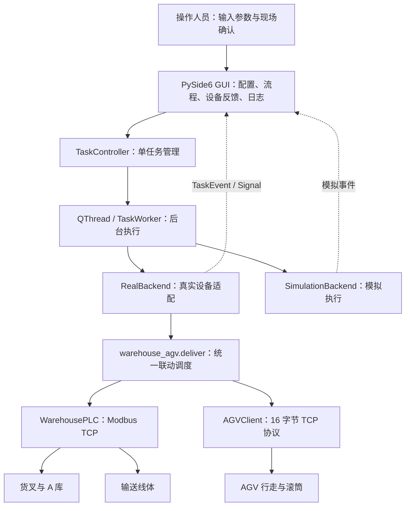

# 仓储系统与 AGV 联动 GUI 技术交接报告

| 项目 | 内容 |
| --- | --- |
| 系统名称 | 仓储 AGV 联动控制系统 |
| 文档版本 | V1.1 |
| 编制日期 | 2026 年 10 月 9 日 |
| 运行平台 | Windows，Python 3.10，PySide6 / Qt Widgets |
| 交接对象 | 负责撰写项目技术报告的队友，并供调试与维护人员参考 |
| 文档用途 | 提供技术方案、联动流程、调试过程及验证结果，作为正式技术报告的编写依据 |
| 技术范围 | A 库、输送线体、AGV、上位机 GUI 及完整联动调度 |
| 编写依据 | 项目现有源代码、开发 Prompt、流程总结、使用说明及自动化测试 |

**给报告编写队友的说明：** 本文用于交接我们负责的仓储系统与 AGV 联动及 GUI 开发工作，供队友编写项目整体技术报告时参考。内容重点是我们采用了哪些技术、如何完成设备之间的联动、完整任务怎样执行、调试中解决了哪些问题，以及最终实现了哪些功能和取得了哪些验证结果。撰写正式报告时，可按“项目目标 → 技术方案 → 联动流程 → 关键实现 → 调试与验证 → 实现成果”组织内容，并突出参数可手动输入、库位可视化选择、设备反馈与运行日志实时查看等特点。部署命令、文件清单和维护说明可作为附录材料。

> 本报告按“GUI 各阶段已完成、进入项目交付”的场景组织，说明可由现有代码核实的技术实现。现有《GUI使用说明.md》仍记录为第二阶段完成离线验证、尚未开展现场 PLC / AGV 联调；因此，本文的软件验证结果与现场验收记录分别说明，不补写未经提供的现场测试次数、成功率或验收签字。调试章节区分已有记录中的问题与离线测试覆盖的异常场景。

## 1. 项目目标、技术实现与成果概述

### 1.1 项目目标与业务范围

本项目实现了一套由电脑端统一调度立体仓库、输送线体和 AGV 的单机控制系统。操作人员通过中文 GUI 输入出库库位、入库库位和线体运行时间，启动任务后，可在同一页面查看仓库动作、装卸交接、AGV 往返运行、设备反馈和退出清理结果。

本次联动的完整业务链路为：

**A 库源库位出库 → 线体出货与 AGV 上料 → 装载确认 → AGV 后退至站点 2 → 前进返回站点 1 → AGV 下料与线体入货 → A 库目标库位入库 → 双方清理及连接关闭。**

仓库固定使用 A 库，包含 6 列、3 层，共 18 个库位。出库源库位与入库目标库位可以相同，也可以不同。站点 1 为上下料交接位置，站点 2 为折返点；本项目流程在站点 2 不执行卸货。

项目完成的关键工作，是将两种不同通信协议下的设备操作组织为有前置条件、反馈检查和异常出口的统一流程，并将原命令行调度接入 GUI。用户的一次任务启动，最终对应多个经过顺序约束的设备动作，而不是同时向两台设备发送一组指令。

### 1.2 可直接用于正式技术报告的技术总结

本项目采用 Python 与 PySide6 开发仓储 AGV 联动控制系统，由上位机统一协调立体仓库 PLC、输送线体和 AGV。仓库及线体通过 Modbus TCP 控制，AGV 通过自定义 16 字节 TCP 报文进行指令交互与状态查询。我们在原有设备控制模块基础上建立统一调度流程，将仓库出库、线体输送、AGV 装载、往返行走、卸载及仓库入库组织为一项完整任务，并通过设备反馈和必要的人工确认控制各阶段的衔接。

在联动实现上，PLC 动作采用“空闲且就绪 → 下发命令 → 忙碌 → 恢复空闲 → 命令清零”的握手机制；装卸阶段采用线体与滚筒重叠运行的时序，上料时滚筒在线体运行的最后 2 秒反转接料，下料时在线体运行的最初 2 秒正转送料；AGV 到站采用目标站点、零速度及停站状态连续两次满足的联合判断。我们还加入物料 IO 校验或上料人工确认，以及超时、取消和双方独立清理机制，使后续动作具有明确的执行条件，并保留异常发生时的处理结果。

在 GUI 实现上，操作人员能够手动输入出入库位置和线体运行时间，通过 18 库位图选择任务位置，并配置设备连接、滚筒定义、物料反馈及超时参数。界面随任务查询和执行事件更新 PLC 状态、AGV 原始站点与确认站点、运行状态、速度比例、报警、电压、流程阶段及运行日志，实现联动过程的可视化查看。设备执行采用 QThread 后台任务，界面通过 Signal / Slot 接收事件，人工确认通过线程安全机制返回调度流程。最终形成了包含模拟模式和真实设备适配器的完整软件实现；报告编制时重新执行的 109 项离线测试全部通过，语法编译及依赖检查通过。现场运行效果和验收结论应引用项目实际联调记录。

### 1.3 正式报告建议突出的问题、方法与成果

| 技术问题或目标 | 我们采用的方法 | 已实现的成果 | 详细依据 |
| --- | --- | --- | --- |
| 仓库与 AGV 使用不同协议，动作需要协调 | 上位机统一调度，分别封装 Modbus TCP 与 AGV TCP 接口 | 出库、装卸、往返及回库形成完整任务链路 | 第 2、3 章 |
| 线体与 AGV 交接需要配合时序 | 上料末段重叠、下料起始段重叠，采用单调时钟绝对截止时间 | 明确装卸动作的先后关系和计划运行时间 | 第 3.5 节及第 6.4 节 |
| 单看指令应答或计时无法证明动作完成 | PLC 忙碌到空闲握手，AGV 联合到站判断，物料校验与确认 | 下一阶段由检查结果门控，异常时终止后续动作 | 第 3.3、3.6 节 |
| 现场参数需要便捷调整，过程需要直观查看 | 手动输入、库位图双向同步、事件驱动设备反馈与日志展示 | 在一个页面完成任务配置和执行过程观察 | 第 4 章 |
| GUI 要保持响应，并正确处理取消和异常 | QThread、Signal / Slot、Condition、独立清理报告 | 后台执行、确认交互、取消及退出流程得到离线验证 | 第 5、6、7 章 |

## 2. 系统总体方案

### 2.1 设备关系与通信方式

| 对象 | 代码默认连接 | 通信方式 | 职责 |
| --- | --- | --- | --- |
| 仓库 PLC | `192.168.1.11:502`，Slave ID `1` | Modbus TCP | 控制货叉出入库、线体出货和线体入货 |
| AGV | `192.168.1.16:1024`，AGV ID `1` | 自定义 16 字节 TCP 报文 | 控制行走、目标站点及滚筒，提供运行反馈 |
| 电脑端 GUI | 本地运行 | 分别连接 PLC 与 AGV | 参数输入、任务调度、过程监控、人工确认、异常清理 |

线体属于仓库 PLC 的控制范围，不需要建立第三条独立的线体网络连接。上位机在一次任务中分别复用 PLC 和 AGV 的连接，完成任务或发生异常后关闭连接。



### 2.2 软件分层与模块职责

| 层级 | 文件 / 主要接口 | 交接说明 |
| --- | --- | --- |
| 启动层 | [`run_gui.py`](run_gui.py)、[`gui/main.py`](gui/main.py) | 启动 Qt 应用，加载字体、样式及主窗口 |
| 界面层 | [`gui/main_window.py`](gui/main_window.py) | 参数输入、模式选择、流程显示、设备状态、日志与确认窗口 |
| 库位组件 | [`gui/storage_grid.py`](gui/storage_grid.py) | A 库 18 个库位的可视化选择及输入同步 |
| 配置层 | [`gui/settings.py`](gui/settings.py) | 设备配置、范围校验、QSettings 持久化 |
| 数据契约 | [`gui/models.py`](gui/models.py) | `TaskParameters`、`TaskEvent`、阶段与事件类型 |
| 生命周期管理 | [`gui/task_controller.py`](gui/task_controller.py) | 禁止重复启动、取消与确认转交、线程退出后解锁 |
| 后台执行 | [`gui/task_worker.py`](gui/task_worker.py) | 执行后端、汇报失败 / 取消、统一清理及最终结果 |
| 真实适配层 | [`gui/real_backend.py`](gui/real_backend.py) | 创建客户端、转发设备反馈、接入原调度、生成清理报告 |
| 模拟适配层 | [`gui/simulation.py`](gui/simulation.py) | 模拟完整任务和异常场景，便于演示及离线验证 |
| 联动调度层 | [`warehouse_agv.py`](warehouse_agv.py) 的 `deliver()`、`Conveyor` | 协调出库、装卸、往返及入库，复用已有设备连接 |
| 仓库业务层 | [`warehouse_modbus.py`](warehouse_modbus.py) | 提供 `outbound()`、`inbound()` 等仓库操作 |
| PLC 驱动层 | [`warehouse_plc.py`](warehouse_plc.py) 的 `WarehousePLC` | 寄存器读写、动作握手、等待、清零及观察接口 |
| AGV 驱动与装卸 | [`outbound_agv.py`](outbound_agv.py) | 报文编解码、状态查询、到站判断、装卸时序及停止清理 |
| 独立通信工具 | [`agv_tcp.py`](agv_tcp.py)、[`tcp_sender.py`](tcp_sender.py)、[`tcp_receiver.py`](tcp_receiver.py) | 单条指令和网络收报排查，辅助分层定位故障 |

GUI 通过 `RealBackend` 调用原 `warehouse_agv.deliver()`，将阶段、日志、确认和取消接口接入图形界面。设备寄存器、AGV 帧格式、装卸方向和完整流程顺序继续由原控制层负责。模拟与真实模式使用相同的界面事件结构，减少两套界面逻辑之间的差异。

## 3. 仓储系统与 AGV 联动的核心实现

### 3.1 联动机制：统一调度、反馈推进、条件门控

仓库 PLC 和 AGV 各自负责设备内部执行，上位机负责跨设备的动作顺序。联动由以下机制共同实现：

1. **统一调度入口。** `warehouse_agv.deliver()` 明确组织出库、上料、往返、下料和入库，避免各设备脚本独立运行而失去顺序约束。
2. **PLC 动作握手。** 发起仓库动作前等待空闲且就绪；下发后必须观察忙碌，再观察恢复空闲，最后清零。
3. **装卸时序协调。** 线体与滚筒按共同截止时间运行，上料重叠最后 2 秒，下料重叠最初 2 秒。
4. **物料与停车检查。** 到时后继续核对停车、线体状态及物料 IO；未配置物料 IO 时，上料完成需要人工确认。
5. **严格到站判断。** AGV 站点、速度和状态连续两次满足条件，再停止并复核。
6. **统一异常出口。** 前置动作失败、反馈不符、超时或取消时，不启动后续搬运动作，进入双方清理。

因此，联动包含“动作执行顺序”和“进入下一动作的条件”两部分。GUI 中阶段变绿，来源于控制流程完成检查后发布的事件。

### 3.2 启动前参数校验与准备确认

开始任务前完成全部参数校验，包括回库目标，避免已经出库后才发现目标库位参数无效。

真实任务的启动顺序为：选择真实设备模式 → 点击开始 → 核对连接地址与任务参数 → 明确确认连接并启动 → 后台建立 AGV 和 PLC 连接 → 检查 AGV 初始状态 → 初始化停止及清除目标 → 现场准备确认 → 执行出库。

AGV 初始检查要求速度为零、处于允许的停车状态，且未触发代码检查的报警条件；配置物料 IO 时还要求初始无料。现场准备确认覆盖源库位有货、AGV 空载、站点 1 可交接，以及目标库位在回库时可用。PLC 空闲且就绪由每个 PLC 动作的前置检查负责。

仅打开程序、切换模式、打开或保存设置、取消启动核对窗口，均不会连接设备。每次重新启动 GUI 默认进入模拟模式。

### 3.3 仓库出入库：寄存器与动作握手

PLC 使用 Modbus TCP，读取保持寄存器使用功能码 `03`，写单个保持寄存器使用功能码 `06`。Python 协议地址从 0 开始：

| 文档地址 | 协议地址 | 含义 | 取值 |
| --- | --- | --- | --- |
| 40001 | 0 | 设备状态，只读 | `0` 空闲，`1` 忙碌，`2` 未回零 |
| 40002 | 1 | 列号 | `1～6` |
| 40003 | 2 | 层号 | `1～3` |
| 40004 | 3 | 仓库编号 | `1`，A 库 |
| 40005 | 4 | 动作命令 | `0` 清除，`1` 出库，`2` 线体出货，`3` 线体入货，`4` 入库 |
| 40006 | 5 | 仓库就绪，只读 | `0` 未就绪，`1` 就绪 |

仓库出库和入库的共同执行过程为：

```text
等待 STATUS=0 且 READY=1
    → 清除旧命令 COMMAND=0
    → 写列号、层号、A 库编号
    → 最后写入动作命令（出库 1 / 入库 4）
    → 等待 STATUS=1，确认动作已启动
    → 等待 STATUS=0，确认动作结束
    → COMMAND=0，结束本次动作
```

先观察忙碌再等待空闲，解决了“命令刚发出，PLC 还没开始，读取到空闲就误判完成”的问题。参数全部写成功后才写动作命令，保证设备不会在参数尚未完整设置时启动。状态与就绪寄存器由 PLC 更新，上位机不写入这两个只读反馈。

### 3.4 AGV 通信：帧格式、应答与实际状态分离

AGV 使用固定 16 字节报文。发送帧以 `AA` 开头，第 14 字节为 `FF`，第 15 字节为前 15 字节相加后对 256 取模的校验和，字节下标从 0 开始。发送指令的数据码低位在前；状态帧地标号按状态协议定义高位在前解析。

| 联动操作 | 功能码 | 数据码 |
| --- | --- | --- |
| 查询状态 | `0x05` | 默认 `0x01`，可显式配置 `0x00` |
| 设置目标站点 | `0x06` | 目标站点编号 |
| 清除目标站点 | `0x06` | `0x00` |
| 后退启动 | `0x01` | `0x01` |
| 前进启动 | `0x01` | `0x00` |
| 停止行走 | `0x02` | `0x00` |
| 滚筒停止 | `0x17` | `0x00` |
| 滚筒反转上料 / 正转下料 | `0x17` | 由显式选择的 `word` / `pdf` 配置确定 |

`FrameDecoder` 使用缓冲区保留未收齐的帧，拆分粘连帧，并丢弃噪声或校验错误的数据。请求按 AGV ID 和功能码匹配应答，不要求应答逐字节回显发送内容。

**收到指令应答只作为通信应答记录；动作完成另查设备状态。** 下发目标站点也只表示设置目标，不能代表车辆已经处于该站点。搬运指令应答丢失后不自动重发。

### 3.5 上料与下料：跨设备重叠运行时序

上下料共用手动输入的线体运行时间 `T`，要求 `2 < T ≤ action_timeout`。滚筒上料、下料的计划运行时长均为 2 秒。线体计时起点是程序观察到 PLC 进入忙碌之后。

| 阶段 | 线体运行 | AGV 滚筒运行 | 截止处理及后置检查 |
| --- | --- | --- | --- |
| 上料 | 出货，计划运行 `T` 秒 | 在 `T−2` 秒启动反转上料 | 到共同截止时间清线体命令、停滚筒，再查线体空闲、AGV 停车和装载条件 |
| 下料 | 入货，计划运行 `T` 秒 | 线体启动握手后随即正转下料，计划运行 2 秒 | 先停滚筒，线体到 `T` 后清零，再查线体空闲、AGV 停车及配置的物料 IO |

以 `T=5 秒` 为例：

```text
上料：0 秒启动线体出货 ─── 3 秒启动滚筒反转 ─── 5 秒清线体命令并停滚筒
下料：0 秒启动线体入货及滚筒正转 ─── 2 秒停滚筒 ─── 5 秒清线体命令
```

`Conveyor` 将现有 PLC 的线体命令适配给 `outbound_agv.transfer()`。计时使用 `time.monotonic()` 和绝对截止时间，滚筒计时包含指令应答等待，避免“等应答后再额外运行 2 秒”导致运行时长叠加。

同一 Worker 顺序发送设备请求，但设备收到启动命令后会各自运行，因此能实现线体与滚筒的时间重叠。上述时间是调度目标，实际启停受网络应答、系统调度及设备执行延迟影响，不属于硬实时同步。

### 3.6 物料交接与到站条件

**物料 IO 模式：** 用户配置输入 IO 编号 `1～8` 和有料电平 `0/1`。上料前无料、上料后有料；下料前有料、下料后无料。IO 与电平必须成对提供。传感器应能反映完全装入或完全卸出，才能承担对应交接判断。

**未配置物料 IO：** 保留任务开始前的现场准备确认，上料定时停止后另行请求确认货物完全上车、滚筒已停止且脱离交接区。确认未通过、取消或超时，均不允许 AGV 出发。现有完整流程没有单独的“下料完成人工确认”窗口；无物料 IO 时，下料阶段依据既定时序、停车状态和线体空闲继续，物料完全回到取料位需结合现场确认及 PLC 侧条件核对。

**AGV 到站：** `wait_at_station()` 要求连续两次状态查询同时满足目标站点号、速度为零、状态为“停站中”或“对接完成”，随后发送停止行走并再查停车状态。行走中出现代码检查的报警或不允许的状态，立即中止流程。

初始原始站点可能为 `0`。仅在初始检查、准备确认和首次上料阶段，基于现场确认的站点 1 起点允许该值；到站点 2 必须反馈 `2`，回到站点 1 必须反馈 `1`。GUI 同时保留原始站点和确认站点，避免掩盖设备原始反馈。

### 3.7 八个阶段与进入下一阶段的条件

| GUI 阶段 | 执行内容 | 继续条件 |
| --- | --- | --- |
| 1. 准备与设备检查 | 连接、AGV 初始检查、初始化停止、现场准备确认 | 起点及停车条件符合，准备确认通过 |
| 2. 仓库出库 | A 库源库位出库 | PLC 忙碌后恢复空闲，命令清零成功 |
| 3. 线体与 AGV 上料 | 线体出货，最后 2 秒反转上料 | 装卸停止处理完成，停车、物料 IO 或人工确认通过 |
| 4. AGV 前往站点 2 | 设置目标 2，后退行走 | 连续两次严格到站，停止后复核通过 |
| 5. AGV 返回站点 1 | 清旧目标，设置目标 1，前进行走 | 连续两次严格到站，停止后复核通过 |
| 6. 线体与 AGV 下料 | 线体入货，最初 2 秒正转下料 | 线体空闲、AGV 停车及配置的物料 IO 校验通过 |
| 7. 仓库入库 | A 库目标库位入库 | PLC 忙碌后恢复空闲，命令清零成功 |
| 8. 完成与清理 | PLC 清理、AGV 停止及清目标、关闭连接 | 清理未报告失败，生成结果，后台线程退出后解锁 |

下料阶段已经执行线体入货命令 `3`，之后直接执行仓库入库命令 `4`，不会再次启动一轮线体入货。异常或取消时保留已完成阶段，标记当前阶段失败 / 取消，未执行阶段保持等待，清理结果独立显示。

## 4. GUI 设计与项目特点

### 4.1 参数手动输入，现场调整不需要改代码

任务页提供出库列层、入库列层及线体时间输入。系统设置提供设备地址、ID、滚筒指令定义、物料反馈和各类超时参数。数字输入支持键盘输入与增减按钮，线体时间支持小数。

| 参数类别 | 可配置内容 | 校验 / 默认行为 |
| --- | --- | --- |
| 库位 | 出库及入库列层 | 列 `1～6`，层 `1～3`，允许同库位 |
| 线体时间 | 上下料共用 `T` | GUI 初始值 5 秒，须大于 2 秒且不超过动作超时 |
| PLC 连接 | IP / 主机名、端口、Slave ID | 地址非空；端口 `1～65535`，ID `1～247` |
| AGV 连接 | IP / 主机名、端口、AGV ID | 地址非空；端口 `1～65535`，ID `1～255` |
| 滚筒配置 | `word` / `pdf` | 必须显式选择现场已验证定义；不自动切换 |
| 物料反馈 | IO 编号、有料电平 | IO `1～8`，电平 `0/1`，两项成对配置 |
| 状态查询 | 查询数据码 | 默认 `1`，可选 `0` |
| 通信与等待 | PLC / AGV 各自通信超时和轮询间隔，动作、就绪、启动、行走、确认超时 | 均须为有限正数 |

设备设置通过 QSettings 保存至项目根目录的 `gui_settings.ini`，下次打开自动加载。设备设置与本次任务参数分开管理；现有设置文件不保存本次出入库位置及线体时间。设置无效时恢复代码默认值并提示重新选择滚筒定义。

默认配置为：AGV 通信超时 5 秒、轮询 0.5 秒；PLC 通信超时 3 秒、轮询 0.2 秒；就绪等待 30 秒、启动握手 15 秒、动作完成 180 秒、每段行走 180 秒、每次人工确认 120 秒。各超时按对应阶段分别计算。

### 4.2 库位可视化与输入框双向同步

库位图按 3 行 × 6 列显示，上方为第 3 层，下方为第 1 层，从左到右为第 1～6 列。用户可以切换“选择出库位置 / 选择入库位置”，点击图形确定源或目标，也可以直接修改数字输入框。

数字输入变化同步到库位图，图形点击同步到数字输入。出库、入库使用不同颜色，同库位通过双色和“出 / 入”文字同时表达。该图显示本次任务选择，现有 PLC 接口未提供全部库位占用数据，因此图形不标注全仓有货 / 空库位。

### 4.3 实时查看设备反馈、过程日志与清理报告

GUI 将设备原始反馈和调度事件汇聚到一个页面，便于判断当前动作、等待原因和异常位置。

| 页面信息 | 数据来源 | 实际含义 |
| --- | --- | --- |
| PLC / AGV 连接状态 | 适配器连接及清理事件 | 连接中、已连接、失败或断开；模拟模式单独标识 |
| PLC 状态与就绪 | `WarehousePLC.set_observer()` | 共用设备状态及仓库就绪反馈 |
| 原始站点 | AGV 状态查询 | 设备返回的原始站点编号 |
| 确认站点、目标站点 | 调度阶段与严格到站检查 | 已确认的离散站点和当前行走目标 |
| 运行状态、速度比例 | AGV 状态查询 | 状态名称及百分比速度比例 |
| 报警、电压 | AGV 状态查询 | 报警 IO 原始值、电压值，单位 V |
| 流程阶段 | `deliver()` 执行钩子 | 等待、执行、完成、失败、取消及说明 |
| 运行日志 | PLC / AGV 日志接口及 Worker | 时间、INFO / WARNING / ERROR、命令及检查过程 |
| 清理报告 | `RealBackend.cleanup()`、`AGVClient.shutdown_report` | 逐设备的停止应答、清零、停车复核及关闭结果 |

这里的“实时查看设备报告”指随任务执行查询和事件更新的状态展示、日志及清理摘要。结构化清理明细同时随 `cleanup` / `result` 事件返回，页面通过日志展示摘要；当前没有独立报表中心、自动日志落盘或报告导出功能。日志窗口最多保留 2000 条显示记录，可清空显示。

设备显示复用控制过程中的查询，PLC 与 AGV 的所有请求由同一个 Worker 串行执行，避免界面另开通信线程抢读应答。刷新节奏取决于当前阶段：人工确认和行走等待会持续查询，部分定时装卸等待不会连续查询，任务结束关闭连接后保留最后一次反馈。

AGV 示意采用“站点 1 ↔ 站点 2”的离散状态。行走中显示上次确认站点及目标，不推算连续坐标；速度比例不解释为米每秒，电压不转换成电池百分比。

### 4.4 界面与设备执行解耦

PLC / AGV 网络请求、等待和清理放在 QThread 内的 QObject Worker 中执行。后台以 `TaskEvent` 通过 Qt Signal 发送数据，主线程通过 Slot 更新界面。

事件分为 `stage`、`device`、`log`、`confirmation`、`cleanup`、`result`，包含数据、时间及模拟 / 真实模式标识。人工确认窗口由主线程创建，后台不调用 `input()` 或直接操作 QWidget。

`TaskControl` 使用 `threading.Condition` 传递确认和取消。确认请求先注册唯一 ID 再发出事件，主线程按 ID 回答，防止旧窗口影响后续任务；真实确认采用有界轮询，等待人员回答期间仍能查询 AGV 停车和报警。

### 4.5 模拟模式与真实模式共用界面

模拟模式无需设备连接即可演示完整流程、库位选择、人工确认和取消，并覆盖上料反馈异常、AGV 到站超时及退出清理异常。模拟可使用缩短时间，但保留装卸重叠关系，并明确标注为模拟。

真实模式调用原设备调度，使用实际秒数，不接收模拟时间比例。两种模式共用流程、状态和日志组件，便于接收人员先熟悉操作，再按现场配置执行真实任务。

## 5. 异常处理、停止请求与任务结束

### 5.1 单任务管理与取消

任务运行和清理期间，相关参数、系统设置及开始按钮锁定，控制器也拒绝重复启动。“请求停止”设置取消标志，在下一检查点停止后续动作并进入清理；正在进行的网络请求仍受通信超时约束。

关闭运行中的窗口时，先请求取消并关闭确认窗口，继续处理 Qt 事件，待后台清理和线程退出后自动关闭。控制器通过非阻塞 `wait(0)` 确认原生线程退出，再释放引用、解锁界面，不强制终止 QThread。

### 5.2 双方清理与结果判定

PLC 清理尝试清除可能活动的命令并关闭连接。AGV 清理尝试停止行走、停止滚筒、清除目标站点，随后查询停车状态并关闭连接。某一设备或某条清理指令失败，不阻止继续尝试另一设备及剩余清理。

清理阶段禁用任务取消检查，避免“已经取消”反过来阻止停止指令发送。AGV 连接损坏时，仅退出停止逻辑可尝试重连发送停止 / 清目标指令；不会重新发送搬运动作。

| 报告字段 | 解释 |
| --- | --- |
| `plc_command_clear` | 有待清命令时记录清零结果；无待清命令时为 `None` |
| `plc_connection_closed` | PLC 连接关闭是否完成 |
| `travel_stop_ack` | AGV 停止行走指令是否收到匹配应答 |
| `roller_stop_ack` | AGV 滚筒停止指令是否收到匹配应答 |
| `target_clear_ack` | 清除 AGV 目标站点指令是否收到匹配应答 |
| `travel_stationary` | AGV 行走停车状态是否通过复核 |
| `roller_stationary`、`plc_mechanical_stop` | 为 `None`，协议未提供足够信息证明相应机械停止 |
| `connection_closed` | AGV 连接关闭是否完成 |
| `errors` | 清理中未确认的错误列表 |

最终成功要求业务流程结束且清理没有报告失败。清理失败会使任务结果为失败，即使前面的搬运步骤已经完成。取消则保留取消结果，清理失败时进一步报告失败。

“请求停止”、命令清零、收到停止应答和关闭 TCP 连接，均不能等同于机械急停或全部机构已确认停机。异常后保留日志及已完成阶段，接收人员结合现场物料位置决定下一步；现有系统没有故障后自动续跑或自动回滚。

## 6. 调试问题与解决过程

以下问题根据现有文档、代码注释和测试整理。标注“已有记录”的事项具备文档依据；标注“离线验证”的事项代表实现中处理并由测试覆盖的风险或异常，不表示曾在现场造成设备故障。

### 6.1 已有记录：协议文档定义不一致

**问题表现：** Word 与 PDF 的滚筒名称、状态查询数据码及帧格式说明存在冲突。PLC 调度说明的部分操作步骤也将命令地址写为 40004，与总表中的 40005 不一致。

**分析与处理：** PLC 按寄存器总表和截图使用 40005 为命令，40004 只选 A 库。AGV 按已整理的表格及示例采用 16 字节帧和单字节累加校验，指令数据码与状态地标分别按其定义处理。查询数据码可显式配置，滚筒按 `word` / `pdf` 分组，由人员选择现场验证后的定义。

**结果与依据：** 配置差异成为明确参数，不在失败后自动换用另一组动作。协议测试直接读取原 Word 的 18 条指令示例核对生成字节，覆盖拆包、校验和状态字段。依据为《AGV测试说明.md》《readme.md》及 `test_agv_tcp.py`。

### 6.2 已有记录：上料滚筒方向与现场需要相反

**问题表现：** 《AGV搬运说明.md》和代码注释记录，现场反馈上料方向相反，需要调整接料方向。

**分析与处理：** 将上料统一为反转接料，下料保留已验证的正转送料；保持两份文档的显式配置关系：

| 配置 | 反转上料数据码 | 正转下料数据码 |
| --- | --- | --- |
| `word` | `0x04` | `0x01` |
| `pdf` | `0x02` | `0x03` |

**结果与交接要求：** 方向定义已经进入原控制逻辑及 GUI 设置。交接配置须记录现场最终采用哪一组，文件名本身不能证明现场含义，GUI 开发也不应再次擅自反转方向。

### 6.3 已有记录：车辆在站点 1，初始反馈却为 0

**问题表现：** 文档记录车辆实际起点已现场确认为站点 1，但初始化时设备可能返回站点 `0`，严格匹配站点 `1` 会阻止任务启动。

**分析与处理：** 仅对启动准备和首次上料允许初始 `0`，继续检查停车、零速度和报警，保留人员确认和原始站点。车辆开始行走后恢复严格站点判断，返回 `0` 不能视为到站点 1。

**结果与依据：** GUI 分开显示原始站点与确认站点。测试覆盖初始 `0` 的完整流程、初始 `0` 伴随运动 / 报警时拒绝执行，以及回程 `0` 不启动下料和回库。依据为《AGV搬运说明.md》、`test_warehouse_agv.py`、`test_real_backend.py`。

### 6.4 离线验证：装卸计时被应答耗时拉长

**问题机制：** 如果在收到滚筒启动应答后才开始等待 2 秒，实际运行会增加网络应答等待时间；如果先等待 PLC 完全停止再发送滚筒停止，也可能拉长上料运行。

**处理方式：** 在发送滚筒指令前计算绝对截止时间；上料与线体共用截止时间。到时先发送线体清零而不等待空闲，再发送滚筒停止，之后才等待线体停止反馈。

**验证结果：** 使用模拟时钟检查 `T=5 秒` 时上料在 3 秒启动、5 秒进入停止处理，下料在最初 2 秒重叠；模拟指令应答延迟不额外增加计划等待时长。依据为 `test_agv_task.py` 的 `TimingTests` 和 `test_warehouse_agv.py` 的 `CombinedTimingTests`。这些结果验证调度算法，不证明真实设备毫秒级同步。

### 6.5 离线验证：应答或站点号被误当作动作完成

**问题机制：** PLC 接受指令到进入忙碌有延迟，初次读取空闲可能误判完成；AGV 行走中也可能提前报告目标站点或保留旧站点，单查站点号无法证明停车。

**处理方式：** PLC 强制“忙碌 → 空闲”握手；AGV 强制“目标站点 + 零速度 + 停站 / 对接完成”连续两次满足，停止后再次复核。

**验证结果：** 测试覆盖仅站点满足但速度或状态不符、途中急停、到站超时等情况，后续下料不会执行。依据为 `test_agv_task.py`、`test_warehouse_agv.py`。

### 6.6 离线验证：计时结束后，物料交接仍未完成

**问题机制：** 线体和滚筒运行到时，只能说明计划运行时间结束，不能独立证明货物完全上车或卸出；协议文档也未明确默认物料传感器的对应 IO。

**处理方式：** 不默认推断物料 IO；用户成对配置 IO 与电平后检查装卸前后状态。未配置时，上料后增加人工确认，未确认不允许出发。

**验证结果：** 上料物料状态不符、人工取消或超时，均阻止行走。下料无 IO 的反馈边界保留在交接说明中，不能写成具备独立物料到位证明。依据为 `transfer()`、`test_agv_task.py`、`test_real_backend.py`。

### 6.7 离线验证：通信超时后重复动作风险

**问题机制：** 设备可能已执行命令，只是应答丢失；自动重发出库、滚筒或行走命令可能引起重复动作。

**处理方式：** PLC 客户端设置 `retries=0`，AGV 动作请求不自动重发。PLC 在发送动作前先标记可能存在活动命令，即使写响应丢失也在退出时尝试清零。AGV 仅清理停止逻辑允许必要重连。

**验证结果：** 测试模拟写应答和上料应答丢失，断言不重发搬运动作、不启动后续行走，同时执行清理。依据为 `test_agv_task.py`、`test_real_backend.py`。

### 6.8 离线验证：GUI 确认阻塞、界面卡顿与应答争用

**问题机制：** 主线程直接等待设备会阻塞界面；后台使用终端输入不适合 GUI；界面刷新线程和控制线程共用 socket 可能错取应答。人员确认期间若完全停止查询，也无法及时识别报警。

**处理方式：** 设备执行移入 QThread；使用 Signal / Slot 更新界面；Condition 和请求 ID 传递确认；真实确认采用有界等待继续查询状态。设备卡片复用原观察接口，不增加并发通信线程。执行钩子及日志接收通过 ContextVar 在当前执行上下文内设置、结束后恢复。

**验证结果：** 测试验证任务期间主线程心跳继续、旧确认被拒绝、确认中报警阻止出库，以及钩子不泄漏到后续 CLI 或其他线程。依据为 `test_gui.py`、`test_real_backend.py`。

### 6.9 离线验证：取消、窗口关闭与清理结果丢失

**问题机制：** 收到取消后如果立即销毁线程或关闭应用，停止指令和连接清理可能无法执行；如果取消检查继续作用于清理，也可能阻止停止。单台设备清理失败还可能影响另一台设备。

**处理方式：** Worker 的 `finally` 统一清理，清理时禁用取消检查，双方独立尝试清理并记录报告。窗口等待线程退出，控制器确认原生线程结束后才释放引用。最终结果在清理之后发布。

**验证结果：** 测试覆盖确认期间取消、行走期间取消、运行中关闭、双方独立清理失败，以及清理失败不能显示成功。依据为 `test_gui.py`、`test_real_backend.py`。

### 6.10 交接核对：旧文档与当前实现存在阶段差异

旧 `readme.md` 中仍出现 `avg_control`、`warehouse_task.py` 和 `test_warehouse_task.py`，当前实际环境及文件为 `agv_control`，完整流程入口为 `warehouse_agv.py`。《仓储联动完整流程总结.md》中的部分 GUI 描述属于接入前背景，开发 Prompt 的第一阶段限制也不代表当前真实适配器仍未实现。

本报告以现有源代码及《GUI使用说明.md》为当前实现依据，启动和测试命令均核对实际文件。设备默认值以代码为准，现场使用值以已核对的 `gui_settings.ini` 为准。当前 INI 已保存 `roller_profile=pdf`，但代码首次默认值为未选择；该保存值不能直接作为现场方向已验证的证明。

## 7. 验证结果与验收依据

### 7.1 本次报告编制时重新执行的软件验证

本次在项目现有环境中重新运行已有离线测试，结果如下：

| 验证项 | 结果 |
| --- | --- |
| Python | `3.10.11` |
| PySide6 | `6.12.0` |
| pymodbus | `3.11.4` |
| GUI 测试 `test_gui` | 40 项 |
| 真实适配器隔离测试 `test_real_backend` | 15 项 |
| 原流程 / 协议测试 `test_warehouse_agv`、`test_agv_task`、`test_agv_tcp` | 54 项 |
| 合计 | **109 项全部通过**，本次运行耗时约 18.4 秒 |
| 语法编译 | `compileall` 通过 |
| 依赖完整性 | `pip check` 通过，未发现依赖冲突 |

测试使用 Qt offscreen、内存 Modbus、假 AGV、局部模拟时钟和本地回环 TCP 服务。真实适配器隔离测试仍执行原 `deliver()` 和装卸算法；GUI / 适配器测试禁止真实设备连接和终端 `input()`。本次验证未连接现场 PLC 或 AGV。

复核命令如下：

```powershell
$env:QT_QPA_PLATFORM = 'offscreen'
.\agv_control\Scripts\python.exe -m unittest -q test_gui test_real_backend test_warehouse_agv test_agv_task test_agv_tcp
.\agv_control\Scripts\python.exe -m compileall -q gui run_gui.py warehouse_agv.py outbound_agv.py warehouse_plc.py test_gui.py test_real_backend.py
.\agv_control\Scripts\python.exe -m pip check
```

已有《GUI使用说明.md》另记录 Windows 原生 Qt 启动、完整模拟任务、主线程心跳和正常退出的冒烟验证，并提供 1366×768、1920×1080 等界面截图。本次未重新执行原生桌面冒烟；`tmp/gui-real-completed-fake.png` 使用假设备执行真实路径，不能作为现场完成证明。

### 7.2 交付时应归档的现场验收记录

若按实际项目进度已完成现场联调，交接时应将下列记录作为附件填写并归档，软件测试结果不能替代这些记录：

| 记录项目 | 应归档内容 |
| --- | --- |
| 设备及网络 | PLC / AGV 型号与配置、IP、端口、ID、网卡配置及通信确认结果 |
| 指令定义 | 最终采用的滚筒 profile、上料 / 下料方向、查询数据码 |
| 物料反馈 | 是否启用 IO、编号、电平、传感器是否证明完全装入 / 卸出 |
| 完整联动 | 出库源、入库目标、T、任务时间及各阶段观察结果 |
| 同库位 / 异库位 | 原库位回库及不同目标回库的现场记录 |
| 异常与恢复 | 取消、超时、报警或通信异常的处理与物料位置核对记录 |
| 停止效果 | 行走、滚筒及 PLC 机构的现场停止核对结果 |
| 操作环境 | 目标电脑分辨率、DPI、字体、窗口显示与关闭结果 |
| 验收确认 | 操作人、复核人、验收日期、配置快照及必要截图 |

## 8. 配套资料：部署、操作与维护

### 8.1 安装与启动

保留项目源码、`requirements.txt`、`gui/` 目录及样式资源，在项目根目录执行：

```powershell
.\agv_control\Scripts\python.exe -m pip install -r requirements.txt
.\agv_control\Scripts\python.exe run_gui.py
```

也可使用 `python -m gui.main`。如当前终端曾配置 offscreen 测试，桌面启动前执行：

```powershell
Remove-Item Env:QT_QPA_PLATFORM -ErrorAction SilentlyContinue
.\agv_control\Scripts\python.exe -m gui.main
```

依赖清单锁定 `pymodbus==3.11.4`，PySide6 约束为 `>=6.8,<7`；本次验证使用上表具体版本。移交时保留验证版本记录。当前源码包含可运行入口，现有资料未提供已经构建及验收的 exe。

### 8.2 接收人员操作顺序

1. 打开系统，先在模拟模式熟悉库位、确认、日志及异常场景。
2. 核对系统设置并保存，记录现场采用的滚筒 profile 和物料反馈配置。
3. 输入出库库位、入库库位及 `T`，核对现场源、目标和交接条件。
4. 执行真实任务时，明确选择真实模式并确认启动核对窗口。
5. 完成现场准备确认；无物料 IO 时，另行完成上料确认。
6. 观察八个阶段、PLC 状态、AGV 原始 / 确认站点、报警及日志。
7. 正常结束后检查任务结果和清理摘要；异常结束后核对物料位置及设备状态，再决定下一次操作。

### 8.3 故障排查入口

| 现象 | 优先检查内容 |
| --- | --- |
| PLC / AGV 连接失败 | 地址、端口、设备服务、电脑网络、端口占用及网络访问条件 |
| PLC 空闲但一直未就绪 | 自动模式、自动运行条件、回零状态及 PLC 的 READY 条件 |
| 下发后未观察到忙碌 | 寄存器地址、指令接收及反馈采样；不直接跳过握手 |
| 动作或行走超时 | 最后反馈、报警、物料位置、设备运行条件；不盲目重发 |
| 滚筒方向不符合交接 | profile 与现场定义是否一致，结合已归档方向验证记录处理 |
| 上料后不能出发 | 物料 IO 状态、上料确认、停车、速度和报警 |
| 返回站点 1 后不能下料 | 原始站点是否为 1，严格到站条件及停止后复核 |
| 清理失败 | 逐设备停止应答、PLC 清零、停车复核及连接关闭日志 |
| 设置未保存 | `gui_settings.ini` 路径、内容有效性及写入权限 |

维护通信时，先核对网络和单条报文，再核对动作握手、装卸时序，最后检查 GUI 事件展示。独立 `warehouse_agv.py --operation stop` 只停止 AGV，不覆盖 PLC；正在运行的 GUI 联动任务使用本任务的停止请求进入双方清理。

### 8.4 交接文件清单

| 类别 | 文件或目录 |
| --- | --- |
| GUI 源码与资源 | `run_gui.py`、`gui/`，含 `styles.qss` 和 `assets/` |
| 设备及联动源码 | `warehouse_agv.py`、`warehouse_modbus.py`、`warehouse_plc.py`、`outbound_agv.py` |
| 配置与依赖 | 现场核对后的 `gui_settings.ini`、`requirements.txt`、验证环境版本记录 |
| 测试 | `test_gui.py`、`test_real_backend.py`、`test_warehouse_agv.py`、`test_agv_task.py`、`test_agv_tcp.py` |
| 通信排查工具 | `agv_tcp.py`、`tcp_sender.py`、`tcp_receiver.py` |
| 使用及技术说明 | 本报告、`GUI使用说明.md`、`仓储联动完整流程总结.md`、AGV / TCP 说明 |
| 原始协议资料 | 仓库调度 Word、AGV 调度 Word、AGV 通信 PDF |
| 验收附件 | 实际现场联调记录、配置快照、操作及停止效果记录 |

## 9. 系统实现范围与后续扩展

现有实现覆盖单次完整联动、手动参数输入、库位可视化选择、模拟与真实适配、事件驱动监控、人工确认、取消和双方清理。接收人员可从 GUI 完成参数配置并观察设备报告，维护人员可通过模块划分和逐阶段反馈定位问题。

交付时应保留以下能力边界：

- 库位图表达源与目标选择，不提供全仓实时库存；系统没有任务队列、暂停续跑或故障后自动续接。
- 设备状态在任务查询期间刷新，断开后保留最后反馈，不提供后台常驻监控。
- 日志和清理摘要支持页面查看，当前没有历史数据库、自动日志文件或报表导出。
- 到时、应答、命令清零和断开连接均有明确含义，不能替代物料到位或全部机械停止的独立证明。
- 装卸采用普通 Windows 进程与 TCP 通信协调，实际现场时序及输送效果以已归档联调记录为准。

后续若增加全仓库存、长期设备监测或报告导出，应在现有设备数据和事件结构上扩展；若调整路线、装卸方向或传感器判断，需要同步更新控制逻辑、现场定义及回归验证。

## 附录 A：完整联动示例

任务设定：A 库第 1 层第 6 列出库，回到同一库位，`T=5 秒`，滚筒配置示例采用 `word`。

| 步骤 | 本次任务行为 |
| --- | --- |
| 参数 | 出库 `6-1`，入库 `6-1`，线体 5 秒；实际 profile 以现场验证为准 |
| 准备 | 检查 AGV 起点与停车，停止行走 / 滚筒、清目标，确认现场准备 |
| 出库 | PLC 命令 `1`，完成忙碌到空闲握手并清零 |
| 上料 | PLC 命令 `2`，第 3 秒启动反转上料，第 5 秒进入停止处理；确认装载 |
| 去程 | 目标 `2`、后退启动，严格到站后停止复核 |
| 回程 | 清旧目标、目标 `1`、前进启动，严格到站后停止复核 |
| 下料 | PLC 命令 `3`，同时段启动正转下料，2 秒停滚筒、5 秒清线体命令 |
| 入库 | 检查装卸后状态，PLC 命令 `4`，存回 `6-1` 并清零 |
| 结束 | 双方清理、关闭连接、生成结果，线程退出后解锁界面 |

仅预览计划、不连接设备的命令：

```powershell
.\agv_control\Scripts\python.exe warehouse_agv.py --column 6 --level 1 --duration 5 --roller-profile word --inbound-column 6 --inbound-level 1 --dry-run
```

## 附录 B：主要参考文件

- [GUI 开发 Prompt](Codex_PySide6_仓储AGV联动GUI_开发Prompt.md)：界面目标、业务约束及第一阶段要求。
- [GUI 使用说明](GUI使用说明.md)：当前第二阶段实现、启动操作、事件接口和已有验证记录。
- [仓储联动完整流程总结](仓储联动完整流程总结.md)：设备分工、完整顺序、时序及反馈边界。
- [AGV 搬运说明](AGV搬运说明.md)：方向修正、起始站点 0、装卸与退出处理记录。
- [AGV 测试说明](AGV测试说明.md)：协议差异、应答解析及本地测试依据。
- [TCP 测试说明](TCP测试说明.md)：网络连接、发送 / 接收与排查步骤。
- [仓库控制说明](readme.md)：寄存器、握手及常见问题；其中历史入口和环境名称以本报告核对结果为准。

