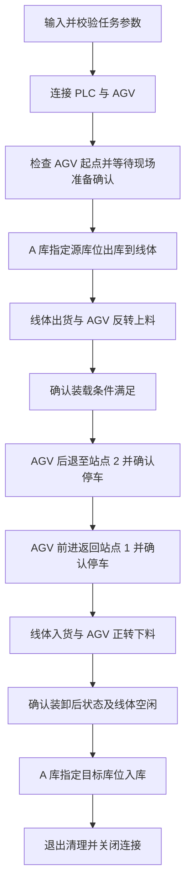

# 仓储、线体与 AGV 完整联动流程总结

本文依据当前项目代码整理，用于后续 GUI 页面需求讨论。范围仅包括“仓库出库 → 线体与 AGV 上料 → AGV 往返 → 线体与 AGV 下料 → 仓库入库”的完整流程。

完整流程入口为 [warehouse_agv.py](warehouse_agv.py)，该入口复用 [outbound_agv.py](outbound_agv.py)、[warehouse_modbus.py](warehouse_modbus.py) 和 [warehouse_plc.py](warehouse_plc.py)。本文描述代码已经实现的行为；GUI 相关内容属于后续讨论背景。

## 1. 项目目标

由电脑端 Python 程序统一调度立体仓库 PLC、输送线体和 AGV，完成一次货物出库、往返搬运与回库。

用户指定 A 库的出库源库位、返回后的入库目标库位和线体运行时间。系统先将货物从源库位取出，经线体送上 AGV；AGV 从站点 1 后退到站点 2，再前进返回站点 1；货物由 AGV 卸回线体，最后存入目标库位。

**站点 1 是上料与下料的交接位置，站点 2 是往返折返点。当前完整流程不在站点 2 卸货。**

仓库固定使用 A 库，列号为 1～6、层号为 1～3，共 18 个可选库位。回库目标可以是本次出库腾空的原库位，也可以是其他已确认可用的库位。

## 2. 设备与通信关系

| 对象 | 默认连接 | 通信方式 | 完整流程中的职责 |
| --- | --- | --- | --- |
| 仓库 PLC | `192.168.1.11:502`，Slave ID 为 `1` | Modbus TCP，依赖 `pymodbus==3.11.4` | 控制货叉出库、线体出货、线体入货和货叉入库 |
| AGV | `192.168.1.16:1024`，AGV ID 为 `1` | TCP，自定义 16 字节报文 | 接料、后退行走、返回行走和送料 |
| 电脑端程序 | 项目内 Python 环境 | 分别连接 PLC 与 AGV | 收集参数、调度时序、检查反馈、处理确认及退出清理 |

线体由仓库 PLC 控制，完整流程没有独立的线体网络连接。正常情况下，一次任务复用各自的 PLC 和 AGV 连接，任务结束后关闭连接。

## 3. 完整流程图



各阶段出现通信异常、状态不符、超时或用户中断时，流程终止后续动作并进入退出清理。

## 4. 各阶段的实际行为

### 4.1 参数准备与初始检查

开始前收集并校验设备连接参数、出库列层、回库列层、线体运行时间和滚筒指令配置。回库目标在出库动作之前完成校验，避免货物已经出库后才发现目标参数无效。

连接设备后，程序读取 AGV 状态，要求车辆处于可装卸的停车状态，速度为零且未触发代码检查的报警条件。若配置了物料 IO，还要求车辆初始无料。

现场已确认 AGV 实际起点为站点 1，但设备初始站点反馈可能是 `0`。代码仅在初始检查、准备确认和首次上料阶段允许反馈 `0` 或 `1`，保留原始反馈值。车辆出发后，到站点 2 必须反馈 `2`，返回站点 1 必须反馈 `1`。

程序先停止 AGV 行走、停止滚筒并清除旧目标站点，再等待人工确认以下条件：源库位有货、AGV 空载、站点 1 可完成装卸，以及回库目标在入库时为空。

### 4.2 仓库出库

等待 PLC 空闲且仓库就绪后，先清除旧命令，再写入源库位列号、层号和 A 库编号，最后下发仓库出库命令 `1`。

程序必须先观察到 PLC 进入忙碌，再等待恢复空闲，随后将命令清 `0`。此阶段完成后，货物已由货叉从源库位放到线体。

### 4.3 线体出货与 AGV 上料

启动 PLC 线体出货命令 `2`，观察到忙碌后开始计算线体运行时间。在线体剩余 2 秒时启动 AGV 滚筒反转上料。

到达共同截止时间后，依次发送线体命令清 `0` 和滚筒停止指令，再等待 PLC 反馈空闲，并检查 AGV 停车状态。

若配置了物料 IO，程序检查上料前无料、上料后有料；未配置物料 IO 时，需要人工确认滚筒已停止、货物完全上车且已与货架脱离，才允许后退。

### 4.4 AGV 后退到站点 2

下发目标站点 `2`，再发送后退启动指令。行走期间轮询站点、速度、运行状态和报警信息。

连续两次反馈同时满足以下条件，才判定到站：目标站点为 `2`、速度为 `0`、状态为“停站中”或“对接完成”。随后发送停止行走指令并再次检查停车状态。

### 4.5 AGV 前进返回站点 1

清除旧目标站点，设置返回目标站点 `1`，发送前进启动指令。

沿用相同的严格到站规则，确认车辆已返回站点 1 并停车。站点 2 到站后直接进入返回阶段，不执行装卸操作。

### 4.6 AGV 下料与线体入货

启动 PLC 线体入货命令 `3`，观察到忙碌后随即启动 AGV 滚筒正转下料。

滚筒运行 2 秒后停止，线体由 PLC 物料检测结束；程序等待已经进入忙碌的 PLC 恢复空闲，再将命令清 `0`。该完成握手复用 `WarehousePLC.finish()`，与原 `line_inbound()` 一致。入货等待保留动作超时，但不使用出货时间 `T` 定时停止。若配置了物料 IO，还检查下料前有料、下料后无料。

此阶段已经启动并结束线体入货，后续回库不再重复启动一次线体入货。

### 4.7 仓库入库与退出

线体停止、装卸后检查通过后，调用仓库入库流程。重新等待 PLC 空闲且就绪，写入目标库位列号、层号和 A 库编号，发送入库命令 `4`，等待忙碌后恢复空闲，再清除命令。

任务正常结束或异常终止时，程序执行清理：尝试清除本次可能仍活动的 PLC 命令，停止 AGV 行走和滚筒、清除目标站点，并关闭双方连接。

## 5. 装卸同步时序

线体出货按运行时间 `T` 计时停止，线体入货由 PLC 物料检测结束。AGV 上料与下料滚筒运行时间均固定为 2 秒。

在完整流程入口中，`T` 必须是大于 2 秒的有限数，且不超过仓库动作超时。未提供时由交互输入收集；完整流程入口没有直接使用辅助模块中 5 秒的默认值。

| 阶段 | 线体动作 | AGV 滚筒动作 | 结束处理 |
| --- | --- | --- | --- |
| 上料 | 出货，总时长为 `T` | 在最后 2 秒反转接料 | 共用截止时间，清除线体命令并停止滚筒 |
| 下料 | 入货，等待 PLC 物料到位后空闲 | 开始阶段正转送料 2 秒 | 先停止滚筒，再等 PLC 入货完成后清除命令 |

以 `T = 5 秒` 为例，时间起点是程序观察到线体忙碌之后：

| 阶段 | 0 秒 | 2 秒 | 3 秒 | 5 秒 |
| --- | --- | --- | --- | --- |
| 上料 | 线体出货运行 | 线体继续 | 启动 AGV 反转上料 | 清除线体命令，停止滚筒 |
| 下料 | 线体入货运行，随即启动 AGV 正转下料 | 停止滚筒 | 按 PLC 物料检测状态推进 | 不按 5 秒清零；等待入货完成 |

入货物料到位时间可以早于或晚于出货设置的 `T`；程序在滚筒停止后确认 PLC 已恢复空闲才清零，超时或取消时进入异常清理，禁止继续仓库入库。

代码使用单调时钟和绝对截止时间，滚筒计时包含指令应答等待。通信发送按顺序进行，表中的同步表示调度目标，不表示设备在物理上毫秒级同时启停。计时结束也不能单独证明货物已经完全交接。

## 6. 任务输入与状态反馈

### 6.1 完整流程需要的输入

| 输入 | 含义或范围 |
| --- | --- |
| PLC 地址、端口、Slave ID | 仓库与线体连接配置 |
| AGV 地址、端口、AGV ID | 车辆连接配置 |
| 出库列号、层号 | A 库源库位，1～6 列、1～3 层 |
| 入库列号、层号 | A 库回库目标，1～6 列、1～3 层 |
| 线体出货时间 `T` | 仅用于出货，大于 2 秒且不超过动作超时；入货由 PLC 检测结束 |
| 滚筒配置 | `word` 或 `pdf`，依据现场已验证的指令定义选择 |
| 物料输入 IO 与有料电平 | 可选；IO 为 1～8，有料电平为 0 或 1，两项必须一起提供 |
| 状态查询数据码 | 默认 `1`，也可配置为 `0` |
| 超时与 AGV 轮询间隔 | 控制通信、动作、行走和人工确认等待 |

滚筒配置对应功能码均为 `0x17`：

| 配置 | 反转上料数据码 | 正转下料数据码 |
| --- | --- | --- |
| `word` | `0x04` | `0x01` |
| `pdf` | `0x02` | `0x03` |

代码没有自动选择滚筒配置，也不会在通信失败时自动换用另一套定义。

### 6.2 已有反馈

| 来源 | 可读取信息 | 展示时的含义 |
| --- | --- | --- |
| PLC | 空闲、忙碌、未回零 | 仓库与线体共用的设备状态，不是每个机构的独立状态 |
| PLC | 仓库就绪标志 | 用于判断能否开始下一动作 |
| AGV | 当前站点、地标 | 原始离散位置反馈，不提供连续地图坐标 |
| AGV | 状态码及状态名称 | 运行、停站、对接、防撞、急停等 |
| AGV | 速度比例 | 百分比形式，不是米每秒 |
| AGV | 电压 | 不能直接解释为电池剩余百分比 |
| AGV | 报警 IO、有效输入 IO、挂钩状态 | 报警和输入反馈；指定物料 IO 后才用于判断有无料 |
| 程序 | 当前动作、等待阶段、日志、任务结果 | 由调度逻辑产生，需要接入 GUI 展示 |

### 6.3 完整入口的超时配置

| 参数 | 默认值 | 用途 |
| --- | --- | --- |
| `--timeout` | 5 秒 | AGV 连接及单次请求超时 |
| `--ready-timeout` | 30 秒 | PLC 等待空闲且就绪 |
| `--start-timeout` | 15 秒 | PLC 下发动作后等待忙碌 |
| `--action-timeout` | 180 秒 | PLC 动作完成及完整流程中线体停止等待 |
| `--travel-timeout` | 180 秒 | 每段 AGV 行走等待 |
| `--transfer-timeout` | 120 秒 | 每次现场确认等待 |
| `--poll-interval` | 0.5 秒 | AGV 状态和确认等待轮询间隔 |

完整入口创建 `WarehousePLC` 时，PLC 单次通信超时使用驱动默认 3 秒，PLC 轮询间隔使用驱动默认 0.2 秒；上述 `--timeout` 和 `--poll-interval` 没有传入该 PLC 驱动。各阶段超时分别计算，不是整次任务的总时限。

## 7. 代码分工

| 文件或接口 | 在完整流程中的作用 |
| --- | --- |
| `warehouse_agv.py::parse_args()` | 收集、校验完整任务参数 |
| `warehouse_agv.py::deliver()` | 调度出库、装卸、AGV 往返和回库 |
| `warehouse_agv.py::Conveyor` | 将已有 PLC 连接适配给共用装卸时序 |
| `outbound_agv.py::AGVClient` | AGV TCP 请求、状态查询和退出停止 |
| `outbound_agv.py::FrameDecoder` | 处理 TCP 拆包、粘包及无效帧 |
| `outbound_agv.py::transfer()` | 上下料滚筒控制及与线体重叠运行 |
| `outbound_agv.py::wait_at_station()` | 行走反馈轮询及严格到站判断 |
| `outbound_agv.py::wait_confirmation()` | 人工确认等待及期间的停车检查 |
| `warehouse_modbus.py::outbound()/inbound()` | 调用 PLC 货叉出库、入库 |
| `warehouse_plc.py::WarehousePLC` | 寄存器读写、动作握手、等待和连接清理 |

完整流程依赖的 PLC 寄存器映射如下，Python 协议地址从 0 开始：

| 文档地址 | 协议地址 | 用途 |
| --- | --- | --- |
| 40001 | 0 | 设备状态：0 空闲、1 忙碌、2 未回零 |
| 40002 | 1 | 列号：1～6 |
| 40003 | 2 | 层号：1～3 |
| 40004 | 3 | 库编号：1 表示 A 库 |
| 40005 | 4 | 命令：0 清除、1 出库、2 线体出货、3 线体入货、4 入库 |
| 40006 | 5 | 仓库就绪：0 未就绪、1 已就绪 |

## 8. GUI 讨论需要保留的现状与边界

以下内容用于说明现有代码与界面的关系，不预先限定页面布局或 GUI 技术选型。

- **执行方式：** 当前一次运行执行一项完整任务，结束后关闭连接；没有任务队列、暂停续跑、故障后自动续接或自动回滚。
- **人工确认：** 当前通过交互终端完成准备确认和未配置物料 IO 时的上料确认。GUI 需要提供对应的确认与取消入口，不能直接跳过这些检查。
- **通信顺序：** 现有流程同步执行，各设备连接上的请求串行处理。GUI 状态刷新应接入已有执行过程，避免显示线程与控制线程争用同一连接。
- **已有显示接口：** `WarehousePLC.set_observer()` 提供连接、寄存器、等待阶段和动作事件；`warehouse_plc.LOG_SINK` 提供日志接收入口。AGV 日志和人工确认目前仍使用终端交互，需要另行适配。
- **库位占用：** 当前代码没有读取 18 个库位的实际占用状态。库位图可以表达本次选择的源与目标，但不能把任务选择或命令完成直接当作全仓实时库存。
- **物料交接：** 物料 IO 是可选反馈；未配置时部分交接条件依赖现场确认。线体空闲和计时结束不能独立证明物料已完全到位。
- **位置与电量：** AGV 有站点和地标反馈，没有连续坐标；返回的电压值不能直接显示为电池百分比。
- **停止范围：** 完整入口的 `--operation stop` 只连接并停止 AGV，不控制仓库 PLC。运行中中断后执行的双方清理，与独立 `stop` 操作范围不同；统一停止完整任务需要单独设计并接入现有流程。
- **完成与停止确认：** 程序异常时会尝试清除 PLC 命令并发送 AGV 停止指令。命令清零、收到应答或连接关闭，均不等同于机械急停或所有机构已确认停止。AGV 行走停止可检查，滚筒停止仍需现场核对。
- **异常恢复：** 动作应答丢失时，设备可能已执行动作。程序不自动重发搬运命令；发生中断后需结合日志和现场物料位置确定后续处理。

## 9. 一个完整任务示例

任务设定：A 库第 1 层第 6 列出库，线体运行 5 秒，使用现场已验证的 `word` 滚筒定义，往返后回到原库位。

预览命令如下，不连接 PLC 或 AGV：

```powershell
.\agv_control\Scripts\python.exe warehouse_agv.py --column 6 --level 1 --duration 5 --roller-profile word --inbound-column 6 --inbound-level 1 --dry-run
```

对应过程为：参数校验 → 现场准备确认 → 第 1 层第 6 列出库 → 线体出货 5 秒且最后 2 秒 AGV 上料 → 装载检查或确认 → 后退到站点 2 → 前进回站点 1 → 启动线体入货并同时 AGV 下料 2 秒 → 等待 PLC 物料到位后空闲、清零并检查装卸后状态 → 第 1 层第 6 列入库 → 清理并退出。

本次文档整理以代码阅读为依据，未运行真实设备；预览只展示计划，不模拟设备反馈或证明现场动作成功。
